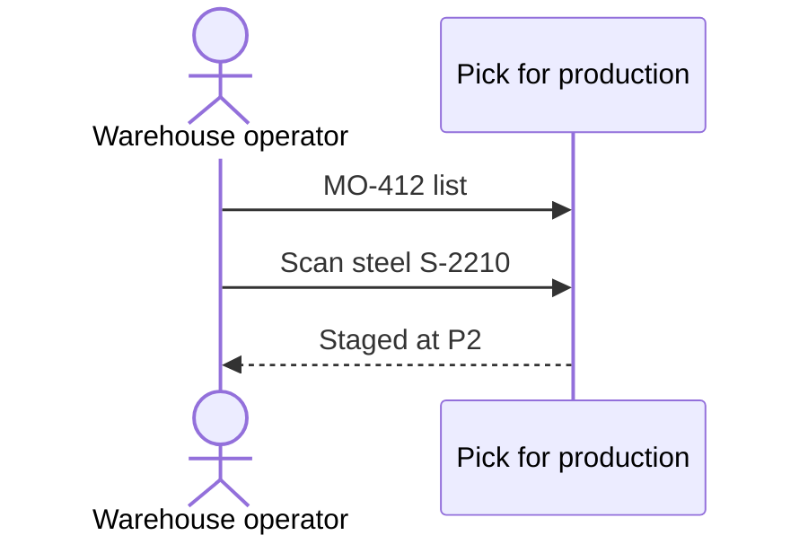

🏠 [Specs](../../../../README.md) › 🧩 [Functional capabilities](../../../README.md) ›
🏭 [F12 Manufacturing (plugin)](../../README.md) › 📝 [Use cases](../README.md) ›
📝 [Use cases: FL-F12-02 Plan production](README.md) › 📝 UC-F12-15 Pick and stage components

# 📝 UC-F12-15 Pick and stage components

**Status:** ✅ specified

## Summary

Pick lists for orders and staging at the work centre.

## Personas

- [U15 Warehouse operator](../../../../01-users/personas/u15-warehouse-operator.md)

## Goal

Components at the work centre before the start.

## Trigger

An order released.

## Frequency

Daily.

## Preconditions

F12 set up for the company.

## Postconditions

- **Succeeded:** components staged.
- **Failed:** a blocked lot replaced.

## Main flow

1. The warehouse operator opens the pick list
   ([S-F12-15](../../screens/02-plan-production/s-f12-15-pick-for-production.md)).
2. They pick by lot, scanning.
3. They stage at the work centre.
4. The order can start ([BR-F12-03](../../business-rules/br-f12-03-components-checked-before-start.md)).

## Alternative flows

- 1a. Pick for several orders.

## Error flows

- 2e. Lot blocked: another proposed.

## Business rules

- [BR-F12-04 Lots traced both ways](../../business-rules/br-f12-04-lots-traced-both-ways.md)
- [BR-F12-05 Consumption never below zero](../../business-rules/br-f12-05-consumption-never-below-zero.md)

## Entities

- [E-F12-06 Component consumption](../../data/e-f12-06-component-consumption.md)

## Permissions

Warehouse operators.

## Notifications

Planner: staged.

## Audit events

Picks.

## AI involvement

None.

## API, MCP and A2A exposure

T5 operations of F12 with the caller's rights; the MCP tool of F12; no A2A skill.

## Screens

- [S-F12-15](../../screens/02-plan-production/s-f12-15-pick-for-production.md)

## Flowchart

See [FL-F12-02 Plan production](../../flows/fl-f12-02-plan-production.md#flowchart).

## Sequence diagram

## Acceptance criteria

1. **Given** MO-412's pick list **when** it is picked **then** components are staged at press P2.
2. **Given** a blocked lot **when** it is scanned **then** another lot is proposed.
3. **Given** no network **when** picks are scanned **then** they sync later.

## Non-functional notes

As the barcode app ([D271](../../../../06-decisions/f07-purchasing-and-stock/d271-warehouse-operations.md)).

## Regulatory references

None.

## Related use cases

See the flows.

## Open questions

None.

---

⬅️ [UC-F12-14 Connect machines and sensors](../06-machines-and-oee/uc-f12-14-connect-machines-and-sensors.md) ·
⬆️ [Up](README.md) ·
➡️ [UC-F12-16 Record product compliance](../07-compliance-and-safety/uc-f12-16-record-product-compliance.md)
