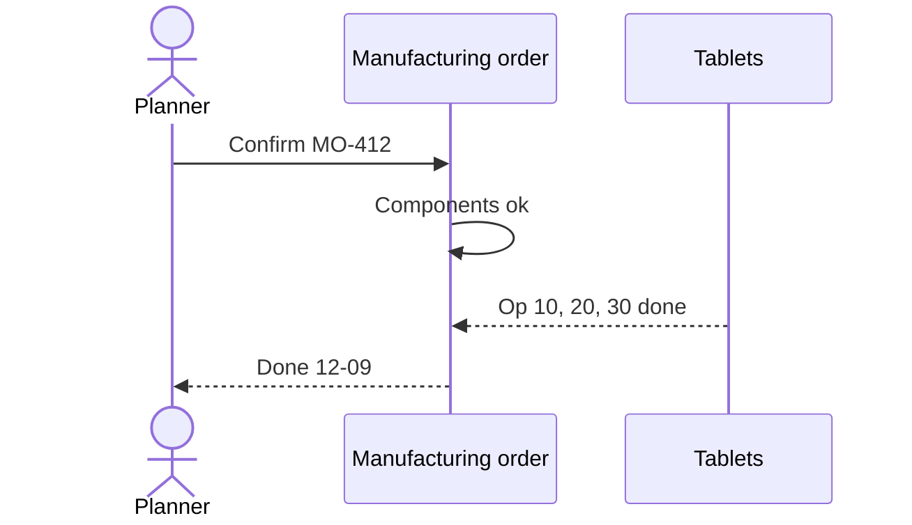

🏠 [Specs](../../../../README.md) › 🧩 [Functional capabilities](../../../README.md) ›
🏭 [F12 Manufacturing (plugin)](../../README.md) › 📝 [Use cases](../README.md) ›
📝 [Use cases: FL-F12-03 Make the products](README.md) › 📝 UC-F12-04 Launch and follow manufacturing orders

# 📝 UC-F12-04 Launch and follow manufacturing orders

**Status:** ✅ specified

## Summary

The planner confirms manufacturing orders, checks their components and follows their operations, progress and dates.

## Personas

- [U21 Production planner](../../../../01-users/personas/u21-production-planner.md)
- [U02 Manager](../../../../01-users/personas/u02-manager.md)

## Goal

Orders done on time.

## Trigger

A released proposal.

## Frequency

Daily.

## Preconditions

F12 set up for the company.

## Postconditions

- **Succeeded:** the order is done.
- **Failed:** missing components refuse the start.

## Main flow

1. The planner confirms the order on the manufacturing order
   ([S-F12-04](../../screens/03-make-the-products/s-f12-04-manufacturing-order.md)).
2. Components are checked ([BR-F12-03](../../business-rules/br-f12-03-components-checked-before-start.md)) and picked
   ([UC-F12-15](../02-plan-production/uc-f12-15-pick-and-stage-components.md)).
3. Operations run on the tablets ([UC-F12-05](uc-f12-05-work-on-the-shop-floor-tablet.md)).
4. The order is done; finished goods enter stock.

## Alternative flows

- 1a. Split or merge orders.

## Error flows

- 2e. Components missing: start refused
  ([BR-F12-03](../../business-rules/br-f12-03-components-checked-before-start.md)).

## Business rules

- [BR-F12-02 An order keeps its versions](../../business-rules/br-f12-02-an-order-keeps-its-versions.md)
- [BR-F12-03 Components checked before start](../../business-rules/br-f12-03-components-checked-before-start.md)

## Entities

- [E-F12-04 Manufacturing order](../../data/e-f12-04-manufacturing-order.md)
- [E-F12-05 Work order](../../data/e-f12-05-work-order.md)

## Permissions

Production planners; managers; record rules by site.

## Notifications

Planner: late operations.

## Audit events

Order status.

## AI involvement

The AI assistant prepares it for confirmation
([BR-F3-07](../../../f03-assistant/business-rules/br-f03-07-no-deletes-no-irreversible-acts.md)); figures come from
queries ([BR-F3-03](../../../f03-assistant/business-rules/br-f03-03-figures-come-from-queries.md)).

## API, MCP and A2A exposure

T5 operations of F12 with the caller's rights; the MCP tool of F12; no A2A skill.

## Screens

- [S-F12-04](../../screens/03-make-the-products/s-f12-04-manufacturing-order.md)

## Flowchart

See [FL-F12-03 Make the products](../../flows/fl-f12-03-make-the-products.md#flowchart).

## Sequence diagram

## Acceptance criteria

1. **Given** MO-412 with all components **when** it is confirmed **then** it can start.
2. **Given** a component short **when** the start is asked **then** it is refused.
3. **Given** the last operation done **when** it is recorded **then** 240 brackets enter stock.

## Non-functional notes

None.

## Regulatory references

None.

## Related use cases

See the flows.

## Open questions

None.

---

⬅️ [UC-F12-03 Plan production](../02-plan-production/uc-f12-03-plan-production.md) · ⬆️ [Up](README.md) ·
➡️ [UC-F12-05 Work on the shop-floor tablet](uc-f12-05-work-on-the-shop-floor-tablet.md)
