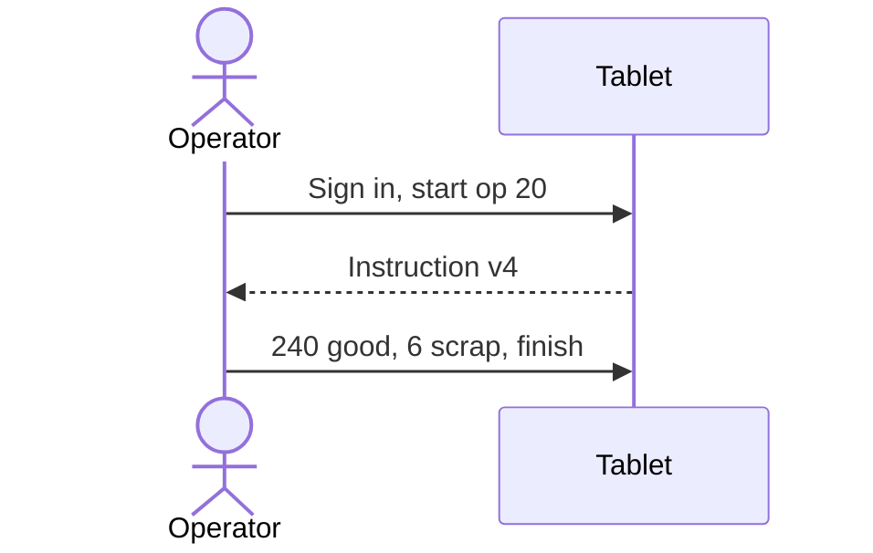

🏠 [Specs](../../../../README.md) › 🧩 [Functional capabilities](../../../README.md) ›
🏭 [F12 Manufacturing (plugin)](../../README.md) › 📝 [Use cases](../README.md) ›
📝 [Use cases: FL-F12-03 Make the products](README.md) › 📝 UC-F12-05 Work on the shop-floor tablet

# 📝 UC-F12-05 Work on the shop-floor tablet

**Status:** 🔄 waiting for the owner

## Summary

The operator signs in at the work centre's tablet, reads the instructions, starts and stops operations, and records
quantities, scrap and checks.

## Personas

- [U20 Production operator](../../../../01-users/personas/u20-production-operator.md)

## Goal

Operators work from the tablet, records are right.

## Trigger

An operation to do.

## Frequency

Every shift.

## Preconditions

F12 set up for the company.

## Postconditions

- **Succeeded:** operations recorded.
- **Failed:** a machine stop is reported.

## Main flow

1. The operator signs in at the tablet ([S-F12-05](../../screens/03-make-the-products/s-f12-05-shop-floor-tablet.md));
   qualifications are checked
   ([UC-F12-22](../10-people-and-tools/uc-f12-22-require-operator-qualifications-per-work-centre.md)).
2. They start the next operation and read the instruction, acknowledging a new version
   ([UC-F12-28](../10-people-and-tools/uc-f12-28-publish-versioned-work-instructions.md)).
3. They record quantities, scrap and checks.
4. They finish; the next operation is offered. Without network, work goes on,
   [UC-F12-26](../11-finite-schedule-and-the-tablet/uc-f12-26-keep-working-on-the-tablet-without-the-network.md).

## Alternative flows

- 3a. Pause for a break.

## Error flows

- 3e. Machine stop: reported with its reason.

## Business rules

- [BR-F12-07 Operators sign in at the work centre](../../business-rules/br-f12-07-operators-sign-in-at-the-work-centre.md)
- [BR-F12-08 Machine data through connectors](../../business-rules/br-f12-08-machine-data-through-connectors.md)

## Entities

- [E-F12-05 Work order](../../data/e-f12-05-work-order.md)
- [E-F12-28 Shop-floor terminal](../../data/e-f12-28-shop-floor-terminal.md)

## Permissions

Production operators at their work centre
([BR-F12-07](../../business-rules/br-f12-07-operators-sign-in-at-the-work-centre.md)); planners.

## Notifications

Planner: stops.

## Audit events

Operations recorded.

## AI involvement

The AI assistant reads instructions aloud.

## API, MCP and A2A exposure

T5 operations of F12 with the caller's rights; the MCP tool of F12; no A2A skill.

## Screens

- [S-F12-05](../../screens/03-make-the-products/s-f12-05-shop-floor-tablet.md)

## Flowchart

See [FL-F12-03 Make the products](../../flows/fl-f12-03-make-the-products.md#flowchart).

## Sequence diagram

## Acceptance criteria

1. **Given** an operator qualified for press P2 **when** he signs in **then** his work orders show.
2. **Given** 240 good and 6 scrap **when** they are recorded **then** the order shows 240 done.
3. **Given** a stop for a jam **when** it is reported **then** the stop reason is recorded for OEE.

## Non-functional notes

Tablet screens answer within 300 ms (Proposed), offline included,
[UC-F12-26](../11-finite-schedule-and-the-tablet/uc-f12-26-keep-working-on-the-tablet-without-the-network.md).

## Regulatory references

None.

## Related use cases

See the flows.

- [UC-F12-22 Require operator qualifications per work centre](../10-people-and-tools/uc-f12-22-require-operator-qualifications-per-work-centre.md)

- [UC-F12-26 Keep working on the tablet without the network](../11-finite-schedule-and-the-tablet/uc-f12-26-keep-working-on-the-tablet-without-the-network.md)

- [UC-F12-28 Publish versioned work instructions](../10-people-and-tools/uc-f12-28-publish-versioned-work-instructions.md)

## Open questions

None.

---

⬅️ [UC-F12-04 Launch and follow manufacturing orders](uc-f12-04-launch-and-follow-manufacturing-orders.md) ·
⬆️ [Up](README.md) ·
➡️ [UC-F12-06 Consume components, trace lots and serials](uc-f12-06-consume-components-trace-lots-and-serials.md)
