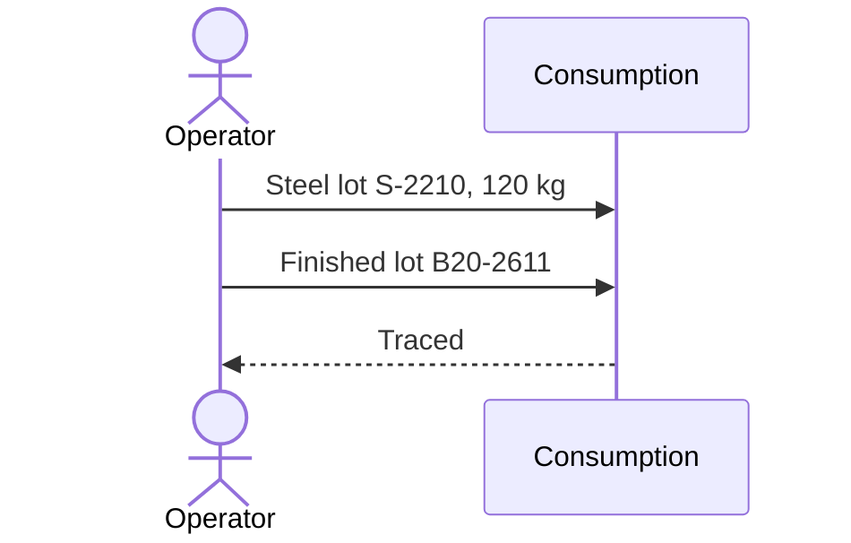

🏠 [Specs](../../../../README.md) › 🧩 [Functional capabilities](../../../README.md) ›
🏭 [F12 Manufacturing (plugin)](../../README.md) › 📝 [Use cases](../README.md) ›
📝 [Use cases: FL-F12-03 Make the products](README.md) › 📝 UC-F12-06 Consume components, trace lots and serials

# 📝 UC-F12-06 Consume components, trace lots and serials

**Status:** 🔄 waiting for the owner

## Summary

Components are consumed by lot or serial and finished lots or serials are produced, traced both ways.

## Personas

- [U20 Production operator](../../../../01-users/personas/u20-production-operator.md)
- [U15 Warehouse operator](../../../../01-users/personas/u15-warehouse-operator.md)

## Goal

Every finished lot traced to its components.

## Trigger

An operation consumes components.

## Frequency

Every order.

## Preconditions

F12 set up for the company.

## Postconditions

- **Succeeded:** consumption and finished lots recorded.
- **Failed:** never below zero.

## Main flow

1. The operator scans component lots on consumption
   ([S-F12-06](../../screens/03-make-the-products/s-f12-06-consumption.md)).
2. They record the finished lot or serials.
3. Traceability works both ways ([BR-F12-04](../../business-rules/br-f12-04-lots-traced-both-ways.md)).
4. Recalls use it,
   [UC-F7-08](../../../f07-purchasing-and-stock/use-cases/05-count-trace-and-analyse/uc-f07-08-trace-lots-and-serials-recall.md).

## Alternative flows

- 1a. Backflush at the end.

## Error flows

- 1e. Shortage: never below zero ([BR-F12-05](../../business-rules/br-f12-05-consumption-never-below-zero.md)).

## Business rules

- [BR-F12-04 Lots traced both ways](../../business-rules/br-f12-04-lots-traced-both-ways.md)
- [BR-F12-05 Consumption never below zero](../../business-rules/br-f12-05-consumption-never-below-zero.md)

## Entities

- [E-F12-06 Component consumption](../../data/e-f12-06-component-consumption.md)

## Permissions

Production operators at their work centre
([BR-F12-07](../../business-rules/br-f12-07-operators-sign-in-at-the-work-centre.md)); planners. Warehouse operators.

## Notifications

None.

## Audit events

Consumption.

## AI involvement

None.

## API, MCP and A2A exposure

T5 operations of F12 with the caller's rights; the MCP tool of F12; no A2A skill.

## Screens

- [S-F12-06](../../screens/03-make-the-products/s-f12-06-consumption.md)

## Flowchart

See [FL-F12-03 Make the products](../../flows/fl-f12-03-make-the-products.md#flowchart).

## Sequence diagram

## Acceptance criteria

1. **Given** steel lot S-2210 **when** it is scanned **then** it is consumed on MO-412.
2. **Given** finished lot B20-2611 **when** it is traced back **then** steel lot S-2210 shows.
3. **Given** 120 kg asked, 100 kg in stock **when** it is consumed **then** it is refused below zero.

## Non-functional notes

Tablet screens answer within 300 ms (Proposed), offline included,
[UC-F12-26](../11-finite-schedule-and-the-tablet/uc-f12-26-keep-working-on-the-tablet-without-the-network.md).

## Regulatory references

[CR-FR-061](../../../../10-country-packs/france/products/cr-fr-061-food-traceability.md).

## Related use cases

See the flows.

## Open questions

None.

---

⬅️ [UC-F12-05 Work on the shop-floor tablet](uc-f12-05-work-on-the-shop-floor-tablet.md) · ⬆️ [Up](README.md) ·
➡️ [UC-F12-07](../04-quality-and-maintenance/uc-f12-07-run-quality-checks-and-handle-non-conformities.md)
