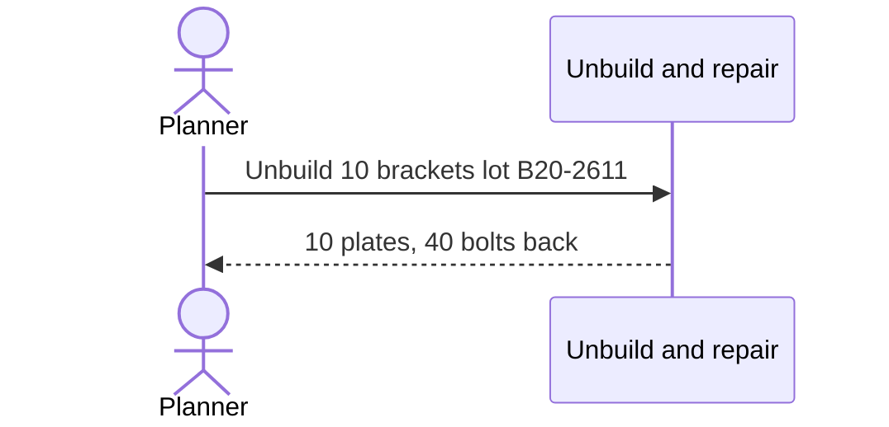

🏠 [Specs](../../../../README.md) › 🧩 [Functional capabilities](../../../README.md) ›
🏭 [F12 Manufacturing (plugin)](../../README.md) › 📝 [Use cases](../README.md) ›
📝 [Use cases: FL-F12-03 Make the products](README.md) › 📝 UC-F12-11 Unbuild, rework and repair

# 📝 UC-F12-11 Unbuild, rework and repair

**Status:** ✅ specified

## Summary

Take finished goods apart, rework defects, and repair customer items.

## Personas

- [U21 Production planner](../../../../01-users/personas/u21-production-planner.md)
- [U20 Production operator](../../../../01-users/personas/u20-production-operator.md)

## Goal

Recover parts and fix defects.

## Trigger

A defect or a repair.

## Frequency

Weekly.

## Preconditions

F12 set up for the company.

## Postconditions

- **Succeeded:** parts back in stock or item repaired.
- **Failed:** unknown lot asked.

## Main flow

1. The planner opens a manufacturing order of the kind unbuild, rework or repair
   ([S-F12-11](../../screens/03-make-the-products/s-f12-11-unbuild-and-repair.md)).
2. Parts and work are recorded.
3. Recovered parts return to stock with their lots.
4. The order closes; a repair may be invoiced (F6).

## Alternative flows

- 4a. Repair invoiced to the customer.

## Error flows

- 1e. Lot unknown: asked.

## Business rules

- [BR-F12-04 Lots traced both ways](../../business-rules/br-f12-04-lots-traced-both-ways.md)

## Entities

- [E-F12-04 Manufacturing order](../../data/e-f12-04-manufacturing-order.md), of the kind unbuild, rework or repair

## Permissions

Production planners; managers; record rules by site.

## Notifications

None.

## Audit events

Orders.

## AI involvement

The AI assistant prepares it for confirmation
([BR-F3-07](../../../f03-assistant/business-rules/br-f03-07-no-deletes-no-irreversible-acts.md)); figures come from
queries ([BR-F3-03](../../../f03-assistant/business-rules/br-f03-03-figures-come-from-queries.md)).

## API, MCP and A2A exposure

T5 operations of F12 with the caller's rights; the MCP tool of F12; no A2A skill.

## Screens

- [S-F12-11](../../screens/03-make-the-products/s-f12-11-unbuild-and-repair.md)

## Flowchart

See [FL-F12-03 Make the products](../../flows/fl-f12-03-make-the-products.md#flowchart).

## Sequence diagram

## Acceptance criteria

1. **Given** 10 defective brackets **when** they are unbuilt **then** 10 plates and 40 bolts return to stock.
2. **Given** a repair without a lot **when** it is opened **then** the lot is asked.
3. **Given** a customer repair **when** it closes **then** an invoice is proposed.

## Non-functional notes

None.

## Regulatory references

None.

## Related use cases

See the flows.

## Open questions

None.

---

⬅️ [UC-F12-10 Manage engineering changes](../01-define-the-products/uc-f12-10-manage-engineering-changes.md) ·
⬆️ [Up](README.md) · ➡️ [UC-F12-12 Cost production](../05-subcontracting-and-costs/uc-f12-12-cost-production.md)
