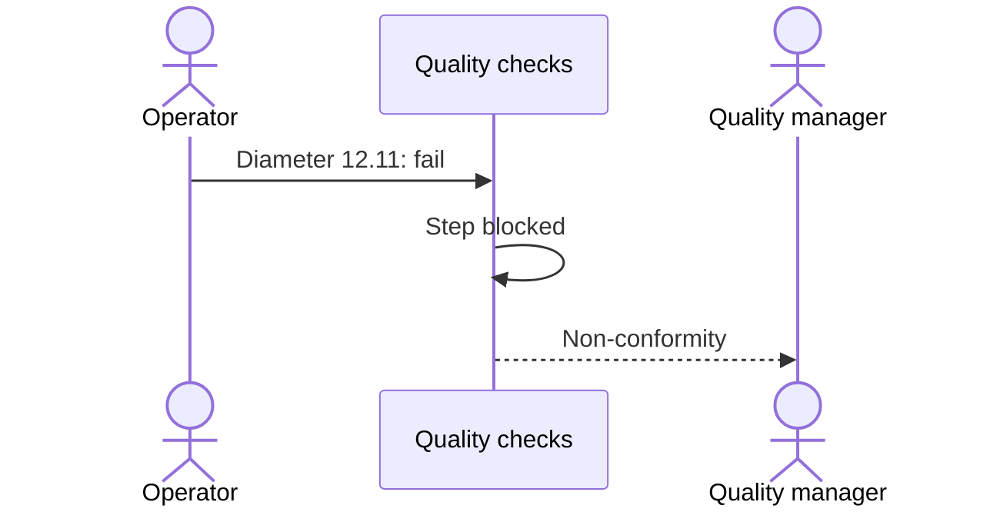

🏠 [Specs](../../../../README.md) › 🧩 [Functional capabilities](../../../README.md) ›
🏭 [F12 Manufacturing (plugin)](../../README.md) › 📝 [Use cases](../README.md) ›
📝 [Use cases: FL-F12-04 Quality and maintenance](README.md) › 📝 UC-F12-07 Run quality checks and handle non-conformities

# 📝 UC-F12-07 Run quality checks and handle non-conformities

**Status:** 🔄 waiting for the owner

## Summary

Checks run at control points with measures and pass or fail; failures open non-conformities with actions.

## Personas

- [U20 Production operator](../../../../01-users/personas/u20-production-operator.md)
- [U21 Production planner](../../../../01-users/personas/u21-production-planner.md)

## Goal

Defects caught and handled.

## Trigger

A control point is reached.

## Frequency

Every order.

## Preconditions

F12 set up for the company.

## Postconditions

- **Succeeded:** checks recorded; non-conformities handled.
- **Failed:** a failed check blocks the step.

## Main flow

1. The operator checks at the control point on quality checks
   ([S-F12-07](../../screens/04-quality-and-maintenance/s-f12-07-quality-checks.md)) with a calibrated instrument
   ([UC-F12-21](../10-people-and-tools/uc-f12-21-calibrate-measuring-equipment.md)).
2. Pass or fail; measures feed the control chart
   ([UC-F12-25](../12-quality-engineering/uc-f12-25-monitor-a-process-with-control-charts.md)).
3. A fail blocks the step ([BR-F12-06](../../business-rules/br-f12-06-a-failed-check-blocks-the-step.md)) and opens a
   non-conformity.
4. The quality manager handles it with actions.

## Alternative flows

- 1a. Sample checks.

## Error flows

- 3e. Failed check: step blocked.

## Business rules

- [BR-F12-06 A failed check blocks the step](../../business-rules/br-f12-06-a-failed-check-blocks-the-step.md)

## Entities

- [E-F12-07 Quality control point](../../data/e-f12-07-quality-control-point.md)
- [E-F12-08 Non-conformity](../../data/e-f12-08-non-conformity.md)

## Permissions

The quality manager; production planners; operators record.

## Notifications

Quality manager: failures.

## Audit events

Checks and non-conformities.

## AI involvement

The AI assistant prepares it for confirmation
([BR-F3-07](../../../f03-assistant/business-rules/br-f03-07-no-deletes-no-irreversible-acts.md)); figures come from
queries ([BR-F3-03](../../../f03-assistant/business-rules/br-f03-03-figures-come-from-queries.md)).

## API, MCP and A2A exposure

T5 operations of F12 with the caller's rights; the MCP tool of F12; no A2A skill.

## Screens

- [S-F12-07](../../screens/04-quality-and-maintenance/s-f12-07-quality-checks.md)

## Flowchart

See [FL-F12-04 Quality and maintenance](../../flows/fl-f12-04-quality-and-maintenance.md#flowchart).

## Sequence diagram

## Acceptance criteria

1. **Given** a diameter of 12.11 mm with a limit of 12.10 **when** it is recorded **then** the check fails and the step
   is blocked.
2. **Given** a non-conformity **when** the quality manager closes it with rework **then** the step is released.
3. **Given** a sample check every 50 units **when** unit 50 comes **then** the check is asked.

## Non-functional notes

Tablet screens answer within 300 ms (Proposed), offline included,
[UC-F12-26](../11-finite-schedule-and-the-tablet/uc-f12-26-keep-working-on-the-tablet-without-the-network.md).

## Regulatory references

None.

## Related use cases

See the flows.

- [UC-F12-21 Calibrate measuring equipment](../10-people-and-tools/uc-f12-21-calibrate-measuring-equipment.md)

- [UC-F12-24 Run an FMEA](../12-quality-engineering/uc-f12-24-run-an-fmea.md)

- [UC-F12-25 Monitor a process with control charts](../12-quality-engineering/uc-f12-25-monitor-a-process-with-control-charts.md)

## Open questions

None.

---

⬅️ [UC-F12-06](../03-make-the-products/uc-f12-06-consume-components-trace-lots-and-serials.md) · ⬆️ [Up](README.md) ·
➡️ [UC-F12-08 Maintain equipment](uc-f12-08-maintain-equipment.md)
