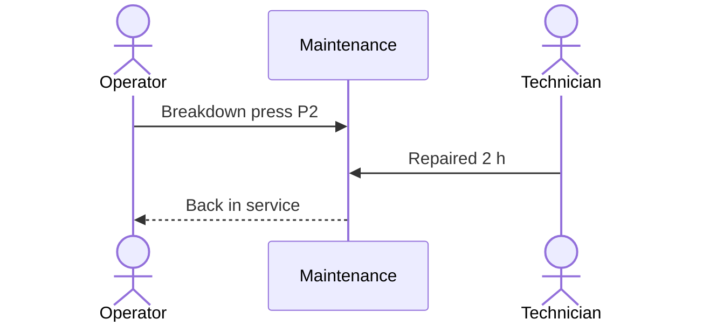

🏠 [Specs](../../../../README.md) › 🧩 [Functional capabilities](../../../README.md) ›
🏭 [F12 Manufacturing (plugin)](../../README.md) › 📝 [Use cases](../README.md) ›
📝 [Use cases: FL-F12-04 Quality and maintenance](README.md) › 📝 UC-F12-08 Maintain equipment

# 📝 UC-F12-08 Maintain equipment

**Status:** ✅ specified

## Summary

Preventive and corrective maintenance, and the legal periodic checks of equipment.

## Personas

- [U21 Production planner](../../../../01-users/personas/u21-production-planner.md)
- [U20 Production operator](../../../../01-users/personas/u20-production-operator.md)

## Goal

Machines available and safe.

## Trigger

A plan date or a breakdown.

## Frequency

Weekly.

## Preconditions

F12 set up for the company.

## Postconditions

- **Succeeded:** work and checks recorded; the plan freed.
- **Failed:** overdue checks flagged.

## Main flow

1. The planner plans preventive maintenance on maintenance
   ([S-F12-08](../../screens/04-quality-and-maintenance/s-f12-08-maintenance.md)).
2. An operator reports a breakdown from the tablet.
3. The technician records the work; the schedule frees the slot
   ([BR-F12-10](../../business-rules/br-f12-10-maintenance-frees-the-plan.md)).
4. Periodic checks are recorded in the safety register
   ([CR-FR-075](../../../../10-country-packs/france/labour/cr-fr-075-work-equipment-periodic-checks.md)).

## Alternative flows

- 3a. Maintenance by an outside company.

## Error flows

- 4e. A check overdue: flagged ([BR-F12-09](../../business-rules/br-f12-09-equipment-checks-before-use.md)).

## Business rules

- [BR-F12-09 Equipment checks before use](../../business-rules/br-f12-09-equipment-checks-before-use.md)
- [BR-F12-10 Maintenance frees the plan](../../business-rules/br-f12-10-maintenance-frees-the-plan.md)

## Entities

- [E-F12-09 Equipment](../../data/e-f12-09-equipment.md)
- [E-F12-10 Maintenance request](../../data/e-f12-10-maintenance-request.md)

## Permissions

Production planners; managers; record rules by site. Technicians.

## Notifications

Planner: breakdowns.

## Audit events

Maintenance and checks.

## AI involvement

The AI assistant prepares it for confirmation
([BR-F3-07](../../../f03-assistant/business-rules/br-f03-07-no-deletes-no-irreversible-acts.md)); figures come from
queries ([BR-F3-03](../../../f03-assistant/business-rules/br-f03-03-figures-come-from-queries.md)).

## API, MCP and A2A exposure

T5 operations of F12 with the caller's rights; the MCP tool of F12; no A2A skill.

## Screens

- [S-F12-08](../../screens/04-quality-and-maintenance/s-f12-08-maintenance.md)

## Flowchart

See [FL-F12-04 Quality and maintenance](../../flows/fl-f12-04-quality-and-maintenance.md#flowchart).

## Sequence diagram

## Acceptance criteria

1. **Given** a preventive plan every 500 hours **when** press P2 reaches 500 hours **then** maintenance is due.
2. **Given** a breakdown reported **when** it is repaired in 2 hours **then** the schedule is updated.
3. **Given** a periodic check due 12-01 **when** 12-02 comes **then** it is flagged.

## Non-functional notes

None.

## Regulatory references

[CR-FR-075](../../../../10-country-packs/france/labour/cr-fr-075-work-equipment-periodic-checks.md).

## Related use cases

See the flows.

- [UC-F12-21 Calibrate measuring equipment](../10-people-and-tools/uc-f12-21-calibrate-measuring-equipment.md)

## Open questions

None.

---

⬅️ [UC-F12-07](uc-f12-07-run-quality-checks-and-handle-non-conformities.md) · ⬆️ [Up](README.md) ·
➡️ [UC-F12-09 Subcontract manufacturing](../05-subcontracting-and-costs/uc-f12-09-subcontract-manufacturing.md)
