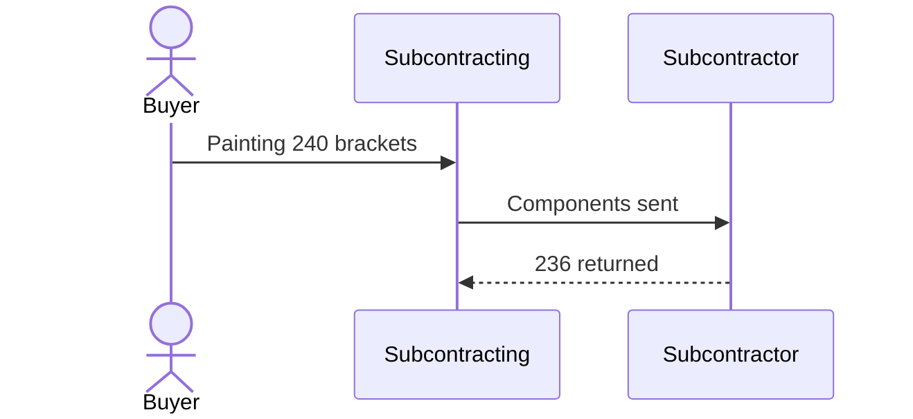

🏠 [Specs](../../../../README.md) › 🧩 [Functional capabilities](../../../README.md) ›
🏭 [F12 Manufacturing (plugin)](../../README.md) › 📝 [Use cases](../README.md) ›
📝 [Use cases: FL-F12-05 Subcontracting and costs](README.md) › 📝 UC-F12-09 Subcontract manufacturing

# 📝 UC-F12-09 Subcontract manufacturing

**Status:** ✅ specified

## Summary

Send components to a subcontractor, receive the finished goods and pay the service.

## Personas

- [U21 Production planner](../../../../01-users/personas/u21-production-planner.md)
- [U04 Purchasing](../../../../01-users/personas/u04-purchasing.md)

## Goal

Subcontracted work under control.

## Trigger

An operation done outside.

## Frequency

Monthly.

## Preconditions

F12 set up for the company.

## Postconditions

- **Succeeded:** goods received and checked; invoice matched.
- **Failed:** short delivery shown.

## Main flow

1. The buyer orders the service on subcontracting
   ([S-F12-09](../../screens/05-subcontracting-and-costs/s-f12-09-subcontracting.md)).
2. Components are sent; they stay ours ([BR-F12-12](../../business-rules/br-f12-12-subcontracted-stock-stays-ours.md)).
3. Finished goods are received and checked.
4. The service invoice is matched,
   [UC-F7-04](../../../f07-purchasing-and-stock/use-cases/01-procure/uc-f07-04-capture-and-match-supplier-invoices.md).

## Alternative flows

- 1a. Subcontract one operation only.

## Error flows

- 3e. Short delivery: shown.

## Business rules

- [BR-F12-12 Subcontracted stock stays ours](../../business-rules/br-f12-12-subcontracted-stock-stays-ours.md)

## Entities

- [E-F12-04 Manufacturing order](../../data/e-f12-04-manufacturing-order.md)

## Permissions

Production planners; managers; record rules by site. Purchasing.

## Notifications

Buyer: delivery.

## Audit events

Sent, received.

## AI involvement

The AI assistant prepares it for confirmation
([BR-F3-07](../../../f03-assistant/business-rules/br-f03-07-no-deletes-no-irreversible-acts.md)); figures come from
queries ([BR-F3-03](../../../f03-assistant/business-rules/br-f03-03-figures-come-from-queries.md)).

## API, MCP and A2A exposure

T5 operations of F12 with the caller's rights; the MCP tool of F12; no A2A skill.

## Screens

- [S-F12-09](../../screens/05-subcontracting-and-costs/s-f12-09-subcontracting.md)

## Flowchart

See [FL-F12-05 Subcontracting and costs](../../flows/fl-f12-05-subcontracting-and-costs.md#flowchart).

## Sequence diagram

## Acceptance criteria

1. **Given** 240 brackets sent for painting **when** 236 return **then** 4 are shown short.
2. **Given** components at the subcontractor **when** stock is valued **then** they count as ours.
3. **Given** an invoice for 240 **when** it arrives **then** it is held for 4 missing.

## Non-functional notes

None.

## Regulatory references

None.

## Related use cases

See the flows.

## Open questions

None.

---

⬅️ [UC-F12-08 Maintain equipment](../04-quality-and-maintenance/uc-f12-08-maintain-equipment.md) · ⬆️ [Up](README.md) ·
➡️ [UC-F12-10 Manage engineering changes](../01-define-the-products/uc-f12-10-manage-engineering-changes.md)
