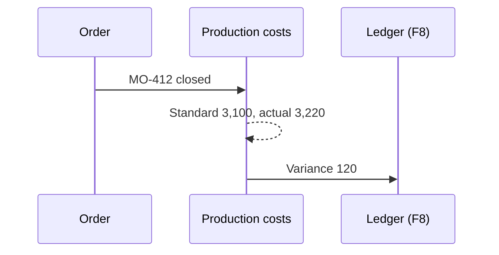

🏠 [Specs](../../../../README.md) › 🧩 [Functional capabilities](../../../README.md) ›
🏭 [F12 Manufacturing (plugin)](../../README.md) › 📝 [Use cases](../README.md) ›
📝 [Use cases: FL-F12-05 Subcontracting and costs](README.md) › 📝 UC-F12-12 Cost production

# 📝 UC-F12-12 Cost production

**Status:** ✅ specified

## Summary

Standard and actual costs, variances, stock valuation and entries to accounting.

## Personas

- [U21 Production planner](../../../../01-users/personas/u21-production-planner.md)
- [U05 Accounting](../../../../01-users/personas/u05-accounting.md)

## Goal

Know what each product really costs.

## Trigger

An order closes.

## Frequency

Daily.

## Preconditions

F12 set up for the company.

## Postconditions

- **Succeeded:** variances posted.
- **Failed:** missing rates warned.

## Main flow

1. The order closes; production costs
   ([S-F12-12](../../screens/05-subcontracting-and-costs/s-f12-12-production-cost-variance.md)) shows standard and
   actual.
2. Components, labour, machine time and energy
   ([UC-F12-29](../13-energy-passport-and-work-in-progress/uc-f12-29-measure-energy-per-operation.md)) are costed
   ([BR-F12-11](../../business-rules/br-f12-11-production-costed-per-order.md)).
3. Variances are posted to F8.
4. Open orders are valued at month end, [UC-F12-27](uc-f12-27-value-work-in-progress-at-month-end.md).

## Alternative flows

- 2a. Cost roll-up after a price change.

## Error flows

- 2e. A rate missing on a work centre: warned.

## Business rules

- [BR-F12-11 Production costed per order](../../business-rules/br-f12-11-production-costed-per-order.md)

## Entities

- [E-F12-04 Manufacturing order](../../data/e-f12-04-manufacturing-order.md)
- [E-F12-02 Work centre](../../data/e-f12-02-work-centre.md)

## Permissions

Planners and accounting.

## Notifications

None.

## Audit events

Costs and postings.

## AI involvement

The AI assistant prepares it for confirmation
([BR-F3-07](../../../f03-assistant/business-rules/br-f03-07-no-deletes-no-irreversible-acts.md)); figures come from
queries ([BR-F3-03](../../../f03-assistant/business-rules/br-f03-03-figures-come-from-queries.md)).

## API, MCP and A2A exposure

T5 operations of F12 with the caller's rights; the MCP tool of F12; no A2A skill.

## Screens

- [S-F12-12](../../screens/05-subcontracting-and-costs/s-f12-12-production-cost-variance.md)

## Flowchart

See [FL-F12-05 Subcontracting and costs](../../flows/fl-f12-05-subcontracting-and-costs.md#flowchart).

## Sequence diagram

## Acceptance criteria

1. **Given** MO-412 at a standard of 3,100 EUR and actual 3,220 EUR **when** it closes **then** a variance of 120 EUR is
   posted.
2. **Given** a work centre without a rate **when** an order closes **then** a warning shows.
3. **Given** energy of 0.16 EUR per unit **when** costs are computed **then** energy is included.

## Non-functional notes

None.

## Regulatory references

[CR-FR-081](../../../../10-country-packs/france/accounting/cr-fr-081-production-cost-of-inventories.md).

## Related use cases

See the flows.

- [UC-F12-27 Value work in progress at month end](uc-f12-27-value-work-in-progress-at-month-end.md)

- [UC-F12-29 Measure energy per operation](../13-energy-passport-and-work-in-progress/uc-f12-29-measure-energy-per-operation.md)

## Open questions

None.

---

⬅️ [UC-F12-11 Unbuild, rework and repair](../03-make-the-products/uc-f12-11-unbuild-rework-and-repair.md) ·
⬆️ [Up](README.md) ·
➡️ [UC-F12-13 Measure OEE and downtime](../06-machines-and-oee/uc-f12-13-measure-oee-and-downtime.md)
