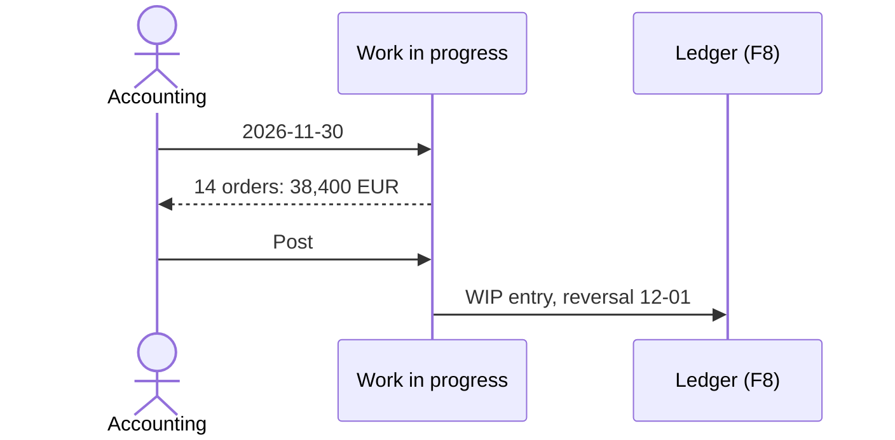

🏠 [Specs](../../../../README.md) › 🧩 [Functional capabilities](../../../README.md) ›
🏭 [F12 Manufacturing (plugin)](../../README.md) › 📝 [Use cases](../README.md) ›
📝 [Use cases: FL-F12-05 Subcontracting and costs](README.md) › 📝 UC-F12-27 Value work in progress at month end

# 📝 UC-F12-27 Value work in progress at month end

**Status:** ✅ specified

## Summary

At month end, accounting values the manufacturing orders in progress at the costs incurred (components consumed, labour
and machine time) and posts the work-in-progress entries.

## Personas

- [U05 Accounting](../../../../01-users/personas/u05-accounting.md)
- [U21 Production planner](../../../../01-users/personas/u21-production-planner.md)

## Goal

Month-end stock and results that include production in progress.

## Trigger

Month end.

## Frequency

Monthly.

## Preconditions

- Orders with consumption and time recorded ([UC-F12-12](uc-f12-12-cost-production.md)).

## Postconditions

- **Succeeded:** WIP valued and posted; reversed next month.
- **Failed:** orders without costs are listed.

## Main flow

1. Accounting opens work in progress
   ([S-F12-26](../../screens/05-subcontracting-and-costs/s-f12-26-work-in-progress.md)) at the month's end.
2. Each open order shows components consumed, labour and machine time at their rates
   ([BR-F12-22](../../business-rules/br-f12-22-work-in-progress-is-valued-at-costs-incurred.md)).
3. Accounting checks and posts the WIP entry,
   [CR-FR-081](../../../../10-country-packs/france/accounting/cr-fr-081-production-cost-of-inventories.md).
4. The entry reverses at the start of the next month.

## Alternative flows

- 2a. Overheads applied by the company's rate.

## Error flows

- 2e. A work centre without a rate: listed, valued at zero with a warning.

## Business rules

- [BR-F12-22 Work in progress is valued at costs incurred](../../business-rules/br-f12-22-work-in-progress-is-valued-at-costs-incurred.md)
- [BR-F12-11 Production costed per order](../../business-rules/br-f12-11-production-costed-per-order.md)

## Entities

- [E-F12-21 Work-in-progress valuation](../../data/e-f12-21-work-in-progress-valuation.md)
- [E-F12-04 Manufacturing order](../../data/e-f12-04-manufacturing-order.md)

## Permissions

Accounting; planners read.

## Notifications

None.

## Audit events

WIP valued and posted.

## AI involvement

The AI assistant prepares it for confirmation
([BR-F3-07](../../../f03-assistant/business-rules/br-f03-07-no-deletes-no-irreversible-acts.md)); figures come from
queries ([BR-F3-03](../../../f03-assistant/business-rules/br-f03-03-figures-come-from-queries.md)).

## API, MCP and A2A exposure

T5 operations of F12 with the caller's rights; the MCP tool of F12; no A2A skill.

## Screens

- [S-F12-26 Work in progress](../../screens/05-subcontracting-and-costs/s-f12-26-work-in-progress.md)

## Flowchart

See
[FL-F12-13 Energy, passport and work in progress](../../flows/fl-f12-13-energy-passport-and-work-in-progress.md#flowchart).

## Sequence diagram

## Acceptance criteria

1. **Given** 14 open orders on 2026-11-30 **when** WIP is valued **then** it totals components, labour and machine time.
2. **Given** a work centre without a rate **when** WIP is valued **then** it is listed with a warning.
3. **Given** the WIP entry of 11-30 **when** 12-01 comes **then** it is reversed.

## Non-functional notes

None.

## Regulatory references

[CR-FR-081](../../../../10-country-packs/france/accounting/cr-fr-081-production-cost-of-inventories.md).

## Related use cases

- [UC-F12-12 Cost production](uc-f12-12-cost-production.md)
- [UC-F8-10 Close the period and the year](../../../f08-accounting/use-cases/05-close-report-and-consolidate/uc-f08-10-close-the-period-and-the-year.md)

## Open questions

None.

---

⬅️ [UC-F12-26](../11-finite-schedule-and-the-tablet/uc-f12-26-keep-working-on-the-tablet-without-the-network.md) ·
⬆️ [Up](README.md) · ➡️ [UC-F12-28](../10-people-and-tools/uc-f12-28-publish-versioned-work-instructions.md)
