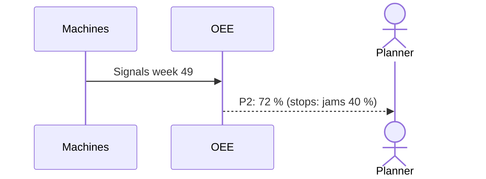

🏠 [Specs](../../../../README.md) › 🧩 [Functional capabilities](../../../README.md) ›
🏭 [F12 Manufacturing (plugin)](../../README.md) › 📝 [Use cases](../README.md) ›
📝 [Use cases: FL-F12-06 Machines and OEE](README.md) › 📝 UC-F12-13 Measure OEE and downtime

# 📝 UC-F12-13 Measure OEE and downtime

**Status:** ✅ specified

## Summary

Availability, performance, quality and stops by reason, from machine data.

## Personas

- [U21 Production planner](../../../../01-users/personas/u21-production-planner.md)
- [U13 Owner](../../../../01-users/personas/u13-owner.md)

## Goal

Know why machines do not produce more.

## Trigger

A review.

## Frequency

Weekly.

## Preconditions

F12 set up for the company.

## Postconditions

- **Succeeded:** OEE read.
- **Failed:** missing data shown as missing.

## Main flow

1. Machine data is collected ([UC-F12-14](uc-f12-14-connect-machines-and-sensors.md)) on OEE
   ([S-F12-13](../../screens/06-machines-and-oee/s-f12-13-oee-measure.md)).
2. Stops are classified by reason.
3. OEE shows availability, performance and quality.
4. The planner acts on the main stop reasons.

## Alternative flows

- 2a. Manual entries counted apart.

## Error flows

- 1e. No data: shown as missing, not zero.

## Business rules

- [BR-F12-08 Machine data through connectors](../../business-rules/br-f12-08-machine-data-through-connectors.md)

## Entities

- [E-F12-13 Machine signal](../../data/e-f12-13-machine-signal.md)

## Permissions

Production planners; managers; record rules by site. The owner reads.

## Notifications

Weekly digest.

## Audit events

Classifications.

## AI involvement

The AI assistant prepares it for confirmation
([BR-F3-07](../../../f03-assistant/business-rules/br-f03-07-no-deletes-no-irreversible-acts.md)); figures come from
queries ([BR-F3-03](../../../f03-assistant/business-rules/br-f03-03-figures-come-from-queries.md)).

## API, MCP and A2A exposure

T5 operations of F12 with the caller's rights; the MCP tool of F12; no A2A skill.

## Screens

- [S-F12-13](../../screens/06-machines-and-oee/s-f12-13-oee-measure.md)

## Flowchart

See [FL-F12-06 Machines and OEE](../../flows/fl-f12-06-machines-and-oee.md#flowchart).

## Sequence diagram

## Acceptance criteria

1. **Given** press P2 in week 49 **when** OEE opens **then** 72 % shows with its three parts.
2. **Given** stops of 6 hours, 40 % jams **when** reasons are read **then** jams lead.
3. **Given** a day without data **when** OEE opens **then** it shows missing, not zero.

## Non-functional notes

None.

## Regulatory references

None.

## Related use cases

See the flows.

## Open questions

None.

---

⬅️ [UC-F12-12 Cost production](../05-subcontracting-and-costs/uc-f12-12-cost-production.md) · ⬆️ [Up](README.md) ·
➡️ [UC-F12-14 Connect machines and sensors](uc-f12-14-connect-machines-and-sensors.md)
