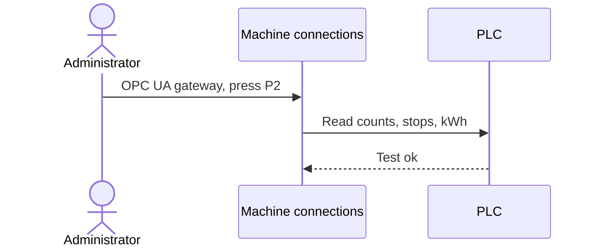

🏠 [Specs](../../../../README.md) › 🧩 [Functional capabilities](../../../README.md) ›
🏭 [F12 Manufacturing (plugin)](../../README.md) › 📝 [Use cases](../README.md) ›
📝 [Use cases: FL-F12-06 Machines and OEE](README.md) › 📝 UC-F12-14 Connect machines and sensors

# 📝 UC-F12-14 Connect machines and sensors

**Status:** ✅ specified

## Summary

PLCs, sensors, scales, meters and label printers through T12 connectors.

## Personas

- [U07 Administrator](../../../../01-users/personas/u07-administrator.md)
- [U21 Production planner](../../../../01-users/personas/u21-production-planner.md)

## Goal

Machine data without typing.

## Trigger

A new machine.

## Frequency

At setup.

## Preconditions

F12 set up for the company.

## Postconditions

- **Succeeded:** signals mapped and tested.
- **Failed:** connector down: manual entry.

## Main flow

1. The administrator adds a connector (T12) on machine connections
   ([S-F12-14](../../screens/06-machines-and-oee/s-f12-14-machine-connections.md)).
2. They map signals (counts, stops, energy) to a work centre
   ([BR-F12-08](../../business-rules/br-f12-08-machine-data-through-connectors.md)).
3. They test.
4. Data feeds OEE ([UC-F12-13](uc-f12-13-measure-oee-and-downtime.md)) and energy
   ([UC-F12-29](../13-energy-passport-and-work-in-progress/uc-f12-29-measure-energy-per-operation.md)).

## Alternative flows

- 1a. Several machines per gateway.

## Error flows

- 3e. Connector down: manual entry, shown.

## Business rules

- [BR-F12-08 Machine data through connectors](../../business-rules/br-f12-08-machine-data-through-connectors.md)

## Entities

- [E-F12-13 Machine signal](../../data/e-f12-13-machine-signal.md)
- [E-F12-02 Work centre](../../data/e-f12-02-work-centre.md)

## Permissions

Administrators and planners.

## Notifications

Planner: connector down.

## Audit events

Connectors.

## AI involvement

None.

## API, MCP and A2A exposure

T5 operations of F12 with the caller's rights; the MCP tool of F12; no A2A skill.

## Screens

- [S-F12-14](../../screens/06-machines-and-oee/s-f12-14-machine-connections.md)

## Flowchart

See [FL-F12-06 Machines and OEE](../../flows/fl-f12-06-machines-and-oee.md#flowchart).

## Sequence diagram

## Acceptance criteria

1. **Given** an OPC UA gateway **when** press P2's counter is mapped **then** counts reach the work orders.
2. **Given** the gateway down **when** an hour passes **then** manual entry is offered and shown.
3. **Given** an energy meter mapped **when** it reads **then** energy feeds the energy screen.

## Non-functional notes

None.

## Regulatory references

None.

## Related use cases

See the flows.

## Open questions

None.

---

⬅️ [UC-F12-13 Measure OEE and downtime](uc-f12-13-measure-oee-and-downtime.md) · ⬆️ [Up](README.md) ·
➡️ [UC-F12-15 Pick and stage components](../02-plan-production/uc-f12-15-pick-and-stage-components.md)
