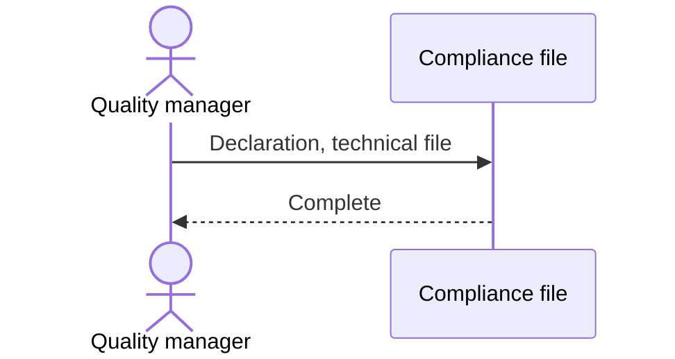

🏠 [Specs](../../../../README.md) › 🧩 [Functional capabilities](../../../README.md) ›
🏭 [F12 Manufacturing (plugin)](../../README.md) › 📝 [Use cases](../README.md) ›
📝 [Use cases: FL-F12-07 Compliance and safety](README.md) › 📝 UC-F12-16 Record product compliance

# 📝 UC-F12-16 Record product compliance

**Status:** ✅ specified

## Summary

Each product's declaration, technical file, substances and notifications.

## Personas

- [U21 Production planner](../../../../01-users/personas/u21-production-planner.md)
- [U07 Administrator](../../../../01-users/personas/u07-administrator.md)

## Goal

Products delivered with complete compliance.

## Trigger

A new product or a substance change.

## Frequency

Per product.

## Preconditions

F12 set up for the company.

## Postconditions

- **Succeeded:** the file is complete.
- **Failed:** delivery blocked while incomplete.

## Main flow

1. The quality manager opens the compliance file
   ([S-F12-16](../../screens/07-compliance-and-safety/s-f12-16-compliance-file.md)).
2. They attach the declaration, technical file and substances,
   [CR-FR-077](../../../../10-country-packs/france/products/cr-fr-077-reach-svhc-information.md),
   [CR-FR-078](../../../../10-country-packs/france/products/cr-fr-078-scip-notification.md).
3. They mark it complete ([BR-F12-13](../../business-rules/br-f12-13-a-compliance-file-per-product.md)).
4. It feeds the product passport,
   [UC-F12-30](../13-energy-passport-and-work-in-progress/uc-f12-30-build-the-digital-product-passport.md).

## Alternative flows

- 2a. Answer a customer's substance request.

## Error flows

- 3e. File incomplete: delivery blocked.

## Business rules

- [BR-F12-13 A compliance file per product](../../business-rules/br-f12-13-a-compliance-file-per-product.md)
- [BR-F12-01 Manufacturing follows the country pack](../../business-rules/br-f12-01-manufacturing-follows-the-country-pack.md)

## Entities

- [E-F12-14 Product compliance file](../../data/e-f12-14-product-compliance-file.md)

## Permissions

The quality manager; production planners; operators record.

## Notifications

None.

## Audit events

Documents.

## AI involvement

The AI assistant prepares it for confirmation
([BR-F3-07](../../../f03-assistant/business-rules/br-f03-07-no-deletes-no-irreversible-acts.md)); figures come from
queries ([BR-F3-03](../../../f03-assistant/business-rules/br-f03-03-figures-come-from-queries.md)).

## API, MCP and A2A exposure

T5 operations of F12 with the caller's rights; the MCP tool of F12; no A2A skill.

## Screens

- [S-F12-16](../../screens/07-compliance-and-safety/s-f12-16-compliance-file.md)

## Flowchart

See [FL-F12-07 Compliance and safety](../../flows/fl-f12-07-compliance-and-safety.md#flowchart).

## Sequence diagram

## Acceptance criteria

1. **Given** a machine product **when** the declaration is attached **then** the file shows it.
2. **Given** an incomplete file **when** a delivery is asked **then** it is blocked.
3. **Given** a substance request **when** it is answered **then** the answer is kept.

## Non-functional notes

None.

## Regulatory references

[CR-FR-074](../../../../10-country-packs/france/products/cr-fr-074-machinery-conformity.md);
[CR-FR-077](../../../../10-country-packs/france/products/cr-fr-077-reach-svhc-information.md);
[CR-FR-078](../../../../10-country-packs/france/products/cr-fr-078-scip-notification.md): quasi-identical articles
may be grouped in one SCIP notification, a simplified notification may refer to data already submitted, and retailers
supplying only consumers do not notify.

## Related use cases

See the flows.

- [UC-F12-30 Build the digital product passport](../13-energy-passport-and-work-in-progress/uc-f12-30-build-the-digital-product-passport.md)

## Open questions

None.

---

⬅️ [UC-F12-15 Pick and stage components](../02-plan-production/uc-f12-15-pick-and-stage-components.md) ·
⬆️ [Up](README.md) · ➡️ [UC-F12-17](uc-f12-17-keep-the-risk-assessment-and-safety-registers.md)
