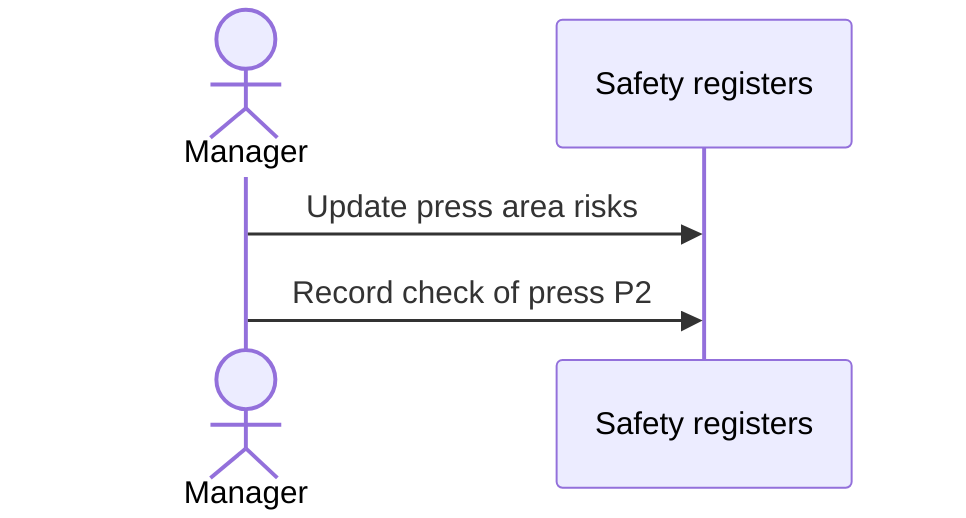

🏠 [Specs](../../../../README.md) › 🧩 [Functional capabilities](../../../README.md) ›
🏭 [F12 Manufacturing (plugin)](../../README.md) › 📝 [Use cases](../README.md) ›
📝 [Use cases: FL-F12-07 Compliance and safety](README.md) › 📝 UC-F12-17 Keep the risk assessment and safety registers

# 📝 UC-F12-17 Keep the risk assessment and safety registers

**Status:** ✅ specified

## Summary

The risk assessment per work unit of the plant and the safety register of equipment checks.

## Personas

- [U02 Manager](../../../../01-users/personas/u02-manager.md)
- [U21 Production planner](../../../../01-users/personas/u21-production-planner.md)

## Goal

The plant's risks and checks in order.

## Trigger

Yearly; after an accident; checks due.

## Frequency

Yearly; checks monthly.

## Preconditions

F12 set up for the company.

## Postconditions

- **Succeeded:** assessment and register current.
- **Failed:** a version due reminded.

## Main flow

1. The manager updates the plant's risk assessment
   ([S-F12-17](../../screens/07-compliance-and-safety/s-f12-17-safety-registers.md)), shared with F9's,
   [UC-F9-27](../../../f09-hr-and-projects/use-cases/09-train-and-protect/uc-f09-27-keep-the-occupational-risk-assessment.md).
2. Checks are recorded in the register
   ([CR-FR-075](../../../../10-country-packs/france/labour/cr-fr-075-work-equipment-periodic-checks.md)).
3. Every version is kept ([BR-F12-15](../../business-rules/br-f12-15-risk-assessment-versions-kept.md)).
4. For an inspector, it is exported.

## Alternative flows

- 4a. Inspector visit: export.

## Error flows

- 1e. A version due: reminded.

## Business rules

- [BR-F12-15 Risk assessment versions kept](../../business-rules/br-f12-15-risk-assessment-versions-kept.md)
- [BR-F12-09 Equipment checks before use](../../business-rules/br-f12-09-equipment-checks-before-use.md)

## Entities

- [E-F12-09 Equipment](../../data/e-f12-09-equipment.md)
- [E-F12-26 Risk assessment](../../data/e-f12-26-risk-assessment.md)
- [E-F12-27 Safety register](../../data/e-f12-27-safety-register.md)

## Permissions

Managers and planners.

## Notifications

Yearly reminder.

## Audit events

Versions.

## AI involvement

The AI assistant prepares it for confirmation
([BR-F3-07](../../../f03-assistant/business-rules/br-f03-07-no-deletes-no-irreversible-acts.md)); figures come from
queries ([BR-F3-03](../../../f03-assistant/business-rules/br-f03-03-figures-come-from-queries.md)).

## API, MCP and A2A exposure

T5 operations of F12 with the caller's rights; the MCP tool of F12; no A2A skill.

## Screens

- [S-F12-17](../../screens/07-compliance-and-safety/s-f12-17-safety-registers.md)

## Flowchart

See [FL-F12-07 Compliance and safety](../../flows/fl-f12-07-compliance-and-safety.md#flowchart).

## Sequence diagram

## Acceptance criteria

1. **Given** a yearly update due **when** it is reminded **then** the manager is told.
2. **Given** a check of press P2 **when** it is recorded **then** the register shows it.
3. **Given** an inspector visit **when** the export is asked **then** a PDF of the assessment and register is produced.

## Non-functional notes

None.

## Regulatory references

[CR-FR-076](../../../../10-country-packs/france/labour/cr-fr-076-occupational-risk-assessment.md);
[CR-FR-075](../../../../10-country-packs/france/labour/cr-fr-075-work-equipment-periodic-checks.md).

## Related use cases

See the flows.

- [UC-F7-23 Store dangerous goods with their safety data sheets](../../../f07-purchasing-and-stock/use-cases/02-receive-and-store/uc-f07-23-store-dangerous-goods-with-their-safety-data-sheets.md)

- [UC-F9-27 Keep the occupational risk assessment](../../../f09-hr-and-projects/use-cases/09-train-and-protect/uc-f09-27-keep-the-occupational-risk-assessment.md)

## Open questions

None.

---

⬅️ [UC-F12-16 Record product compliance](uc-f12-16-record-product-compliance.md) · ⬆️ [Up](README.md) ·
➡️ [UC-F12-18 Track waste and environmental records](uc-f12-18-track-waste-and-environmental-records.md)
