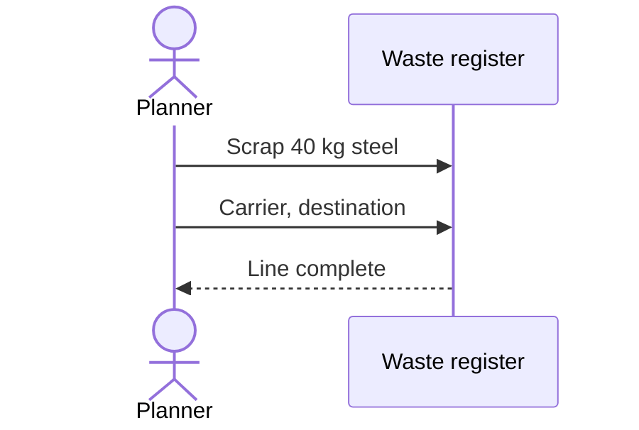

🏠 [Specs](../../../../README.md) › 🧩 [Functional capabilities](../../../README.md) ›
🏭 [F12 Manufacturing (plugin)](../../README.md) › 📝 [Use cases](../README.md) ›
📝 [Use cases: FL-F12-07 Compliance and safety](README.md) › 📝 UC-F12-18 Track waste and environmental records

# 📝 UC-F12-18 Track waste and environmental records

**Status:** ✅ specified

## Summary

The waste register from scrap, and classified installations per site.

## Personas

- [U21 Production planner](../../../../01-users/personas/u21-production-planner.md)
- [U15 Warehouse operator](../../../../01-users/personas/u15-warehouse-operator.md)

## Goal

Waste traced to its destination.

## Trigger

Scrap or waste leaves.

## Frequency

Weekly.

## Preconditions

F12 set up for the company.

## Postconditions

- **Succeeded:** register lines complete.
- **Failed:** missing code asked.

## Main flow

1. Scrap is declared as waste ([BR-F12-14](../../business-rules/br-f12-14-scrap-writes-the-waste-register.md)) on the
   waste register ([S-F12-18](../../screens/07-compliance-and-safety/s-f12-18-waste-register.md)).
2. The carrier and destination are completed.
3. Hazardous waste is declared online.
4. The register is exported ([CR-FR-079](../../../../10-country-packs/france/environment/cr-fr-079-waste-register.md)).

## Alternative flows

- 3a. Hazardous waste declared online.

## Error flows

- 1e. Code missing: asked.

## Business rules

- [BR-F12-14 Scrap writes the waste register](../../business-rules/br-f12-14-scrap-writes-the-waste-register.md)
- [BR-F12-01 Manufacturing follows the country pack](../../business-rules/br-f12-01-manufacturing-follows-the-country-pack.md)

## Entities

- [E-F12-15 Waste register line](../../data/e-f12-15-waste-register-line.md)

## Permissions

Production planners; managers; record rules by site. Warehouse operators.

## Notifications

None.

## Audit events

Lines.

## AI involvement

The AI assistant prepares it for confirmation
([BR-F3-07](../../../f03-assistant/business-rules/br-f03-07-no-deletes-no-irreversible-acts.md)); figures come from
queries ([BR-F3-03](../../../f03-assistant/business-rules/br-f03-03-figures-come-from-queries.md)).

## API, MCP and A2A exposure

T5 operations of F12 with the caller's rights; the MCP tool of F12; no A2A skill.

## Screens

- [S-F12-18](../../screens/07-compliance-and-safety/s-f12-18-waste-register.md)

## Flowchart

See [FL-F12-07 Compliance and safety](../../flows/fl-f12-07-compliance-and-safety.md#flowchart).

## Sequence diagram

## Acceptance criteria

1. **Given** 40 kg of steel scrap **when** it is declared **then** a register line is created.
2. **Given** a line without a waste code **when** it is saved **then** the code is asked.
3. **Given** the year's register **when** it is exported **then** every line shows carrier and destination.

## Non-functional notes

None.

## Regulatory references

[CR-FR-079](../../../../10-country-packs/france/environment/cr-fr-079-waste-register.md);
[CR-FR-080](../../../../10-country-packs/france/environment/cr-fr-080-classified-installations.md).

## Related use cases

See the flows.

## Open questions

None.

---

⬅️ [UC-F12-17](uc-f12-17-keep-the-risk-assessment-and-safety-registers.md) · ⬆️ [Up](README.md) ·
➡️ [UC-F12-19 Report production](../08-report-and-assist/uc-f12-19-report-production.md)
