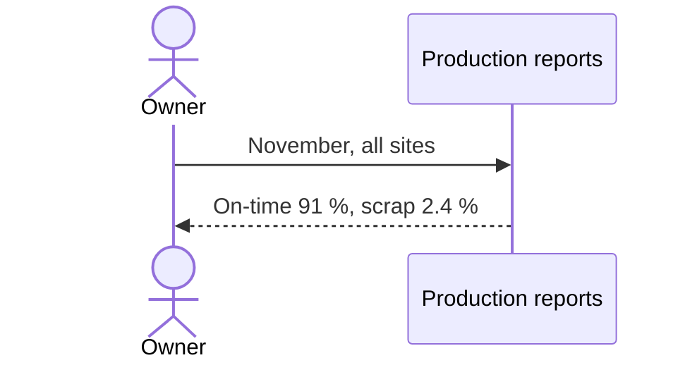

🏠 [Specs](../../../../README.md) › 🧩 [Functional capabilities](../../../README.md) ›
🏭 [F12 Manufacturing (plugin)](../../README.md) › 📝 [Use cases](../README.md) ›
📝 [Use cases: FL-F12-08 Report and assist](README.md) › 📝 UC-F12-19 Report production

# 📝 UC-F12-19 Report production

**Status:** ✅ specified

## Summary

Output, lead times, on-time rate, scrap, costs, load and energy by site and period.

## Personas

- [U13 Owner](../../../../01-users/personas/u13-owner.md)
- [U21 Production planner](../../../../01-users/personas/u21-production-planner.md)

## Goal

See how production performs.

## Trigger

A review.

## Frequency

Weekly.

## Preconditions

F12 set up for the company.

## Postconditions

- **Succeeded:** reports read and exported.
- **Failed:** missing data shown as missing.

## Main flow

1. The owner opens production reports
   ([S-F12-19](../../screens/08-report-and-assist/s-f12-19-manufacturing-dashboard.md)).
2. They filter by site and period.
3. They compare periods and sites.
4. They export or save a tile,
   [UC-F2-12](../../../f02-no-code-configuration/use-cases/07-benchmark-additions/uc-f02-12-build-live-spreadsheets-and-dashboards.md).

## Alternative flows

- 3a. Compare sites.

## Error flows

- 2e. No data: shown as missing.

## Business rules

- [BR-F12-11 Production costed per order](../../business-rules/br-f12-11-production-costed-per-order.md)

## Entities

- [E-F12-04 Manufacturing order](../../data/e-f12-04-manufacturing-order.md)
- [E-F12-13 Machine signal](../../data/e-f12-13-machine-signal.md)

## Permissions

Production planners; managers; record rules by site. The owner.

## Notifications

Weekly digest.

## Audit events

Exports.

## AI involvement

The AI assistant prepares it for confirmation
([BR-F3-07](../../../f03-assistant/business-rules/br-f03-07-no-deletes-no-irreversible-acts.md)); figures come from
queries ([BR-F3-03](../../../f03-assistant/business-rules/br-f03-03-figures-come-from-queries.md)).

## API, MCP and A2A exposure

T5 operations of F12 with the caller's rights; the MCP tool of F12; no A2A skill.

## Screens

- [S-F12-19](../../screens/08-report-and-assist/s-f12-19-manufacturing-dashboard.md)

## Flowchart

See [FL-F12-08 Report and assist](../../flows/fl-f12-08-report-and-assist.md#flowchart).

## Sequence diagram

## Acceptance criteria

1. **Given** November **when** reports open **then** on-time rate and scrap show.
2. **Given** two sites **when** they are compared **then** both show side by side.
3. **Given** a site without data **when** it is opened **then** it shows missing.

## Non-functional notes

None.

## Regulatory references

None.

## Related use cases

See the flows.

## Open questions

None.

---

⬅️ [UC-F12-18](../07-compliance-and-safety/uc-f12-18-track-waste-and-environmental-records.md) · ⬆️ [Up](README.md) ·
➡️ [UC-F12-20 Ask the AI assistant about production](uc-f12-20-ask-the-assistant-about-production.md)
