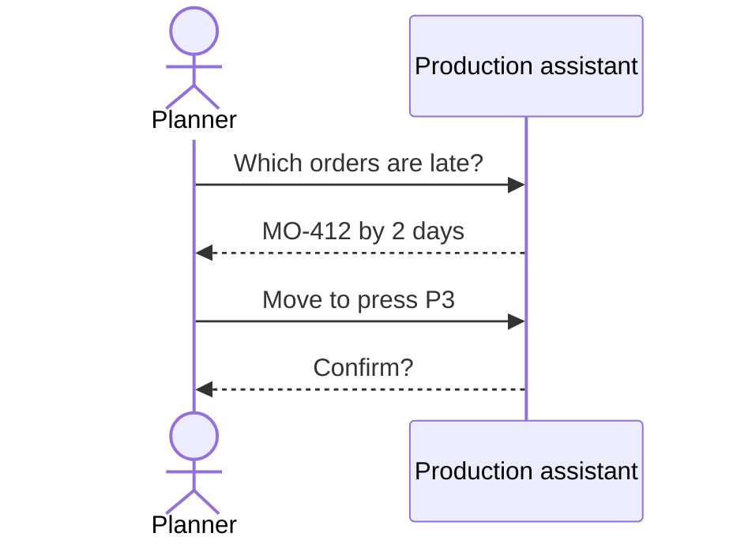

🏠 [Specs](../../../../README.md) › 🧩 [Functional capabilities](../../../README.md) ›
🏭 [F12 Manufacturing (plugin)](../../README.md) › 📝 [Use cases](../README.md) ›
📝 [Use cases: FL-F12-08 Report and assist](README.md) › 📝 UC-F12-20 Ask the AI assistant about production

# 📝 UC-F12-20 Ask the AI assistant about production

**Status:** ✅ specified

## Summary

Ask or act about production: late orders, a machine's OEE, the next instruction read aloud, a plan scenario, within the
role's rights.

## Personas

- [U21 Production planner](../../../../01-users/personas/u21-production-planner.md)
- [U20 Production operator](../../../../01-users/personas/u20-production-operator.md)

## Goal

Answers and actions without searching.

## Trigger

Staff ask.

## Frequency

Daily.

## Preconditions

F12 set up for the company.

## Postconditions

- **Succeeded:** answered or action confirmed.
- **Failed:** actions beyond rights refused.

## Main flow

1. The planner asks the production assistant
   ([S-F12-20](../../screens/08-report-and-assist/s-f12-20-production-assistant.md)).
2. It answers from data with figures
   ([BR-F3-03](../../../f03-assistant/business-rules/br-f03-03-figures-come-from-queries.md)).
3. For an action, it prepares it.
4. The user confirms ([BR-F3-07](../../../f03-assistant/business-rules/br-f03-07-no-deletes-no-irreversible-acts.md)).

## Alternative flows

- 1a. The operator has the instruction read aloud at the machine.

## Error flows

- 3e. Action beyond rights: refused.

## Business rules

- [BR-F12-01 Manufacturing follows the country pack](../../business-rules/br-f12-01-manufacturing-follows-the-country-pack.md)

## Entities

- [E-F12-04 Manufacturing order](../../data/e-f12-04-manufacturing-order.md)
- [E-F12-05 Work order](../../data/e-f12-05-work-order.md)

## Permissions

Planners and operators within their rights.

## Notifications

None.

## Audit events

Actions through the AI assistant.

## AI involvement

Answers and prepares.

## API, MCP and A2A exposure

T5 operations of F12 with the caller's rights; the MCP tool of F12; no A2A skill.

## Screens

- [S-F12-20](../../screens/08-report-and-assist/s-f12-20-production-assistant.md)

## Flowchart

See [FL-F12-08 Report and assist](../../flows/fl-f12-08-report-and-assist.md#flowchart).

## Sequence diagram

## Acceptance criteria

1. **Given** MO-412 late by 2 days **when** the planner asks **then** it is listed with the reason.
2. **Given** a move to press P3 **when** it is confirmed **then** the schedule changes.
3. **Given** an operator asking to change a recipe **when** he asks **then** it is refused.

## Non-functional notes

None.

## Regulatory references

None.

## Related use cases

See the flows.

## Open questions

None.

---

⬅️ [UC-F12-19 Report production](uc-f12-19-report-production.md) · ⬆️ [Up](README.md) ·
➡️ [UC-F12-21 Calibrate measuring equipment](../10-people-and-tools/uc-f12-21-calibrate-measuring-equipment.md)
