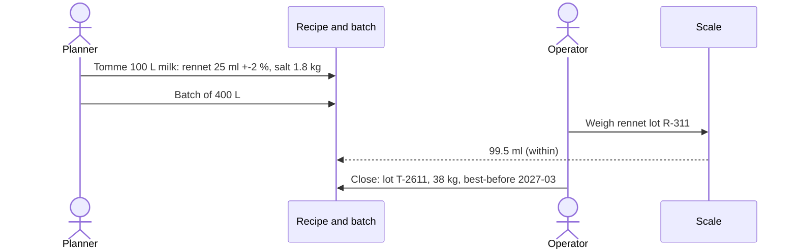

🏠 [Specs](../../../../README.md) › 🧩 [Functional capabilities](../../../README.md) ›
🏭 [F12 Manufacturing (plugin)](../../README.md) › 📝 [Use cases](../README.md) ›
📝 [Use cases: FL-F12-09 Recipes and batches](README.md) › 📝 UC-F12-31 Define a recipe and produce in batches

# 📝 UC-F12-31 Define a recipe and produce in batches

**Status:** ✅ specified

## Summary

The planner defines a recipe (ingredients with quantities and tolerances, steps, yield, allergens, best-before) and
produces it in batches scaled to the batch size, weighed and traced by lot; the shared recipes capability of D457.

## Personas

- [U21 Production planner](../../../../01-users/personas/u21-production-planner.md)
- [U20 Production operator](../../../../01-users/personas/u20-production-operator.md)
- [U19 Kitchen staff](../../../../01-users/personas/u19-kitchen-staff.md)
- [U40 Farmer](../../../../01-users/personas/u40-farmer.md)

## Goal

The same product every batch, traced from ingredient lots to the finished lot.

## Trigger

A new product; a batch to produce.

## Frequency

Daily in food workshops and kitchens.

## Preconditions

- Ingredients as items with lots (F7).

## Postconditions

- **Succeeded:** the batch lot exists with its yield, best-before and ingredient lots.
- **Failed:** a batch out of tolerance is held or rejected.

## Main flow

1. The planner defines the recipe on recipe and batch
   ([S-F12-30](../../screens/09-recipes-and-batches/s-f12-30-recipe-and-batch.md)): ingredients per reference quantity
   with tolerances, steps with times and temperatures, expected yield, allergens and best-before.
2. A batch order scales the recipe to its size
   ([BR-F12-26](../../business-rules/br-f12-26-recipes-scale-to-the-batch-and-keep-their-tolerances.md)).
3. The operator weighs each ingredient by lot on the tablet
   ([S-F12-05](../../screens/03-make-the-products/s-f12-05-shop-floor-tablet.md)); the scale gives the weight and the
   tolerance is checked.
4. The steps and their checks (temperature, time) are recorded
   ([UC-F12-07](../04-quality-and-maintenance/uc-f12-07-run-quality-checks-and-handle-non-conformities.md)).
5. The batch closes with its lot, yield and best-before; the ingredient lots are traced
   ([BR-F12-04](../../business-rules/br-f12-04-lots-traced-both-ways.md)).

## Alternative flows

- 1a. A restaurant kitchen's recipes for dishes, costed per portion.
- 1b. The farm's cheese: milk from its own herd as an ingredient lot.

## Error flows

- 3e. An ingredient out of tolerance: adjust within the rule, or the batch is held.
- 5e. Yield far from the expected (over 10 %): flagged for the planner.

## Business rules

- [BR-F12-26 Recipes scale to the batch and keep their tolerances](../../business-rules/br-f12-26-recipes-scale-to-the-batch-and-keep-their-tolerances.md)
- [BR-F12-04 Lots traced both ways](../../business-rules/br-f12-04-lots-traced-both-ways.md)

## Entities

- [E-F12-25 Recipe](../../data/e-f12-25-recipe.md)
- [E-F12-04 Manufacturing order](../../data/e-f12-04-manufacturing-order.md)

## Permissions

Production planners; managers; record rules by site. Operators and kitchen staff record.

## Notifications

Planner: batches held, yields off.

## Audit events

Recipe versions; batch records.

## AI involvement

The AI assistant prepares it for confirmation
([BR-F3-07](../../../f03-assistant/business-rules/br-f03-07-no-deletes-no-irreversible-acts.md)); figures come from
queries ([BR-F3-03](../../../f03-assistant/business-rules/br-f03-03-figures-come-from-queries.md)).

## API, MCP and A2A exposure

T5 operations of F12 with the caller's rights; the MCP tool of F12; no A2A skill.

## Screens

- [S-F12-30 Recipe and batch](../../screens/09-recipes-and-batches/s-f12-30-recipe-and-batch.md)
- [S-F12-05 Shop-floor tablet](../../screens/03-make-the-products/s-f12-05-shop-floor-tablet.md)
- [S-F12-06 Consumption](../../screens/03-make-the-products/s-f12-06-consumption.md)

## Flowchart

See [FL-F12-09 Recipes and batches](../../flows/fl-f12-09-recipes-and-batches.md#flowchart).

## Sequence diagram

## Acceptance criteria

1. **Given** Ferme des Trois Chênes' tomme recipe for 100 L of milk **when** a batch of 400 L is planned **then** every
   ingredient is scaled by 4.
2. **Given** rennet 100 ml +-2 % and 104 ml weighed **when** it is recorded **then** it is out of tolerance and must be
   adjusted or the batch held.
3. **Given** the batch closed as lot T-2611 **when** it is traced **then** its milk and rennet lots show.
4. **Given** an expected yield of 40 kg and 34 kg made **when** the batch closes **then** the yield gap is flagged.

## Non-functional notes

Tablet screens answer within 300 ms, offline included,
[UC-F12-26](../11-finite-schedule-and-the-tablet/uc-f12-26-keep-working-on-the-tablet-without-the-network.md).

## Regulatory references

[CR-FR-061](../../../../10-country-packs/france/products/cr-fr-061-food-traceability.md);
[CR-FR-165](../../../../10-country-packs/france/consumer/cr-fr-165-prepacked-food-labelling.md);
[CR-FR-110](../../../../10-country-packs/france/hospitality/cr-fr-110-food-hygiene-records.md);
[CR-FR-107](../../../../10-country-packs/france/consumer/cr-fr-107-allergen-information.md).

## Related use cases

- [UC-F12-01 Define bills of materials](../01-define-the-products/uc-f12-01-define-bills-of-materials.md)
- [UC-SC05-02 Manage recipes with potency, yields and batch scaling](../../../../08-sectors/sc05-manufacturing/use-cases/01-production-setups/uc-sc05-02-manage-recipes-with-potency-yields-and-batch-scaling.md)
- [UC-SC13-13 Manage recipes and batches for processing](../../../../08-sectors/sc13-agriculture-and-food/use-cases/05-food-processing/uc-sc13-13-manage-recipes-and-batches-for-processing.md)

## Open questions

None.

---

⬅️ [UC-F12-30](../13-energy-passport-and-work-in-progress/uc-f12-30-build-the-digital-product-passport.md) ·
⬆️ [Up](README.md) ·
➡️ [UC-F12-32 Link CAD files and revisions](../14-cad-kanban-mps-and-tools/uc-f12-32-link-cad-files-and-revisions.md)
