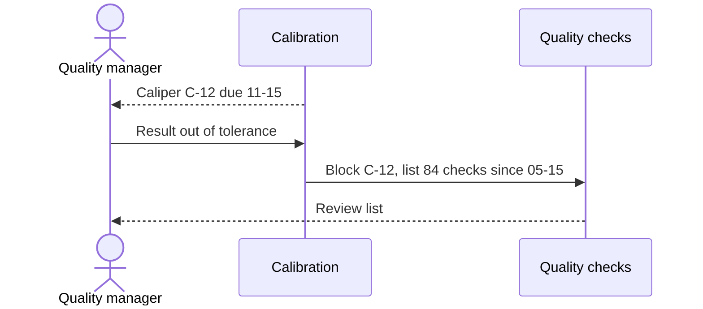

🏠 [Specs](../../../../README.md) › 🧩 [Functional capabilities](../../../README.md) ›
🏭 [F12 Manufacturing (plugin)](../../README.md) › 📝 [Use cases](../README.md) ›
📝 [Use cases: FL-F12-10 People and tools](README.md) › 📝 UC-F12-21 Calibrate measuring equipment

# 📝 UC-F12-21 Calibrate measuring equipment

**Status:** ✅ specified

## Summary

The quality manager keeps every measuring instrument with its calibration interval and certificates; an instrument out
of calibration cannot record a quality check.

## Personas

- [U27 Quality manager](../../../../01-users/personas/u27-quality-manager.md)
- [U21 Production planner](../../../../01-users/personas/u21-production-planner.md)

## Goal

Every measure taken with an instrument that is right.

## Trigger

A calibration due date; a new instrument; a drop.

## Frequency

Monthly reviews.

## Preconditions

- Instruments recorded as equipment ([E-F12-09](../../data/e-f12-09-equipment.md)).

## Postconditions

- **Succeeded:** calibration recorded with its certificate and next date.
- **Failed:** an out-of-tolerance result opens a review of past measures.

## Main flow

1. The quality manager opens calibration ([S-F12-21](../../screens/10-people-and-tools/s-f12-21-calibration.md)):
   instruments, intervals and due dates.
2. Due instruments are calibrated in-house or by a laboratory; the result and certificate are recorded.
3. Within tolerance: the next date is set; out of tolerance: the instrument is blocked and the checks made with it since
   the last calibration are listed for review.
4. Quality checks refuse a measure from an instrument out of calibration
   ([BR-F12-16](../../business-rules/br-f12-16-only-calibrated-instruments-record-checks.md)).

## Alternative flows

- 2a. Calibration by an outside laboratory ordered as a service (F7).

## Error flows

- 4e. A check with an expired instrument: refused, another instrument proposed.

## Business rules

- [BR-F12-16 Only calibrated instruments record checks](../../business-rules/br-f12-16-only-calibrated-instruments-record-checks.md)
- [BR-F12-09 Equipment checks before use](../../business-rules/br-f12-09-equipment-checks-before-use.md)

## Entities

- [E-F12-16 Calibration](../../data/e-f12-16-calibration.md)
- [E-F12-09 Equipment](../../data/e-f12-09-equipment.md)

## Permissions

The quality manager; production planners; operators record.

## Notifications

Quality manager: due calibrations.

## Audit events

Calibrations, blocks, reviews.

## AI involvement

The AI assistant prepares it for confirmation
([BR-F3-07](../../../f03-assistant/business-rules/br-f03-07-no-deletes-no-irreversible-acts.md)); figures come from
queries ([BR-F3-03](../../../f03-assistant/business-rules/br-f03-03-figures-come-from-queries.md)).

## API, MCP and A2A exposure

T5 operations of F12 with the caller's rights; the MCP tool of F12; no A2A skill.

## Screens

- [S-F12-21 Calibration](../../screens/10-people-and-tools/s-f12-21-calibration.md)

## Flowchart

See [FL-F12-10 People and tools](../../flows/fl-f12-10-people-and-tools.md#flowchart).

## Sequence diagram

## Acceptance criteria

1. **Given** caliper C-12 calibrated every 6 months, last on 2026-05-15 **when** 2026-11-15 comes **then** it is due and
   listed.
2. **Given** C-12 out of tolerance **when** the result is recorded **then** it is blocked and its 84 checks since 05-15
   are listed.
3. **Given** a check with C-12 blocked **when** a measure is entered **then** it is refused.

## Non-functional notes

None.

## Regulatory references

Design reference, not a law: ISO 9001:2015 clause 7.1.5 (monitoring and measuring resources) ([D575](../../../../06-decisions/foundations/d575-answers-of-2026-11-27-on-the-last-open-points.md)).

## Related use cases

- [UC-F12-07 Run quality checks and handle non-conformities](../04-quality-and-maintenance/uc-f12-07-run-quality-checks-and-handle-non-conformities.md)
- [UC-F12-08 Maintain equipment](../04-quality-and-maintenance/uc-f12-08-maintain-equipment.md)
- [UC-SC05-12 Calibrate measuring equipment](../../../../08-sectors/sc05-manufacturing/use-cases/04-quality-system/uc-sc05-12-calibrate-measuring-equipment.md)

## Open questions

None.

---

⬅️ [UC-F12-20](../08-report-and-assist/uc-f12-20-ask-the-assistant-about-production.md) · ⬆️ [Up](README.md) ·
➡️ [UC-F12-22](uc-f12-22-require-operator-qualifications-per-work-centre.md)
