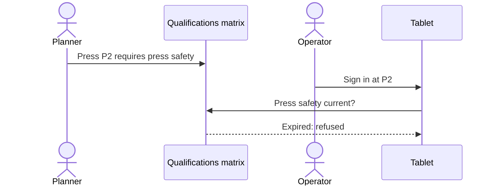

🏠 [Specs](../../../../README.md) › 🧩 [Functional capabilities](../../../README.md) ›
🏭 [F12 Manufacturing (plugin)](../../README.md) › 📝 [Use cases](../README.md) ›
📝 [Use cases: FL-F12-10 People and tools](README.md) › 📝 UC-F12-22 Require operator qualifications per work centre

# 📝 UC-F12-22 Require operator qualifications per work centre

**Status:** 🔄 waiting for the owner

## Summary

The planner sets the qualifications each work centre requires; an operator signs in only where they hold them, current.

## Personas

- [U21 Production planner](../../../../01-users/personas/u21-production-planner.md)
- [U06 Human resources](../../../../01-users/personas/u06-hr.md)
- [U20 Production operator](../../../../01-users/personas/u20-production-operator.md)

## Goal

Only trained people run each machine.

## Trigger

A new work centre, a hire, a qualification expiring.

## Frequency

Monthly.

## Preconditions

- Qualifications tracked in F9,
  [UC-F9-11](../../../f09-hr-and-projects/use-cases/04-grow/uc-f09-11-run-appraisals-and-track-skills.md).

## Postconditions

- **Succeeded:** work centres show who may work there.
- **Failed:** an unqualified sign-in is refused.

## Main flow

1. The planner opens the qualifications matrix
   ([S-F12-22](../../screens/10-people-and-tools/s-f12-22-qualifications-matrix.md)) and sets what each work centre
   requires (press safety, forklift, food hygiene).
2. The matrix shows operators against work centres: qualified, expiring, missing.
3. At sign-in on the tablet ([BR-F12-07](../../business-rules/br-f12-07-operators-sign-in-at-the-work-centre.md)), the
   operator must hold the requirements
   ([BR-F12-17](../../business-rules/br-f12-17-operators-sign-in-only-where-qualified.md)).
4. Gaps go to the training plan,
   [UC-F9-25](../../../f09-hr-and-projects/use-cases/09-train-and-protect/uc-f09-25-run-the-training-plan-with-opco-funding.md).

## Alternative flows

- 3a. A supervisor allows a supervised trainee, logged.

## Error flows

- 3e. Not qualified: refused, the supervisor told.

## Business rules

- [BR-F12-17 Operators sign in only where qualified](../../business-rules/br-f12-17-operators-sign-in-only-where-qualified.md)
- [BR-F12-07 Operators sign in at the work centre](../../business-rules/br-f12-07-operators-sign-in-at-the-work-centre.md)

## Entities

- [E-F12-17 Qualification requirement](../../data/e-f12-17-qualification-requirement.md)
- [E-F9-12 Qualification](../../../f09-hr-and-projects/data/e-f09-12-certification.md)

## Permissions

Production planners; managers; record rules by site. HR keeps qualifications.

## Notifications

Supervisor: refused sign-ins; HR: expiring.

## Audit events

Requirements changed; refusals; supervised trainees.

## AI involvement

The AI assistant prepares it for confirmation
([BR-F3-07](../../../f03-assistant/business-rules/br-f03-07-no-deletes-no-irreversible-acts.md)); figures come from
queries ([BR-F3-03](../../../f03-assistant/business-rules/br-f03-03-figures-come-from-queries.md)).

## API, MCP and A2A exposure

T5 operations of F12 with the caller's rights; the MCP tool of F12; no A2A skill.

## Screens

- [S-F12-22 Qualifications matrix](../../screens/10-people-and-tools/s-f12-22-qualifications-matrix.md)

## Flowchart

See [FL-F12-10 People and tools](../../flows/fl-f12-10-people-and-tools.md#flowchart).

## Sequence diagram

## Acceptance criteria

1. **Given** press P2 requiring press safety **when** an operator without it signs in **then** it is refused and the
   supervisor told.
2. **Given** a qualification expiring in 30 days **when** the matrix opens **then** it shows expiring.
3. **Given** a supervised trainee **when** the supervisor allows him **then** it is logged.

## Non-functional notes

Tablet screens answer within 300 ms (Proposed), offline included,
[UC-F12-26](../11-finite-schedule-and-the-tablet/uc-f12-26-keep-working-on-the-tablet-without-the-network.md).

## Regulatory references

[CR-FR-075](../../../../10-country-packs/france/labour/cr-fr-075-work-equipment-periodic-checks.md).

## Related use cases

- [UC-F12-05 Work on the shop-floor tablet](../03-make-the-products/uc-f12-05-work-on-the-shop-floor-tablet.md)
- [UC-F9-25 Run the training plan with OPCO funding](../../../f09-hr-and-projects/use-cases/09-train-and-protect/uc-f09-25-run-the-training-plan-with-opco-funding.md)
- [UC-SC05-13 Qualify staff for operations](../../../../08-sectors/sc05-manufacturing/use-cases/05-suppliers-and-customers/uc-sc05-13-qualify-staff-for-operations.md)

## Open questions

None.

---

⬅️ [UC-F12-21 Calibrate measuring equipment](uc-f12-21-calibrate-measuring-equipment.md) · ⬆️ [Up](README.md) ·
➡️ [UC-F12-23](../11-finite-schedule-and-the-tablet/uc-f12-23-schedule-with-finite-capacity.md)
