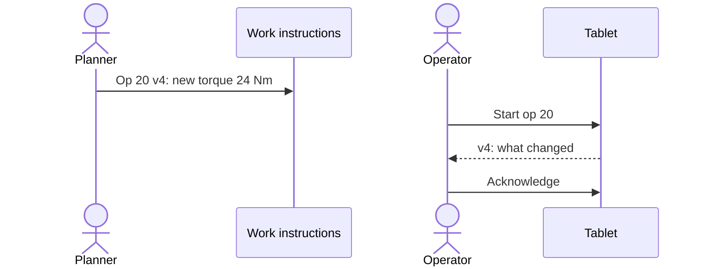

🏠 [Specs](../../../../README.md) › 🧩 [Functional capabilities](../../../README.md) ›
🏭 [F12 Manufacturing (plugin)](../../README.md) › 📝 [Use cases](../README.md) ›
📝 [Use cases: FL-F12-10 People and tools](README.md) › 📝 UC-F12-28 Publish versioned work instructions

# 📝 UC-F12-28 Publish versioned work instructions

**Status:** 🔄 waiting for the owner

## Summary

The planner publishes work instructions per operation with versions; operators acknowledge a new version on the tablet
before starting.

## Personas

- [U21 Production planner](../../../../01-users/personas/u21-production-planner.md)
- [U20 Production operator](../../../../01-users/personas/u20-production-operator.md)

## Goal

Operators always work from the current instruction, and it is proven.

## Trigger

An instruction changes.

## Frequency

Weekly.

## Preconditions

- Operations in routings ([UC-F12-02](../01-define-the-products/uc-f12-02-define-work-centres-and-routings.md)).

## Postconditions

- **Succeeded:** the new version is live and acknowledged.
- **Failed:** an operator who has not acknowledged cannot start.

## Main flow

1. The planner edits an operation's instruction on work instructions
   ([S-F12-27](../../screens/10-people-and-tools/s-f12-27-work-instructions.md)): text, images, video.
2. They publish a new version with what changed; the previous is kept.
3. An operator starting that operation sees the new version and acknowledges it
   ([BR-F12-23](../../business-rules/br-f12-23-a-new-instruction-version-is-acknowledged-before-work.md)).
4. The planner sees who acknowledged.

## Alternative flows

- 1a. An engineering change brings the new version
  ([UC-F12-10](../01-define-the-products/uc-f12-10-manage-engineering-changes.md)).

## Error flows

- 3e. Not acknowledged: the operation cannot start.

## Business rules

- [BR-F12-23 A new instruction version is acknowledged before work](../../business-rules/br-f12-23-a-new-instruction-version-is-acknowledged-before-work.md)
- [BR-F12-02 An order keeps its versions](../../business-rules/br-f12-02-an-order-keeps-its-versions.md)

## Entities

- [E-F12-22 Work instruction version](../../data/e-f12-22-work-instruction-version.md)
- [E-F12-03 Routing operation](../../data/e-f12-03-routing-operation.md)

## Permissions

Production planners; managers; record rules by site. Operators acknowledge.

## Notifications

Operators: new version.

## Audit events

Versions and acknowledgements.

## AI involvement

The AI assistant reads instructions aloud at the machine
([UC-F12-20](../08-report-and-assist/uc-f12-20-ask-the-assistant-about-production.md)).

## API, MCP and A2A exposure

T5 operations of F12 with the caller's rights; the MCP tool of F12; no A2A skill.

## Screens

- [S-F12-27 Work instructions](../../screens/10-people-and-tools/s-f12-27-work-instructions.md)
- [S-F12-05 Shop-floor tablet](../../screens/03-make-the-products/s-f12-05-shop-floor-tablet.md)

## Flowchart

See [FL-F12-10 People and tools](../../flows/fl-f12-10-people-and-tools.md#flowchart).

## Sequence diagram

## Acceptance criteria

1. **Given** instruction v4 for op 20 with a new torque of 24 Nm **when** an operator starts op 20 **then** v4 shows
   with what changed and must be acknowledged.
2. **Given** not acknowledged **when** the operator taps Start **then** it is refused.
3. **Given** v3 **when** v4 is published **then** v3 stays kept.

## Non-functional notes

Tablet screens answer within 300 ms (Proposed), offline included,
[UC-F12-26](../11-finite-schedule-and-the-tablet/uc-f12-26-keep-working-on-the-tablet-without-the-network.md).

## Regulatory references

None.

## Related use cases

- [UC-F12-05 Work on the shop-floor tablet](../03-make-the-products/uc-f12-05-work-on-the-shop-floor-tablet.md)
- [UC-F12-10 Manage engineering changes](../01-define-the-products/uc-f12-10-manage-engineering-changes.md)

## Open questions

None.

---

⬅️ [UC-F12-27](../05-subcontracting-and-costs/uc-f12-27-value-work-in-progress-at-month-end.md) · ⬆️ [Up](README.md) ·
➡️ [UC-F12-29](../13-energy-passport-and-work-in-progress/uc-f12-29-measure-energy-per-operation.md)
