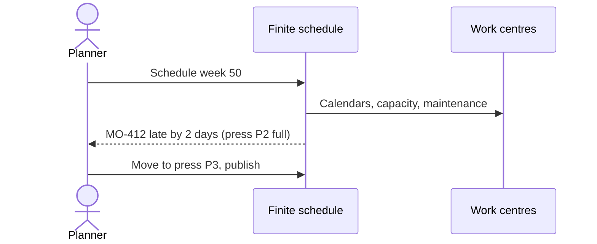

🏠 [Specs](../../../../README.md) › 🧩 [Functional capabilities](../../../README.md) ›
🏭 [F12 Manufacturing (plugin)](../../README.md) › 📝 [Use cases](../README.md) ›
📝 [Use cases: FL-F12-11 Finite schedule and the tablet](README.md) › 📝 UC-F12-23 Schedule with finite capacity

# 📝 UC-F12-23 Schedule with finite capacity

**Status:** 🔄 waiting for the owner

## Summary

The planner schedules operations within each work centre's calendar and capacity; the schedule shows what can be done
when, and late orders.

## Personas

- [U21 Production planner](../../../../01-users/personas/u21-production-planner.md)
- [U02 Manager](../../../../01-users/personas/u02-manager.md)

## Goal

A schedule the shop floor can follow.

## Trigger

Orders released; a change.

## Frequency

Daily.

## Preconditions

- Work centres with calendars and capacity
  ([UC-F12-02](../01-define-the-products/uc-f12-02-define-work-centres-and-routings.md)).

## Postconditions

- **Succeeded:** operations have slots; late orders shown.
- **Failed:** an overloaded centre pushes orders later.

## Main flow

1. The planner opens the finite schedule
   ([S-F12-23](../../screens/11-finite-schedule-and-the-tablet/s-f12-23-finite-schedule.md)) as a Gantt per work centre.
2. SimpleERP places operations by priority and due date within capacity, maintenance and calendars,
   [BR-F12-18](../../business-rules/br-f12-18-the-schedule-never-exceeds-capacity.md),
   [BR-F12-10](../../business-rules/br-f12-10-maintenance-frees-the-plan.md).
3. Orders that will be late show with their expected date.
4. The planner moves operations, uses an alternative centre, or splits an order, and publishes to the tablets.

## Alternative flows

- 2a. Backward from the due date, or forward from today.

## Error flows

- 2e. No slot before the due date: the order shows late with the reason (capacity, components).

## Business rules

- [BR-F12-18 The schedule never exceeds capacity](../../business-rules/br-f12-18-the-schedule-never-exceeds-capacity.md)
- [BR-F12-10 Maintenance frees the plan](../../business-rules/br-f12-10-maintenance-frees-the-plan.md)

## Entities

- [E-F12-18 Schedule slot](../../data/e-f12-18-schedule-slot.md)
- [E-F12-05 Work order](../../data/e-f12-05-work-order.md)

## Permissions

Production planners; managers; record rules by site.

## Notifications

Sales: orders that will be late.

## Audit events

Schedules published.

## AI involvement

The AI assistant prepares it for confirmation
([BR-F3-07](../../../f03-assistant/business-rules/br-f03-07-no-deletes-no-irreversible-acts.md)); figures come from
queries ([BR-F3-03](../../../f03-assistant/business-rules/br-f03-03-figures-come-from-queries.md)).

## API, MCP and A2A exposure

T5 operations of F12 with the caller's rights; the MCP tool of F12; no A2A skill.

## Screens

- [S-F12-23 Finite schedule](../../screens/11-finite-schedule-and-the-tablet/s-f12-23-finite-schedule.md)

## Flowchart

See [FL-F12-11 Finite schedule and the tablet](../../flows/fl-f12-11-finite-schedule-and-the-tablet.md#flowchart).

## Sequence diagram

## Acceptance criteria

1. **Given** press P2 at 16 hours a day fully booked on 12-08 **when** MO-412 needs 6 hours **then** it is placed on
   12-09 and shown late.
2. **Given** press P3 as alternative **when** the planner moves it **then** it fits on 12-08.
3. **Given** a maintenance on 12-10 **when** the schedule runs **then** no operation is placed during it.

## Non-functional notes

Scheduling 500 operations within 30 seconds (Proposed).

## Regulatory references

None.

## Related use cases

- [UC-F12-03 Plan production](../02-plan-production/uc-f12-03-plan-production.md)
- [UC-F12-26 Keep working on the tablet without the network](uc-f12-26-keep-working-on-the-tablet-without-the-network.md)

## Open questions

None.

---

⬅️ [UC-F12-22](../10-people-and-tools/uc-f12-22-require-operator-qualifications-per-work-centre.md) ·
⬆️ [Up](README.md) · ➡️ [UC-F12-24 Run an FMEA](../12-quality-engineering/uc-f12-24-run-an-fmea.md)
