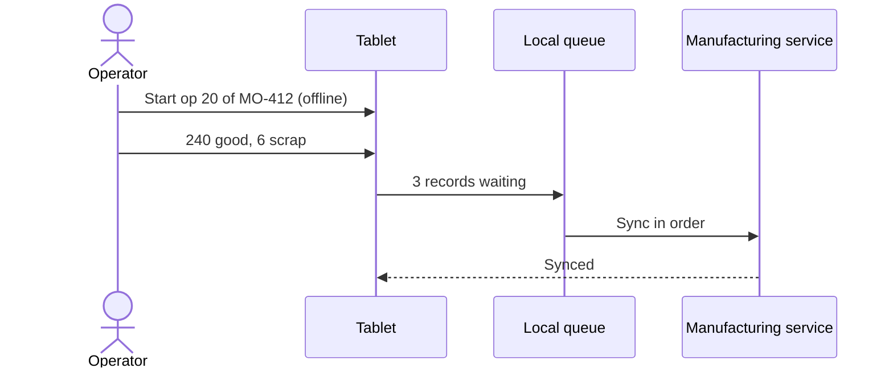

🏠 [Specs](../../../../README.md) › 🧩 [Functional capabilities](../../../README.md) ›
🏭 [F12 Manufacturing (plugin)](../../README.md) › 📝 [Use cases](../README.md) ›
📝 [Use cases: FL-F12-11 Finite schedule and the tablet](README.md) ›
📝 UC-F12-26 Keep working on the tablet without the network

# 📝 UC-F12-26 Keep working on the tablet without the network

**Status:** 🔄 waiting for the owner

## Summary

The shop-floor tablet keeps the shift's work orders and instructions; operators start, stop, record quantities and
checks without the network, and the records sync in order.

## Personas

- [U20 Production operator](../../../../01-users/personas/u20-production-operator.md)
- [U21 Production planner](../../../../01-users/personas/u21-production-planner.md)

## Goal

Production never stops because of the network.

## Trigger

The network drops on the shop floor.

## Frequency

Occasionally; daily in some plants.

## Preconditions

- The tablet loaded the shift at its start.

## Postconditions

- **Succeeded:** every record is on the server in order.
- **Failed:** a conflict waits for the planner.

## Main flow

1. At the shift's start, the tablet ([S-F12-05](../../screens/03-make-the-products/s-f12-05-shop-floor-tablet.md)) loads
   the work centre's work orders, instructions and checks.
2. The network drops; the tablet shows Offline and the number of records waiting.
3. The operator starts, stops, records quantities, scrap and checks as usual
   ([BR-F12-21](../../business-rules/br-f12-21-tablet-records-sync-in-order.md)).
4. When the network is back, records sync in order; consumption is checked against stock
   ([BR-F12-05](../../business-rules/br-f12-05-consumption-never-below-zero.md)).
5. A conflict (an order changed by the planner meanwhile) waits for the planner.

## Alternative flows

- 2a. A new work order released during the outage reaches the tablet at sync.

## Error flows

- 4e. Consumption would go below zero after sync: the line waits for the planner.
- 1e. The tablet did not load the shift: it says so and works online only.

## Business rules

- [BR-F12-21 Tablet records sync in order](../../business-rules/br-f12-21-tablet-records-sync-in-order.md)
- [BR-F12-05 Consumption never below zero](../../business-rules/br-f12-05-consumption-never-below-zero.md)

## Entities

- [E-F12-05 Work order](../../data/e-f12-05-work-order.md)
- [E-F12-06 Component consumption](../../data/e-f12-06-component-consumption.md)

## Permissions

Production operators at their work centre
([BR-F12-07](../../business-rules/br-f12-07-operators-sign-in-at-the-work-centre.md)); planners.

## Notifications

Planner: conflicts.

## Audit events

Records with their offline time and sync time.

## AI involvement

None offline.

## API, MCP and A2A exposure

T5 sync operations of the tablet.

## Screens

- [S-F12-05 Shop-floor tablet](../../screens/03-make-the-products/s-f12-05-shop-floor-tablet.md)

## Flowchart

See [FL-F12-11 Finite schedule and the tablet](../../flows/fl-f12-11-finite-schedule-and-the-tablet.md#flowchart).

## Sequence diagram

## Acceptance criteria

1. **Given** the example factory's tablet at press P2 with the shift loaded **when** the network drops at 10:10 **then**
   the tablet shows Offline and keeps working.
2. **Given** 240 good and 6 scrap recorded at 10:40 offline **when** the network returns at 11:00 **then** they sync
   with 10:40 as their time.
3. **Given** the planner changed MO-412 meanwhile **when** it syncs **then** the conflict waits for the planner.

## Non-functional notes

Tablet screens answer within 300 ms (Proposed), offline included
([UC-F12-26](uc-f12-26-keep-working-on-the-tablet-without-the-network.md)).

## Regulatory references

None.

## Related use cases

- [UC-F12-05 Work on the shop-floor tablet](../03-make-the-products/uc-f12-05-work-on-the-shop-floor-tablet.md)
- [UC-F2-22 Fill a form offline on the phone](../../../f02-no-code-configuration/use-cases/09-portals-and-offline-forms/uc-f02-22-fill-a-form-offline-on-the-phone.md)

## Open questions

None.

---

⬅️ [UC-F12-25](../12-quality-engineering/uc-f12-25-monitor-a-process-with-control-charts.md) · ⬆️ [Up](README.md) ·
➡️ [UC-F12-27](../05-subcontracting-and-costs/uc-f12-27-value-work-in-progress-at-month-end.md)
