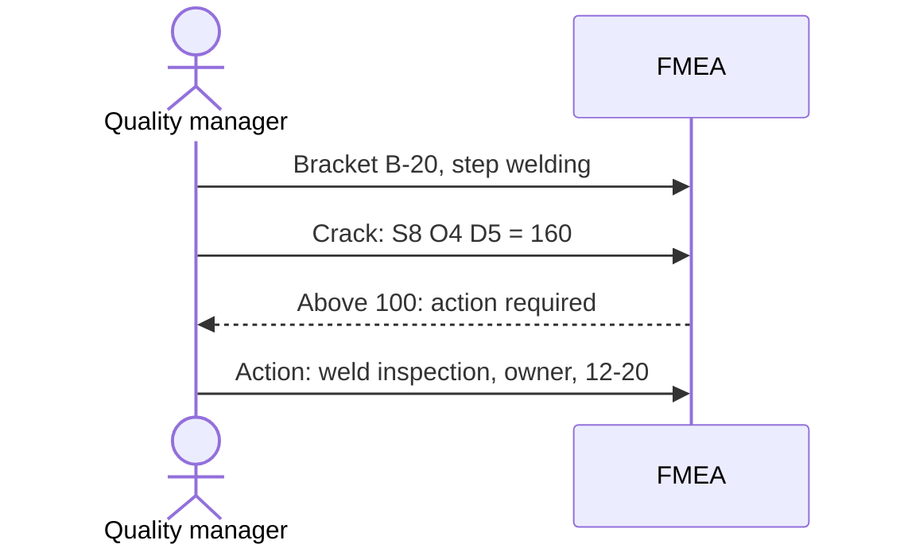

🏠 [Specs](../../../../README.md) › 🧩 [Functional capabilities](../../../README.md) ›
🏭 [F12 Manufacturing (plugin)](../../README.md) › 📝 [Use cases](../README.md) ›
📝 [Use cases: FL-F12-12 Quality engineering](README.md) › 📝 UC-F12-24 Run an FMEA

# 📝 UC-F12-24 Run an FMEA

**Status:** 🔄 waiting for the owner

## Summary

The quality manager analyses a product's or process's failure modes, rates severity, occurrence and detection, and
follows the actions on the highest risks.

## Personas

- [U27 Quality manager](../../../../01-users/personas/u27-quality-manager.md)
- [U21 Production planner](../../../../01-users/personas/u21-production-planner.md)

## Goal

Prevent failures before they reach the customer.

## Trigger

A new product or process; a serious defect.

## Frequency

Per new product; yearly review.

## Preconditions

- The product or routing exists.

## Postconditions

- **Succeeded:** the FMEA is kept with its actions.
- **Failed:** actions overdue are flagged.

## Main flow

1. The quality manager opens FMEA ([S-F12-24](../../screens/12-quality-engineering/s-f12-24-fmea.md)) on a product or a
   routing.
2. For each step: failure mode, effect, cause, current controls.
3. They rate severity, occurrence and detection; the risk priority is computed.
4. Above the bar, an action is required with owner and date
   ([BR-F12-19](../../business-rules/br-f12-19-high-risks-in-an-fmea-need-an-action.md)); after it, the risk is rated
   again.

## Alternative flows

- 4a. A control plan is drawn from the FMEA's controls.

## Error flows

- 4e. An action past its date: flagged.

## Business rules

- [BR-F12-19 High risks in an FMEA need an action](../../business-rules/br-f12-19-high-risks-in-an-fmea-need-an-action.md)

## Entities

- [E-F12-19 FMEA line](../../data/e-f12-19-fmea-line.md)

## Permissions

The quality manager; production planners; operators record.

## Notifications

Owners of actions.

## Audit events

Ratings and actions.

## AI involvement

The AI assistant proposes failure modes from past non-conformities; people rate.

## API, MCP and A2A exposure

T5 operations of F12 with the caller's rights; the MCP tool of F12; no A2A skill.

## Screens

- [S-F12-24 FMEA](../../screens/12-quality-engineering/s-f12-24-fmea.md)

## Flowchart

See [FL-F12-12 Quality engineering](../../flows/fl-f12-12-quality-engineering.md#flowchart).

## Sequence diagram

## Acceptance criteria

1. **Given** a weld crack rated 8, 4 and 5 **when** it is saved **then** its risk priority is 160 and an action is
   required above 100 (Proposed).
2. **Given** the action done and occurrence rated 2 **when** it is re-rated **then** the priority drops to 80.
3. **Given** an action due 12-20 open on 12-21 **when** the date passes **then** it is flagged.

## Non-functional notes

None.

## Regulatory references

(Proposed) to read: IEC 60812 (FMEA).

## Related use cases

- [UC-F12-07 Run quality checks and handle non-conformities](../04-quality-and-maintenance/uc-f12-07-run-quality-checks-and-handle-non-conformities.md)
- [UC-F12-25 Monitor a process with control charts](uc-f12-25-monitor-a-process-with-control-charts.md)

## Open questions

None.

---

⬅️ [UC-F12-23](../11-finite-schedule-and-the-tablet/uc-f12-23-schedule-with-finite-capacity.md) · ⬆️ [Up](README.md) ·
➡️ [UC-F12-25 Monitor a process with control charts](uc-f12-25-monitor-a-process-with-control-charts.md)
