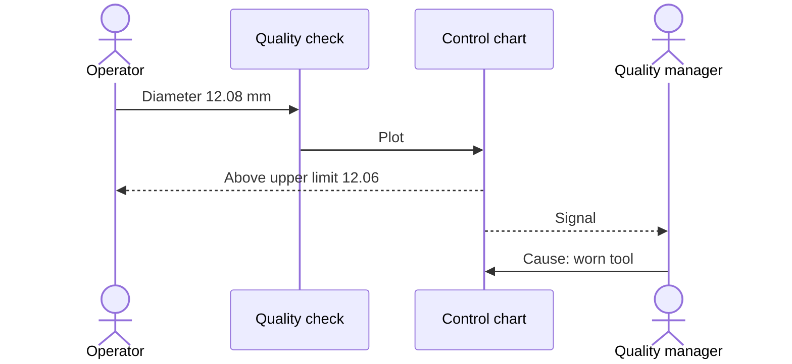

🏠 [Specs](../../../../README.md) › 🧩 [Functional capabilities](../../../README.md) ›
🏭 [F12 Manufacturing (plugin)](../../README.md) › 📝 [Use cases](../README.md) ›
📝 [Use cases: FL-F12-12 Quality engineering](README.md) › 📝 UC-F12-25 Monitor a process with control charts

# 📝 UC-F12-25 Monitor a process with control charts

**Status:** 🔄 waiting for the owner

## Summary

Measures from quality checks feed control charts; signals of a process out of control alert the operator and the quality
manager before defects are made.

## Personas

- [U27 Quality manager](../../../../01-users/personas/u27-quality-manager.md)
- [U20 Production operator](../../../../01-users/personas/u20-production-operator.md)
- [U21 Production planner](../../../../01-users/personas/u21-production-planner.md)

## Goal

Catch drift before it makes scrap.

## Trigger

Measures recorded at a control point.

## Frequency

Every shift.

## Preconditions

- A control point with measures
  ([UC-F12-07](../04-quality-and-maintenance/uc-f12-07-run-quality-checks-and-handle-non-conformities.md)).

## Postconditions

- **Succeeded:** the chart is current; signals are handled.
- **Failed:** a signal not handled stays open.

## Main flow

1. Operators record measures at the control point on the tablet
   ([S-F12-07](../../screens/04-quality-and-maintenance/s-f12-07-quality-checks.md)).
2. simple-ERP computes control limits from the first measures and plots each new one on the control chart
   ([S-F12-25](../../screens/12-quality-engineering/s-f12-25-control-chart.md)).
3. A signal (a point beyond the limits, a run of points on one side) alerts the operator and the quality manager
   ([BR-F12-20](../../business-rules/br-f12-20-out-of-control-signals-alert-at-once.md)).
4. They check the process and record the cause; a real defect opens a non-conformity
   ([UC-F12-07](../04-quality-and-maintenance/uc-f12-07-run-quality-checks-and-handle-non-conformities.md)).

## Alternative flows

- 2a. Limits recomputed after a process change.

## Error flows

- 2e. Fewer than 25 measures (Proposed): limits not computed yet, said so.

## Business rules

- [BR-F12-20 Out-of-control signals alert at once](../../business-rules/br-f12-20-out-of-control-signals-alert-at-once.md)
- [BR-F12-06 A failed check blocks the step](../../business-rules/br-f12-06-a-failed-check-blocks-the-step.md)

## Entities

- [E-F12-20 Control chart](../../data/e-f12-20-control-chart.md)
- [E-F12-07 Quality control point](../../data/e-f12-07-quality-control-point.md)

## Permissions

The quality manager; production planners; operators record.

## Notifications

Operator and quality manager: signals.

## Audit events

Signals and causes.

## AI involvement

The AI assistant prepares it for confirmation
([BR-F3-07](../../../f03-assistant/business-rules/br-f03-07-no-deletes-no-irreversible-acts.md)); figures come from
queries ([BR-F3-03](../../../f03-assistant/business-rules/br-f03-03-figures-come-from-queries.md)).

## API, MCP and A2A exposure

T5 operations of F12 with the caller's rights; the MCP tool of F12; no A2A skill.

## Screens

- [S-F12-25 Control chart](../../screens/12-quality-engineering/s-f12-25-control-chart.md)
- [S-F12-07 Quality checks](../../screens/04-quality-and-maintenance/s-f12-07-quality-checks.md)

## Flowchart

See [FL-F12-12 Quality engineering](../../flows/fl-f12-12-quality-engineering.md#flowchart).

## Sequence diagram

## Acceptance criteria

1. **Given** limits of 11.94 to 12.06 mm **when** 12.08 mm is recorded **then** a signal alerts the operator and the
   quality manager.
2. **Given** 7 points in a row above the mean **when** the seventh is recorded **then** a run signal is raised.
3. **Given** 12 measures only **when** the chart opens **then** it says limits need more measures.

## Non-functional notes

Tablet screens answer within 300 ms (Proposed), offline included,
[UC-F12-26](../11-finite-schedule-and-the-tablet/uc-f12-26-keep-working-on-the-tablet-without-the-network.md).

## Regulatory references

(Proposed) to read: ISO 7870-2 (Shewhart control charts).

## Related use cases

- [UC-F12-07 Run quality checks and handle non-conformities](../04-quality-and-maintenance/uc-f12-07-run-quality-checks-and-handle-non-conformities.md)
- [UC-F12-24 Run an FMEA](uc-f12-24-run-an-fmea.md)

## Open questions

None.

---

⬅️ [UC-F12-24 Run an FMEA](uc-f12-24-run-an-fmea.md) · ⬆️ [Up](README.md) ·
➡️ [UC-F12-26](../11-finite-schedule-and-the-tablet/uc-f12-26-keep-working-on-the-tablet-without-the-network.md)
