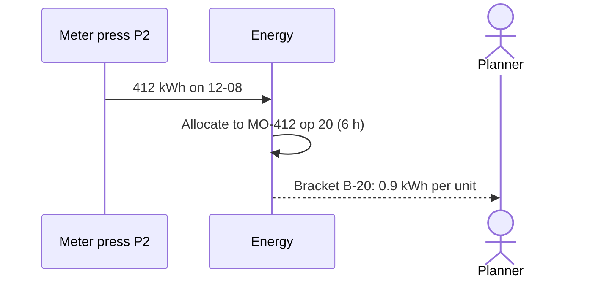

🏠 [Specs](../../../../README.md) › 🧩 [Functional capabilities](../../../README.md) ›
🏭 [F12 Manufacturing (plugin)](../../README.md) › 📝 [Use cases](../README.md) ›
📝 [Use cases: FL-F12-13 Energy, passport and work in progress](README.md) › 📝 UC-F12-29 Measure energy per operation

# 📝 UC-F12-29 Measure energy per operation

**Status:** ✅ specified, ⚖️ lawyer review before launch (D574)

## Summary

Energy from meters and machines is allocated to operations and products, so that the planner and the owner see the
energy and its cost per product.

## Personas

- [U21 Production planner](../../../../01-users/personas/u21-production-planner.md)
- [U13 Owner](../../../../01-users/personas/u13-owner.md)

## Goal

Know what each product costs in energy, and reduce it.

## Trigger

Meters connected; a review.

## Frequency

Monthly reviews.

## Preconditions

- Meters or machine signals ([UC-F12-14](../06-machines-and-oee/uc-f12-14-connect-machines-and-sensors.md)).

## Postconditions

- **Succeeded:** energy per operation and product shown and costed.
- **Failed:** machines without meters use time-based allocation.

## Main flow

1. The planner connects meters per work centre
   ([UC-F12-14](../06-machines-and-oee/uc-f12-14-connect-machines-and-sensors.md)).
2. Energy is allocated to the operations run in each period
   ([BR-F12-24](../../business-rules/br-f12-24-energy-is-allocated-by-meter-else-by-time.md)).
3. Energy per product shows on energy
   ([S-F12-28](../../screens/13-energy-passport-and-work-in-progress/s-f12-28-energy.md)) with its cost.
4. It feeds production costs ([UC-F12-12](../05-subcontracting-and-costs/uc-f12-12-cost-production.md)), the product
   passport ([UC-F12-30](uc-f12-30-build-the-digital-product-passport.md)) and the sustainability report,
   [UC-F8-28](../../../f08-accounting/use-cases/09-pay-analyse-and-report/uc-f08-28-prepare-the-sustainability-report.md).

## Alternative flows

- 2a. Without a meter: allocated by machine time and rated power.

## Error flows

- 1e. A meter stops sending: the gap shows, filled by time-based allocation.

## Business rules

- [BR-F12-24 Energy is allocated by meter, else by time](../../business-rules/br-f12-24-energy-is-allocated-by-meter-else-by-time.md)
- [BR-F12-08 Machine data through connectors](../../business-rules/br-f12-08-machine-data-through-connectors.md)

## Entities

- [E-F12-23 Energy reading](../../data/e-f12-23-energy-reading.md)
- [E-F12-13 Machine signal](../../data/e-f12-13-machine-signal.md)

## Permissions

Production planners; managers; record rules by site. The owner reads.

## Notifications

Planner: meter gaps.

## Audit events

Allocations.

## AI involvement

The AI assistant prepares it for confirmation
([BR-F3-07](../../../f03-assistant/business-rules/br-f03-07-no-deletes-no-irreversible-acts.md)); figures come from
queries ([BR-F3-03](../../../f03-assistant/business-rules/br-f03-03-figures-come-from-queries.md)).

## API, MCP and A2A exposure

T5 operations of F12 with the caller's rights; the MCP tool of F12; no A2A skill.

## Screens

- [S-F12-28 Energy](../../screens/13-energy-passport-and-work-in-progress/s-f12-28-energy.md)

## Flowchart

See
[FL-F12-13 Energy, passport and work in progress](../../flows/fl-f12-13-energy-passport-and-work-in-progress.md#flowchart).

## Sequence diagram

## Acceptance criteria

1. **Given** press P2 using 412 kWh on 12-08 for 3 orders **when** energy is allocated **then** each order gets its
   share by run time.
2. **Given** a machine without a meter rated 15 kW running 4 hours **when** it is allocated **then** 60 kWh is used.
3. **Given** energy at 0.18 EUR per kWh **when** the product view opens **then** the cost per unit shows.

## Non-functional notes

None.

## Regulatory references

(⚖️ lawyer review before launch, D574) to read: the energy audit duties of the Code de l'énergie (L233-1 to L233-4).

## Related use cases

- [UC-F12-12 Cost production](../05-subcontracting-and-costs/uc-f12-12-cost-production.md)
- [UC-F12-30 Build the digital product passport](uc-f12-30-build-the-digital-product-passport.md)

## Open questions

None.

---

⬅️ [UC-F12-28](../10-people-and-tools/uc-f12-28-publish-versioned-work-instructions.md) · ⬆️ [Up](README.md) ·
➡️ [UC-F12-30 Build the digital product passport](uc-f12-30-build-the-digital-product-passport.md)
