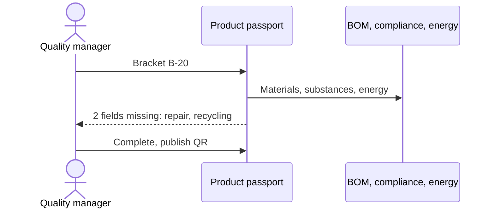

🏠 [Specs](../../../../README.md) › 🧩 [Functional capabilities](../../../README.md) ›
🏭 [F12 Manufacturing (plugin)](../../README.md) › 📝 [Use cases](../README.md) ›
📝 [Use cases: FL-F12-13 Energy, passport and work in progress](README.md) ›
📝 UC-F12-30 Build the digital product passport

# 📝 UC-F12-30 Build the digital product passport

**Status:** 🔄 waiting for the owner

## Summary

The quality manager builds a product's digital passport from production records (materials, origin, energy, substances,
repair and recycling information) and publishes it behind the product's identifier.

## Personas

- [U27 Quality manager](../../../../01-users/personas/u27-quality-manager.md)
- [U21 Production planner](../../../../01-users/personas/u21-production-planner.md)
- [U09 Customer](../../../../01-users/personas/u09-customer.md)

## Goal

Meet passport requirements from data already in SimpleERP.

## Trigger

A product category becomes subject to a passport; a new product.

## Frequency

Per product.

## Preconditions

- The product's compliance file ([UC-F12-16](../07-compliance-and-safety/uc-f12-16-record-product-compliance.md)).

## Postconditions

- **Succeeded:** the passport is published behind its identifier.
- **Failed:** missing data is listed.

## Main flow

1. The quality manager opens product passport
   ([S-F12-29](../../screens/13-energy-passport-and-work-in-progress/s-f12-29-product-passport.md)) for a product.
2. SimpleERP fills what it holds: materials from the bill of materials, substances
   ([CR-FR-077](../../../../10-country-packs/france/products/cr-fr-077-reach-svhc-information.md)), energy per unit
   ([UC-F12-29](uc-f12-29-measure-energy-per-operation.md)), origin of components
   ([BR-F12-25](../../business-rules/br-f12-25-passport-data-come-from-records-with-their-source.md)).
3. Missing data are listed; the quality manager completes them (repair, recycling).
4. The passport is published with a QR code; customers read it by scanning.

## Alternative flows

- 4a. A new version when the product changes.

## Error flows

- 3e. Required data missing for the category: not published.

## Business rules

- [BR-F12-25 Passport data come from records with their source](../../business-rules/br-f12-25-passport-data-come-from-records-with-their-source.md)
- [BR-F12-13 A compliance file per product](../../business-rules/br-f12-13-a-compliance-file-per-product.md)

## Entities

- [E-F12-24 Product passport](../../data/e-f12-24-product-passport.md)
- [E-F12-14 Product compliance file](../../data/e-f12-14-product-compliance-file.md)

## Permissions

The quality manager; production planners; operators record.

## Notifications

Quality manager: missing data.

## Audit events

Versions published.

## AI involvement

The AI assistant prepares it for confirmation
([BR-F3-07](../../../f03-assistant/business-rules/br-f03-07-no-deletes-no-irreversible-acts.md)); figures come from
queries ([BR-F3-03](../../../f03-assistant/business-rules/br-f03-03-figures-come-from-queries.md)).

## API, MCP and A2A exposure

T5 operations of F12 with the caller's rights; the MCP tool of F12; no A2A skill.

## Screens

- [S-F12-29 Product passport](../../screens/13-energy-passport-and-work-in-progress/s-f12-29-product-passport.md)

## Flowchart

See
[FL-F12-13 Energy, passport and work in progress](../../flows/fl-f12-13-energy-passport-and-work-in-progress.md#flowchart).

## Sequence diagram

## Acceptance criteria

1. **Given** bracket B-20 with its bill of materials and compliance file **when** the passport is built **then**
   materials, substances and energy per unit are filled.
2. **Given** repair information missing **when** publish is asked **then** it is refused with the field.
3. **Given** a published passport **when** a customer scans the QR code **then** she reads it.

## Non-functional notes

None.

## Regulatory references

(Proposed) to read: Regulation (EU) 2024/1781 (ESPR).

## Related use cases

- [UC-F12-16 Record product compliance](../07-compliance-and-safety/uc-f12-16-record-product-compliance.md)
- [UC-F12-29 Measure energy per operation](uc-f12-29-measure-energy-per-operation.md)

## Open questions

None.

---

⬅️ [UC-F12-29 Measure energy per operation](uc-f12-29-measure-energy-per-operation.md) · ⬆️ [Up](README.md) ·
➡️ [UC-F12-31](../09-recipes-and-batches/uc-f12-31-define-a-recipe-and-produce-in-batches.md)
