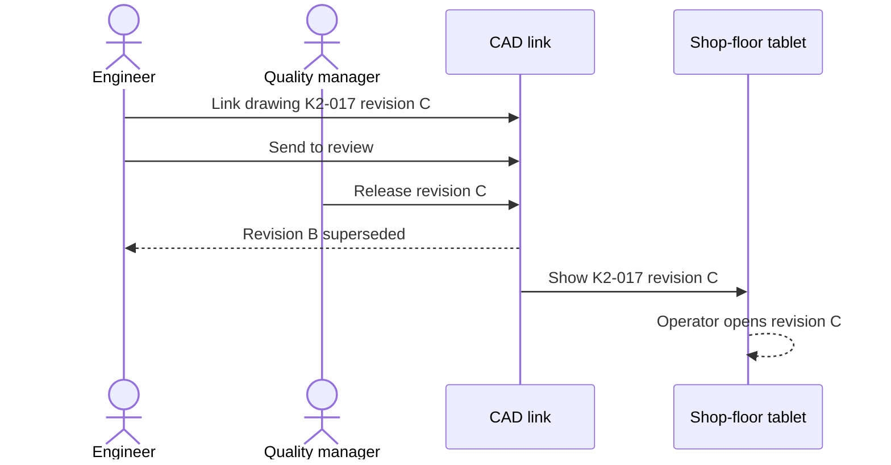

🏠 [Specs](../../../../README.md) › 🧩 [Functional capabilities](../../../README.md) ›
🏭 [F12 Manufacturing (plugin)](../../README.md) › 📝 [Use cases](../README.md) › 📝 [Use cases: FL-F12-14](README.md) ›
📝 UC-F12-32 Link CAD files and revisions

# 📝 UC-F12-32 Link CAD files and revisions

**Status:** ✅ specified

## Summary

The drawings, 3D models and specifications of a product live in the company's CAD or document store. simple-ERP links
each file, by its reference and revision, to the product, its bill of materials and its routing. A revision becomes
visible on the shop floor only when the quality manager has released it; older revisions are marked superseded, and a
work order shows the released revision that was current when it started.

## Personas

- [U27 Quality manager](../../../../01-users/personas/u27-quality-manager.md), who reviews and releases revisions
- [U21 Production planner](../../../../01-users/personas/u21-production-planner.md), who checks which revision the plan
  uses

## Goal

The shop floor works from the right drawing, and nobody builds from a revision that was not released.

## Trigger

A new or changed drawing is linked, or an engineering change asks for a new revision.

## Frequency

A few revisions a week in a running workshop.

## Preconditions

- The file store is connected ([UC-F12-14](../06-machines-and-oee/uc-f12-14-connect-machines-and-sensors.md)).
- The product, its bill of materials and routing exist
  ([E-F12-01 Bill of materials](../../data/e-f12-01-bill-of-materials.md),
  [E-F12-03 Routing operation](../../data/e-f12-03-routing-operation.md)).
- The quality manager may release revisions ([E-F1-06 Role](../../../f01-administration/data/e-f01-06-role.md)).

## Postconditions

- **Succeeded:** the revision is released and shown on the tablets and the instructions, and the old one is superseded
  ([E-F12-30 CAD document](../../data/e-f12-30-cad-document.md)).
- **Failed:** the revision stays in draft or in review and is not shown on the shop floor.

## Main flow

1. The engineer or planner opens CAD link ([S-F12-31](../../screens/14-cad-kanban-mps-and-tools/s-f12-31-cad-link.md))
   and links a file from the store by its reference and revision to a product, a bill of materials or a routing step.
2. The screen shows the preview, the file's format and size, and the revisions already linked.
3. The revision is sent to review; the reviewer compares it with the previous one and sends it back or approves.
4. The quality manager releases the revision
   ([BR-F12-27](../../business-rules/br-f12-27-only-released-revisions-reach-the-shop-floor.md)); the previous released
   revision becomes superseded.
5. Tablets and work instructions show the released revision
   ([UC-F12-28](../10-people-and-tools/uc-f12-28-publish-versioned-work-instructions.md)); an engineering change links
   to the new revision ([UC-F12-10](../01-define-the-products/uc-f12-10-manage-engineering-changes.md)).
6. A work order records the revision in force at its start, so what was built can be traced back to its drawing
   ([BR-F12-02](../../business-rules/br-f12-02-an-order-keeps-its-versions.md)).

## Alternative flows

- 1a. A file is linked to several products: each link has its own state.
- 4a. A revision is withdrawn (an error found): the last released revision stays, or none, and the work orders that used
  it are flagged.
- 5a. A file exists only as a read-only PDF: the shop floor sees the PDF, not the CAD file.

## Error flows

- 1e. The file is not found in the store: the link is not created and the reference is shown.
- 4e. The revision is released by someone other than a person with the right: refused
  ([BR-F12-27](../../business-rules/br-f12-27-only-released-revisions-reach-the-shop-floor.md)).
- 5e. The store is down: the tablet shows the last downloaded released revision with its date.
- Any step: a service does not answer; the call is retried first
  ([BR-F3-32](../../../f03-assistant/business-rules/br-f03-32-retry-before-an-error.md)), then the message follows the
  error pattern ([D122](../../../../06-decisions/ux/d122-error-message-standard.md)) and the previous released revision
  stays in force.

## Business rules

- [BR-F12-27 Only released revisions reach the shop floor](../../business-rules/br-f12-27-only-released-revisions-reach-the-shop-floor.md)
- [BR-F12-02 An order keeps its versions](../../business-rules/br-f12-02-an-order-keeps-its-versions.md)
- [BR-F12-06 A failed check blocks the step](../../business-rules/br-f12-06-a-failed-check-blocks-the-step.md)

## Entities

- [E-F12-30 CAD document](../../data/e-f12-30-cad-document.md): created, reviewed, released, superseded, withdrawn
- [E-F12-01 Bill of materials](../../data/e-f12-01-bill-of-materials.md): read
- [E-F12-03 Routing operation](../../data/e-f12-03-routing-operation.md): read
- [E-F12-11 Engineering change](../../data/e-f12-11-engineering-change.md): read
- [E-F12-22 Work instruction version](../../data/e-f12-22-work-instruction-version.md): read

## Permissions

Engineers and planners link files and send them to review. Only the quality manager releases or withdraws. Operators see
released revisions of the work they are on.

## Notifications

- The reviewer, in the app: a revision to review.
- The planner and the operators on affected orders: a new revision released.

## Audit events

Link created, reviewed, released, superseded and withdrawn, with the revision, the reviewer and the work orders that
used it.

## AI involvement

The AI assistant may summarise the difference between two revisions from their metadata, flagged as AI
([BR-F9-12](../../../f09-hr-and-projects/business-rules/br-f09-12-ai-calls-say-they-are-ai.md)); it never releases a
revision.

## API, MCP and A2A exposure

T5 operations on CAD links; the file store connector uses a credential from the secret store; no MCP tool releases and
no A2A skill.

## Screens

- [S-F12-31 CAD link](../../screens/14-cad-kanban-mps-and-tools/s-f12-31-cad-link.md)

## Flowchart

See [FL-F12-14 CAD, kanban, MPS and tools](../../flows/fl-f12-14-cad-kanban-mps-and-tools.md#flowchart).

## Sequence diagram

## Acceptance criteria

1. **Given** a revision in review **when** an operator opens the tablet **then** they see the previous released
   revision.
2. **Given** a revision released **when** the operator opens the tablet **then** they see the new revision.
3. **Given** a revision B released then C **when** C is released **then** B is superseded.
4. **Given** someone without the right **when** they try to release **then** it is refused.
5. **Given** a work order started on revision B **when** C is released **then** the order still shows B.

## Non-functional notes

A released revision reaches the tablets within 1 minute; the preview opens in under 3 seconds.

## Regulatory references

Product records and their drawings support the product's technical file
([UC-F12-16](../07-compliance-and-safety/uc-f12-16-record-product-compliance.md)) and, for machinery, the conformity
file ([CR-FR-074](../../../../10-country-packs/france/products/cr-fr-074-machinery-conformity.md)).

## Related use cases

- [UC-F12-01 Define bills of materials](../01-define-the-products/uc-f12-01-define-bills-of-materials.md)
- [UC-F12-10 Manage engineering changes](../01-define-the-products/uc-f12-10-manage-engineering-changes.md)
- [UC-F12-28 Publish versioned work instructions](../10-people-and-tools/uc-f12-28-publish-versioned-work-instructions.md)
- [UC-F12-05 Work on the shop-floor tablet](../03-make-the-products/uc-f12-05-work-on-the-shop-floor-tablet.md)

## Open questions

None.

---

⬅️ [UC-F12-31](../09-recipes-and-batches/uc-f12-31-define-a-recipe-and-produce-in-batches.md) · ⬆️ [Up](README.md) ·
➡️ [UC-F12-33 Replenish with kanban cards](uc-f12-33-replenish-with-kanban-cards.md)
