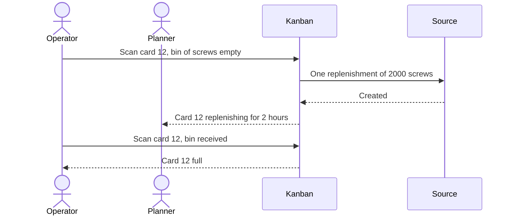

🏠 [Specs](../../../../README.md) › 🧩 [Functional capabilities](../../../README.md) ›
🏭 [F12 Manufacturing (plugin)](../../README.md) › 📝 [Use cases](../README.md) › 📝 [Use cases: FL-F12-14](README.md) ›
📝 UC-F12-33 Replenish with kanban cards

# 📝 UC-F12-33 Replenish with kanban cards

**Status:** ✅ specified

## Summary

A kanban card stands for a container of an item at a point of use. When the operator empties the container, scanning its
card on the tablet triggers one replenishment: a production order for a made item, a purchase request for a bought one,
or a transfer from the store. The planner sizes the number of cards from the consumption and the lead time and sees
where cards wait.

## Personas

- [U20 Production operator](../../../../01-users/personas/u20-production-operator.md), who scans the empty containers,
  on a tablet
- [U21 Production planner](../../../../01-users/personas/u21-production-planner.md), who sizes and follows the cards

## Goal

Material is replenished by what is consumed, with no list to prepare and no stock-out at the line.

## Trigger

An operator empties a container and scans its card.

## Frequency

Many times a shift on lines that run on kanban.

## Preconditions

- The item and its source are set: made, bought or transferred
  ([E-F7-06 Item](../../../f07-purchasing-and-stock/data/e-f07-06-item.md),
  [E-F7-09 Reordering rule](../../../f07-purchasing-and-stock/data/e-f07-09-reordering-rule.md)).
- The card is printed or shown on the tablet with its container size and location
  ([E-F12-31 Kanban card](../../data/e-f12-31-kanban-card.md)).
- The operator works at a station on the tablet
  ([UC-F12-05](../03-make-the-products/uc-f12-05-work-on-the-shop-floor-tablet.md)).

## Postconditions

- **Succeeded:** one replenishment is created for the card and, once received, the card is Full again
  ([E-F12-31 Kanban card](../../data/e-f12-31-kanban-card.md)).
- **Failed:** no replenishment is created twice and the card shows where it is stuck.

## Main flow

1. The planner opens Kanban ([S-F12-32](../../screens/14-cad-kanban-mps-and-tools/s-f12-32-kanban.md)), creates a card
   for an item at a location with a container size and a source, and prints it.
2. The operator empties the container and scans the card on the tablet; the card becomes Empty.
3. One replenishment is created from the card's source and the card becomes Replenishing
   ([BR-F12-28](../../business-rules/br-f12-28-a-card-triggers-one-replenishment.md)).
4. The container arrives; the operator scans the card again to confirm receipt and the card is Full.
5. The screen shows each card's state and the time it has waited; cards waiting too long are flagged.
6. The planner adjusts the number of cards for an item from the consumption and the lead time shown, or suspends a card.

## Alternative flows

- 2a. An operator scans an empty container with no network: the scan is kept on the tablet and sent on reconnect, in
  order ([BR-F12-21](../../business-rules/br-f12-21-tablet-records-sync-in-order.md)).
- 3a. The source is a supplier: a purchase request is created and follows the purchase flow.
- 5a. A card is lost: the planner marks it retired and prints a new one.

## Error flows

- 2e. The card is scanned twice while Empty or Replenishing: no second replenishment is made
  ([BR-F12-28](../../business-rules/br-f12-28-a-card-triggers-one-replenishment.md)).
- 4e. A scanned card does not match the container or the location: refused with the card's data.
- 3e. The source has no stock or capacity: the replenishment is created and shown late.
- Any step: a service does not answer; the call is retried first
  ([BR-F3-32](../../../f03-assistant/business-rules/br-f03-32-retry-before-an-error.md)), then the message follows the
  error pattern ([D122](../../../../06-decisions/ux/d122-error-message-standard.md)) and the card stays as it was.

## Business rules

- [BR-F12-28 A card triggers one replenishment](../../business-rules/br-f12-28-a-card-triggers-one-replenishment.md)
- [BR-F12-21 Tablet records sync in order](../../business-rules/br-f12-21-tablet-records-sync-in-order.md)
- [BR-F12-05 Consumption never below zero](../../business-rules/br-f12-05-consumption-never-below-zero.md)

## Entities

- [E-F12-31 Kanban card](../../data/e-f12-31-kanban-card.md): created, emptied, replenishing, full, suspended, retired
- [E-F7-06 Item](../../../f07-purchasing-and-stock/data/e-f07-06-item.md): read
- [E-F7-09 Reordering rule](../../../f07-purchasing-and-stock/data/e-f07-09-reordering-rule.md): read
- [E-F12-04 Manufacturing order](../../data/e-f12-04-manufacturing-order.md): created for a made item
- [E-F7-02 Purchase request](../../../f07-purchasing-and-stock/data/e-f07-02-purchase-request.md): created for a bought
  item
- [E-F7-04 Transfer](../../../f07-purchasing-and-stock/data/e-f07-04-transfer.md): created for a transfer

## Permissions

Operators scan the cards of their station. The planner creates, sizes, suspends and retires cards. The buyer sees the
purchase requests that cards create.

## Notifications

- The planner, in the app: cards waiting too long.
- The buyer, in the app: a purchase request from a card.

## Audit events

Card created, emptied, replenishing, full, suspended and retired, with the scan and the replenishment created.

## AI involvement

The AI assistant may suggest the number of cards of an item from the consumption, flagged as AI
([BR-F9-12](../../../f09-hr-and-projects/business-rules/br-f09-12-ai-calls-say-they-are-ai.md)); the planner decides.

## API, MCP and A2A exposure

T5 operations on cards and scans; a read MCP tool for cards waiting; no A2A skill.

## Screens

- [S-F12-32 Kanban](../../screens/14-cad-kanban-mps-and-tools/s-f12-32-kanban.md)

## Flowchart

See [FL-F12-14 CAD, kanban, MPS and tools](../../flows/fl-f12-14-cad-kanban-mps-and-tools.md#flowchart).

## Sequence diagram

## Acceptance criteria

1. **Given** a full card **when** the operator scans it empty **then** one replenishment is created.
2. **Given** a card already replenishing **when** it is scanned again as empty **then** no second replenishment is
   created.
3. **Given** a container received **when** the card is scanned **then** it is Full.
4. **Given** no network **when** the operator scans an empty card **then** it is kept and sent when the network returns.
5. **Given** a card waiting 4 hours with a lead time of 2 **when** the planner opens the screen **then** it is flagged.

## Non-functional notes

A scan creates its replenishment in under 2 seconds, also after a reconnect.

## Regulatory references

No regulatory reference: the replenishment follows the stock and purchase rules of the source.

## Related use cases

- [UC-F12-05 Work on the shop-floor tablet](../03-make-the-products/uc-f12-05-work-on-the-shop-floor-tablet.md)
- [UC-F12-03 Plan production](../02-plan-production/uc-f12-03-plan-production.md)
- [UC-F12-15 Pick and stage components](../02-plan-production/uc-f12-15-pick-and-stage-components.md)
- [UC-F12-26 Keep working on the tablet without the network](../11-finite-schedule-and-the-tablet/uc-f12-26-keep-working-on-the-tablet-without-the-network.md)

## Open questions

None.

---

⬅️ [UC-F12-32 Link CAD files and revisions](uc-f12-32-link-cad-files-and-revisions.md) · ⬆️ [Up](README.md) ·
➡️ [UC-F12-34 Run the master production schedule](uc-f12-34-run-the-master-production-schedule.md)
