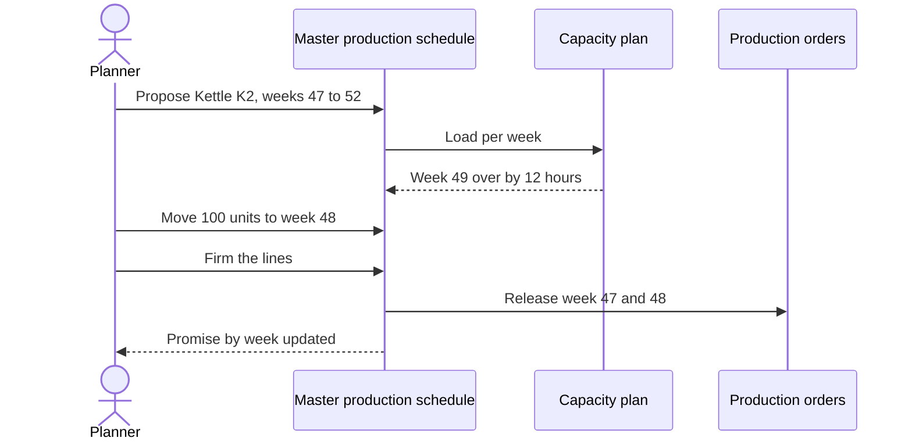

🏠 [Specs](../../../../README.md) › 🧩 [Functional capabilities](../../../README.md) ›
🏭 [F12 Manufacturing (plugin)](../../README.md) › 📝 [Use cases](../README.md) › 📝 [Use cases: FL-F12-14](README.md) ›
📝 UC-F12-34 Run the master production schedule

# 📝 UC-F12-34 Run the master production schedule

**Status:** ✅ specified

## Summary

The master production schedule turns the forecast and the firm orders into the quantity of each finished product to make
in each week, over a horizon of months. The planner sees forecast, firm demand, planned production and what can be
promised to customers, checks each week against the capacity of the plant, firms the lines, and releases them as
production orders. Lines near today are frozen against change.

## Personas

- [U21 Production planner](../../../../01-users/personas/u21-production-planner.md), the planner, on a desktop

## Goal

Production is planned months ahead within what the plant can do, and sales can promise dates they can keep.

## Trigger

The weekly planning meeting, a large order, or a change of forecast.

## Frequency

Weekly.

## Preconditions

- Products have bills of materials and routings ([E-F12-01 Bill of materials](../../data/e-f12-01-bill-of-materials.md),
  [E-F12-03 Routing operation](../../data/e-f12-03-routing-operation.md)).
- Forecasts and firm orders exist
  ([E-F7-21 Demand forecast](../../../f07-purchasing-and-stock/data/e-f07-21-demand-forecast.md),
  [E-F6-04 Order](../../../f06-customers-and-sales/data/e-f06-04-order.md)).
- Capacity per work centre is known ([E-F12-02 Work centre](../../data/e-f12-02-work-centre.md),
  [UC-F12-23](../11-finite-schedule-and-the-tablet/uc-f12-23-schedule-with-finite-capacity.md)).

## Postconditions

- **Succeeded:** the lines are firm within capacity and released as production orders, and available-to-promise is shown
  to sales ([E-F12-32 MPS line](../../data/e-f12-32-mps-line.md)).
- **Failed:** the lines stay in draft and the weeks over capacity are shown with the gap.

## Main flow

1. The planner opens the master production schedule
   ([S-F12-33](../../screens/14-cad-kanban-mps-and-tools/s-f12-33-mps.md)) and sees, per product and week, the forecast,
   the firm orders, the planned production and the stock projected.
2. The plan lines of the period ([E-F12-12 Master plan line](../../data/e-f12-12-master-plan-line.md)) are proposed as
   draft lines for the horizon; the planner changes the quantities.
3. Each week shows the load against the capacity plan; a week over capacity is flagged with the hours missing
   ([BR-F12-29](../../business-rules/br-f12-29-the-mps-stays-within-the-capacity-plan.md)).
4. The planner moves quantities to other weeks, adds shifts or subcontracting until the weeks fit, and firms the lines.
5. Firm lines inside the release fence are released as production orders
   ([UC-F12-04](../03-make-the-products/uc-f12-04-launch-and-follow-manufacturing-orders.md)); lines inside the frozen
   fence cannot be changed without a reason.
6. Sales see available-to-promise by week to answer a customer's date.

## Alternative flows

- 3a. A week stays over capacity: the line is firmed only with the planner's note and the over load is shown on the
  line.
- 5a. A large urgent order arrives: the planner reopens a firm line outside the frozen fence.
- 6a. A customer asks for an earlier date: sales see the first week with promise left.

## Error flows

- 4e. A line is firmed in a week over capacity without a note: refused
  ([BR-F12-29](../../business-rules/br-f12-29-the-mps-stays-within-the-capacity-plan.md)).
- 5e. A line in the frozen fence is changed without a reason: refused and audited.
- 1e. A product has no routing: its load cannot be computed and it is flagged.
- Any step: a service does not answer; the call is retried first
  ([BR-F3-32](../../../f03-assistant/business-rules/br-f03-32-retry-before-an-error.md)), then the message follows the
  error pattern ([D122](../../../../06-decisions/ux/d122-error-message-standard.md)) and the schedule stays as it was.

## Business rules

- [BR-F12-29 The MPS stays within the capacity plan](../../business-rules/br-f12-29-the-mps-stays-within-the-capacity-plan.md)
- [BR-F12-18 The schedule never exceeds capacity](../../business-rules/br-f12-18-the-schedule-never-exceeds-capacity.md)
- [BR-F12-02 An order keeps its versions](../../business-rules/br-f12-02-an-order-keeps-its-versions.md)

## Entities

- [E-F12-32 MPS line](../../data/e-f12-32-mps-line.md): created, firmed, released, closed
- [E-F12-12 Master plan line](../../data/e-f12-12-master-plan-line.md): read, as the plan line
- [E-F12-02 Work centre](../../data/e-f12-02-work-centre.md): read, for the capacity
- [E-F12-04 Manufacturing order](../../data/e-f12-04-manufacturing-order.md): created at release
- [E-F7-21 Demand forecast](../../../f07-purchasing-and-stock/data/e-f07-21-demand-forecast.md): read, for the forecast

## Permissions

The planner builds and firms the schedule. Sales read available-to-promise. The plant manager reads the load.

## Notifications

- The planner, in the app: a week over capacity after a new order.
- Sales, in the app: promise changed for a week.

## Audit events

Line created, firmed, reopened, released and closed, with the quantities, the capacity at that time and any note on an
over-capacity week.

## AI involvement

The AI assistant may propose a levelled schedule that fits the capacity, flagged as AI
([BR-F9-12](../../../f09-hr-and-projects/business-rules/br-f09-12-ai-calls-say-they-are-ai.md)); the planner firms it.

## API, MCP and A2A exposure

T5 operations on the schedule for the planner and the sales app; a read MCP tool for available-to-promise; no A2A skill.

## Screens

- [S-F12-33 MPS](../../screens/14-cad-kanban-mps-and-tools/s-f12-33-mps.md)

## Flowchart

See [FL-F12-14 CAD, kanban, MPS and tools](../../flows/fl-f12-14-cad-kanban-mps-and-tools.md#flowchart).

## Sequence diagram

## Acceptance criteria

1. **Given** a week with a load of 112 hours and a capacity of 100 **when** the planner opens it **then** it is flagged
   12 hours over.
2. **Given** a week over capacity **when** the planner firms it without a note **then** it is refused.
3. **Given** a line in the frozen fence **when** it is changed without a reason **then** it is refused.
4. **Given** firm lines released **when** the planner opens production orders **then** the orders exist for the
   quantities.
5. **Given** a firm order of 50 units **when** sales open promise **then** the promise of the week is reduced by 50.

## Non-functional notes

A schedule of 200 products over 26 weeks loads in under 3 seconds with the load per week.

## Regulatory references

No regulatory reference: the schedule follows the company's own capacity and orders.

## Related use cases

- [UC-F12-03 Plan production](../02-plan-production/uc-f12-03-plan-production.md)
- [UC-F12-23 Schedule with finite capacity](../11-finite-schedule-and-the-tablet/uc-f12-23-schedule-with-finite-capacity.md)
- [UC-F12-04 Launch and follow manufacturing orders](../03-make-the-products/uc-f12-04-launch-and-follow-manufacturing-orders.md)
- [UC-F7-07 Count stock](../../../f07-purchasing-and-stock/use-cases/05-count-trace-and-analyse/uc-f07-07-count-stock.md)

## Open questions

None.

---

⬅️ [UC-F12-33 Replenish with kanban cards](uc-f12-33-replenish-with-kanban-cards.md) · ⬆️ [Up](README.md) ·
➡️ [UC-F12-35 Manage tools and moulds](uc-f12-35-manage-tools-and-moulds.md)
