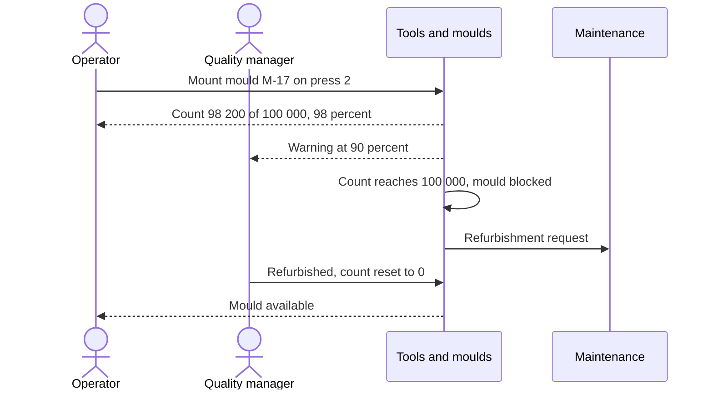

🏠 [Specs](../../../../README.md) › 🧩 [Functional capabilities](../../../README.md) ›
🏭 [F12 Manufacturing (plugin)](../../README.md) › 📝 [Use cases](../README.md) › 📝 [Use cases: FL-F12-14](README.md) ›
📝 UC-F12-35 Manage tools and moulds

# 📝 UC-F12-35 Manage tools and moulds

**Status:** ✅ specified

## Summary

Tools, moulds, dies and fixtures are registered with a life limit in shots or cycles. The operator mounts a tool on a
work centre on the tablet; every production order made with it adds its quantity to the tool's count. A tool warns at 90
percent of its life and is blocked at the limit until it has been refurbished, and the quality manager sees the counts,
the services and the tools near the end of their life.

## Personas

- [U20 Production operator](../../../../01-users/personas/u20-production-operator.md), who mounts the tools and sees
  their counts, on a tablet
- [U27 Quality manager](../../../../01-users/personas/u27-quality-manager.md), who follows life, services and blocked
  tools, on a desktop

## Goal

No part is made with a worn tool, and refurbishment is planned before the tool stops the line.

## Trigger

An operator mounts a tool, a production order adds to its count, or the count nears its limit.

## Frequency

At every set-up for the operator; weekly for the quality manager.

## Preconditions

- The tool is registered with its life limit ([E-F12-33 Tool](../../data/e-f12-33-tool.md)).
- The work centre where it is used exists ([E-F12-02 Work centre](../../data/e-f12-02-work-centre.md)).
- Maintenance is set up for equipment ([UC-F12-08](../04-quality-and-maintenance/uc-f12-08-maintain-equipment.md)).

## Postconditions

- **Succeeded:** the tool is used within its life, its count is kept and a refurbishment is planned before the limit
  ([E-F12-33 Tool](../../data/e-f12-33-tool.md)).
- **Failed:** the tool is blocked and cannot be mounted until it is refurbished.

## Main flow

1. The quality manager registers the tool on Tools and moulds
   ([S-F12-34](../../screens/14-cad-kanban-mps-and-tools/s-f12-34-tools-and-moulds.md)) with its kind, life limit and
   service interval.
2. The operator mounts the tool on a work centre on the tablet; it must be Available.
3. Each production order made with the tool adds its produced quantity to the tool's count, from the recorded quantity
   or the machine's signal ([UC-F12-14](../06-machines-and-oee/uc-f12-14-connect-machines-and-sensors.md)).
4. At 90 percent of the limit, the operator and the quality manager are warned and a refurbishment is proposed.
5. At the limit the tool is Blocked
   ([BR-F12-30](../../business-rules/br-f12-30-a-tool-past-its-life-count-is-blocked.md)); a maintenance request is
   opened ([UC-F12-08](../04-quality-and-maintenance/uc-f12-08-maintain-equipment.md)).
6. After the refurbishment the count is reset, with a note, and the tool is Available; a tool beyond repair is retired.

## Alternative flows

- 2a. A tool is shared between work centres: it can be mounted on one at a time.
- 4a. A planned service by date, before the limit, takes the tool out of use for the service.
- 5a. The quality manager extends the limit once after an inspection, with the reason.

## Error flows

- 2e. The operator mounts a blocked tool: refused with the count and the limit
  ([BR-F12-30](../../business-rules/br-f12-30-a-tool-past-its-life-count-is-blocked.md)).
- 3e. The count cannot be read from the machine: the operator types the quantity and it is marked as typed.
- 5e. A reset without a refurbishment note: refused.
- Any step: a service does not answer; the call is retried first
  ([BR-F3-32](../../../f03-assistant/business-rules/br-f03-32-retry-before-an-error.md)), then the message follows the
  error pattern ([D122](../../../../06-decisions/ux/d122-error-message-standard.md)) and the tool stays blocked with its
  count.

## Business rules

- [BR-F12-30 A tool past its life count is blocked](../../business-rules/br-f12-30-a-tool-past-its-life-count-is-blocked.md)
- [BR-F12-09 Equipment checks before use](../../business-rules/br-f12-09-equipment-checks-before-use.md)
- [BR-F12-17 Operators sign in only where qualified](../../business-rules/br-f12-17-operators-sign-in-only-where-qualified.md)

## Entities

- [E-F12-33 Tool](../../data/e-f12-33-tool.md): registered, mounted, counted, blocked, refurbished, retired
- [E-F12-02 Work centre](../../data/e-f12-02-work-centre.md): read
- [E-F12-05 Work order](../../data/e-f12-05-work-order.md): read, for the quantity
- [E-F12-10 Maintenance request](../../data/e-f12-10-maintenance-request.md): created for a refurbishment
- [E-F12-13 Machine signal](../../data/e-f12-13-machine-signal.md): read, for the count

## Permissions

Operators mount and unmount tools at their station. The quality manager registers, extends, resets and retires. The
planner sees which tools are available.

## Notifications

- The operator and the quality manager, on the tablet and in the app: a tool at 90 percent of its life or blocked.

## Audit events

Tool registered, mounted, unmounted, counted, blocked, extended, reset and retired, with the quantity, the order and who
did it.

## AI involvement

None: the life limit and the block are rules, not decisions of the AI assistant.

## API, MCP and A2A exposure

T5 operations on tools for the tablet and the quality manager; a read MCP tool for tools near the end of their life; no
A2A skill.

## Screens

- [S-F12-34 Tools and moulds](../../screens/14-cad-kanban-mps-and-tools/s-f12-34-tools-and-moulds.md)

## Flowchart

See [FL-F12-14 CAD, kanban, MPS and tools](../../flows/fl-f12-14-cad-kanban-mps-and-tools.md#flowchart).

## Sequence diagram

## Acceptance criteria

1. **Given** a mould with a limit of 100 000 shots **when** the count reaches 90 000 **then** operator and quality
   manager are warned.
2. **Given** the count reaches 100 000 **when** an operator mounts the mould **then** it is refused, the mould is
   blocked.
3. **Given** a refurbished mould **when** the count is reset with a note **then** the mould is available.
4. **Given** a reset without a note **when** the quality manager saves it **then** it is refused.
5. **Given** a mould mounted on press 2 **when** another operator mounts it on press 3 **then** it is refused.

## Non-functional notes

The count is updated within 5 seconds of a production quantity being recorded.

## Regulatory references

Tools used on machinery keep their maintenance records with the equipment
([BR-F12-09](../../business-rules/br-f12-09-equipment-checks-before-use.md));
[CR-FR-074](../../../../10-country-packs/france/products/cr-fr-074-machinery-conformity.md) applies to the machine, not
to the tool.

## Related use cases

- [UC-F12-08 Maintain equipment](../04-quality-and-maintenance/uc-f12-08-maintain-equipment.md)
- [UC-F12-05 Work on the shop-floor tablet](../03-make-the-products/uc-f12-05-work-on-the-shop-floor-tablet.md)
- [UC-F12-14 Connect machines and sensors](../06-machines-and-oee/uc-f12-14-connect-machines-and-sensors.md)
- [UC-F12-22 Require operator qualifications per work centre](../10-people-and-tools/uc-f12-22-require-operator-qualifications-per-work-centre.md)

## Open questions

None.

---

⬅️ [UC-F12-34 Run the master production schedule](uc-f12-34-run-the-master-production-schedule.md) ·
⬆️ [Up](README.md)
