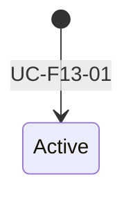

🏠 [Specs](../../../README.md) › 🧩 [Functional capabilities](../../README.md) › 💶 [F13 Payroll (plugin)](../README.md) ›
🗃️ [Data](README.md) › 🗃️ E-F13-01 Payroll establishment

# 🗃️ E-F13-01 Payroll establishment

**Status:** ✅ specified

## Purpose

An establishment's payroll settings.

## Fields

| Name | Type | Required | Validation | Default | Example | Personal data | Custom fields |
|---|---|---|---|---|---|---|---|
| establishment, SIRET | records | yes | - | - | Lyon, 123 456 789 00012 | no | no |
| agreements, accounts | lists | yes | BR-F13-05 | - | Syntec | no | no |

## Relations

As its use cases.

## Lifecycle

## Indexes and search

By number, date, partner.

## Retention

Kept for the period of its kind of record in the country pack (D293), or else its kind's default in the
[retention schedule](../../../05-non-functional/data-retention.md).

## Audit

Every change.

## Import and export

CSV, FEC where relevant.

## Used by

- [UC-F13-01](../use-cases/01-set-up/uc-f13-01-set-up-the-company-s-payroll.md)

## Open questions

None.

---

⬆️ [Up](README.md) · ➡️ [E-F13-02 Employee pay profile](e-f13-02-employee-pay-profile.md)
