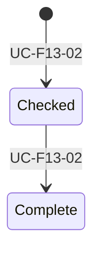

🏠 [Specs](../../../README.md) › 🧩 [Functional capabilities](../../README.md) › 💶 [F13 Payroll (plugin)](../README.md) ›
🗃️ [Data](README.md) › 🗃️ E-F13-02 Employee pay profile

# 🗃️ E-F13-02 Employee pay profile

**Status:** ✅ specified

## Purpose

An employee's pay elements.

## Fields

| Name | Type | Required | Validation | Default | Example | Personal data | Custom fields |
|---|---|---|---|---|---|---|---|
| employee, classification, base | records | yes | BR-F13-04 | - | S. B., cadre 2.1, 3 400 | yes | no |
| benefits | list | no | BR-F13-14 | - | car | yes | no |

## Relations

As its use cases.

## Lifecycle

## Indexes and search

By number, date, partner.

## Retention

Kept for the period of its kind of record in the country pack (D293), or else its kind's default in the
[retention schedule](../../../05-non-functional/data-retention.md).

## Audit

Every change.

## Import and export

CSV, FEC where relevant.

## Used by

- [UC-F13-02](../use-cases/01-set-up/uc-f13-02-set-up-employees-pay.md)
- [UC-F13-17](../use-cases/04-events/uc-f13-17-handle-benefits.md)
- [UC-F13-21 Enrol employees in health and provident schemes](../use-cases/07-schemes-and-special-contracts/uc-f13-21-enrol-employees-in-health-and-provident-schemes.md)
- [UC-F13-22 Pay an apprentice or an intern](../use-cases/07-schemes-and-special-contracts/uc-f13-22-pay-an-apprentice-or-an-intern.md)

## Open questions

None.

---

⬅️ [E-F13-01 Payroll establishment](e-f13-01-payroll-establishment.md) · ⬆️ [Up](README.md) ·
➡️ [E-F13-03 Pay input](e-f13-03-pay-input.md)
