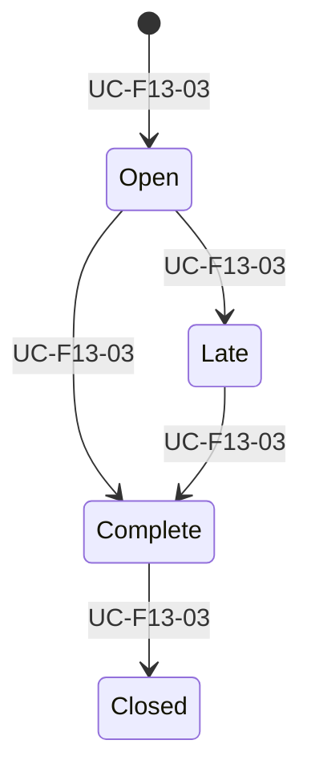

🏠 [Specs](../../../README.md) › 🧩 [Functional capabilities](../../README.md) › 💶 [F13 Payroll (plugin)](../README.md) ›
🗃️ [Data](README.md) › 🗃️ E-F13-03 Pay input

# 🗃️ E-F13-03 Pay input

**Status:** ✅ specified

## Purpose

A time, leave or expense input.

## Fields

| Name | Type | Required | Validation | Default | Example | Personal data | Custom fields |
|---|---|---|---|---|---|---|---|
| employee, period, kind, quantity | records | yes | BR-F13-03 | - | S. B., Nov, overtime, 6 h | yes | no |

## Relations

As its use cases.

## Lifecycle

## Indexes and search

By number, date, partner.

## Retention

Kept for the period of its kind of record in the country pack (D293), or else its kind's default in the
[retention schedule](../../../05-non-functional/data-retention.md).

## Audit

Every change.

## Import and export

CSV, FEC where relevant.

## Used by

- [UC-F13-03](../use-cases/02-monthly-pay-run/uc-f13-03-collect-pay-inputs-from-f9.md)
- [UC-F13-14](../use-cases/04-events/uc-f13-14-handle-sick-leave-and-daily-allowances.md)
- [UC-F13-31 Apply the home-help agreement](../use-cases/09-collective-agreements-by-family/uc-f13-31-apply-the-home-help-agreement.md)
- [UC-F13-33 Apply the construction agreements](../use-cases/09-collective-agreements-by-family/uc-f13-33-apply-the-construction-agreements.md)

## Open questions

None.

---

⬅️ [E-F13-02 Employee pay profile](e-f13-02-employee-pay-profile.md) · ⬆️ [Up](README.md) ·
➡️ [E-F13-04 Payslip line](e-f13-04-payslip-line.md)
