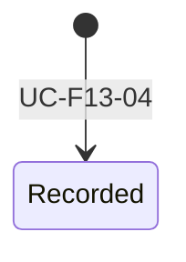

🏠 [Specs](../../../README.md) › 🧩 [Functional capabilities](../../README.md) › 💶 [F13 Payroll (plugin)](../README.md) ›
🗃️ [Data](README.md) › 🗃️ E-F13-04 Payslip line

# 🗃️ E-F13-04 Payslip line

**Status:** ✅ specified

## Purpose

A computed line.

## Fields

| Name | Type | Required | Validation | Default | Example | Personal data | Custom fields |
|---|---|---|---|---|---|---|---|
| payslip, item, base, rate, amount | records | yes | BR-F13-02 | - | old-age, 3 400, 6.9 %, 234.60 | yes | no |

## Relations

As its use cases.

## Lifecycle

## Indexes and search

By number, date, partner.

## Retention

Payslips and pay records: [CR-FR-182 The payslip](../../../10-country-packs/france/payroll/cr-fr-182-payslip.md);
[CR-FR-047 HR records retention](../../../10-country-packs/france/labour/cr-fr-047-hr-records-retention.md).

## Audit

Every change.

## Import and export

CSV, FEC where relevant.

## Used by

- [UC-F13-04](../use-cases/02-monthly-pay-run/uc-f13-04-compute-gross-to-net.md)
- [UC-F13-05](../use-cases/02-monthly-pay-run/uc-f13-05-apply-collective-agreement-rules.md)
- [UC-F13-16](../use-cases/04-events/uc-f13-16-simulate-pay-and-costs.md)
- [UC-F13-29 Value paid-leave pay](../use-cases/08-deductions-savings-and-leave-pay/uc-f13-29-value-paid-leave-pay.md)
- [UC-F13-30 Apply the hotels-and-restaurants agreement](../use-cases/09-collective-agreements-by-family/uc-f13-30-apply-the-hotels-and-restaurants-agreement.md)
- [UC-F13-32 Apply the Syntec agreement](../use-cases/09-collective-agreements-by-family/uc-f13-32-apply-the-syntec-agreement.md)

## Open questions

None.

---

⬅️ [E-F13-03 Pay input](e-f13-03-pay-input.md) · ⬆️ [Up](README.md) ·
➡️ [E-F13-05 Withholding rate](e-f13-05-withholding-rate.md)
