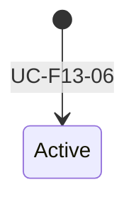

🏠 [Specs](../../../README.md) › 🧩 [Functional capabilities](../../README.md) › 💶 [F13 Payroll (plugin)](../README.md) ›
🗃️ [Data](README.md) › 🗃️ E-F13-05 Withholding rate

# 🗃️ E-F13-05 Withholding rate

**Status:** ✅ specified

## Purpose

An employee's tax rate.

## Fields

| Name | Type | Required | Validation | Default | Example | Personal data | Custom fields |
|---|---|---|---|---|---|---|---|
| employee, rate, received | records | yes | BR-F13-06 | - | S. B., 7.4 %, 3 Nov | yes | no |

## Relations

As its use cases.

## Lifecycle

## Indexes and search

By number, date, partner.

## Retention

Kept for the period of its kind of record in the country pack (D293), or else its kind's default in the
[retention schedule](../../../05-non-functional/data-retention.md).

## Audit

Every change.

## Import and export

CSV, FEC where relevant.

## Used by

- [UC-F13-06](../use-cases/02-monthly-pay-run/uc-f13-06-apply-withholding-tax.md)

## Open questions

None.

---

⬅️ [E-F13-04 Payslip line](e-f13-04-payslip-line.md) · ⬆️ [Up](README.md) · ➡️ [E-F13-06 Pay run](e-f13-06-pay-run.md)
