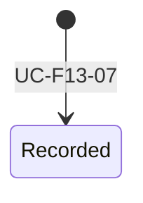

🏠 [Specs](../../../README.md) › 🧩 [Functional capabilities](../../README.md) › 💶 [F13 Payroll (plugin)](../README.md) ›
🗃️ [Data](README.md) › 🗃️ E-F13-06 Pay run

# 🗃️ E-F13-06 Pay run

**Status:** ✅ specified

## Purpose

A period's pay run.

## Fields

| Name | Type | Required | Validation | Default | Example | Personal data | Custom fields |
|---|---|---|---|---|---|---|---|
| period, establishment | records | yes | - | - | Nov 2026, Lyon | no | no |
| anomalies, state | list, state | yes | BR-F13-07, BR-F13-10 | draft | paid | no | no |

## Relations

As its use cases.

## Lifecycle

## Indexes and search

By number, date, partner.

## Retention

Payslips and pay records: [CR-FR-182 The payslip](../../../10-country-packs/france/payroll/cr-fr-182-payslip.md);
[CR-FR-047 HR records retention](../../../10-country-packs/france/labour/cr-fr-047-hr-records-retention.md).

## Audit

Every change.

## Import and export

CSV, FEC where relevant.

## Used by

- [UC-F13-07](../use-cases/02-monthly-pay-run/uc-f13-07-check-and-approve-the-pay-run.md)
- [UC-F13-34 Analyse payroll cost by site, project and analytic axis](../use-cases/05-reports-and-rules/uc-f13-34-analyse-payroll-cost-by-site-project-and-analytic-axis.md)

## Open questions

None.

---

⬅️ [E-F13-05 Withholding rate](e-f13-05-withholding-rate.md) · ⬆️ [Up](README.md) ·
➡️ [E-F13-07 Payslip](e-f13-07-payslip.md)
