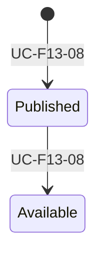

🏠 [Specs](../../../README.md) › 🧩 [Functional capabilities](../../README.md) › 💶 [F13 Payroll (plugin)](../README.md) ›
🗃️ [Data](README.md) › 🗃️ E-F13-07 Payslip

# 🗃️ E-F13-07 Payslip

**Status:** ✅ specified

## Purpose

A clarified payslip.

## Fields

| Name | Type | Required | Validation | Default | Example | Personal data | Custom fields |
|---|---|---|---|---|---|---|---|
| employee, period, net, net social | records | yes | BR-F13-08 | - | S. B., Nov, 2 618.36, 2 701.20 | yes | no |
| delivery | digital, paper | yes | - | digital | digital | no | no |

## Relations

As its use cases.

## Lifecycle

## Indexes and search

By number, date, partner.

## Retention

Payslips and pay records: [CR-FR-182 The payslip](../../../10-country-packs/france/payroll/cr-fr-182-payslip.md);
[CR-FR-047 HR records retention](../../../10-country-packs/france/labour/cr-fr-047-hr-records-retention.md).

## Audit

Every change.

## Import and export

CSV, FEC where relevant.

## Used by

- [UC-F13-08](../use-cases/02-monthly-pay-run/uc-f13-08-issue-clarified-payslips-digitally.md)
- [UC-F13-20](../use-cases/06-assistant/uc-f13-20-ask-the-assistant-about-pay.md)

## Open questions

None.

---

⬅️ [E-F13-06 Pay run](e-f13-06-pay-run.md) · ⬆️ [Up](README.md) · ➡️ [E-F13-08 Pay transfer](e-f13-08-pay-transfer.md)
