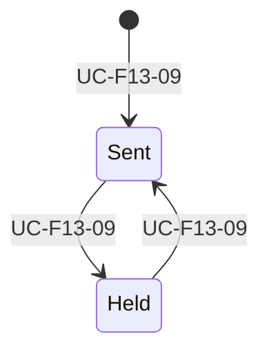

🏠 [Specs](../../../README.md) › 🧩 [Functional capabilities](../../README.md) › 💶 [F13 Payroll (plugin)](../README.md) ›
🗃️ [Data](README.md) › 🗃️ E-F13-08 Pay transfer

# 🗃️ E-F13-08 Pay transfer

**Status:** ✅ specified

## Purpose

A SEPA transfer of net pay.

## Fields

| Name | Type | Required | Validation | Default | Example | Personal data | Custom fields |
|---|---|---|---|---|---|---|---|
| run, employee, amount | records | yes | - | - | Nov, S. B., 2 618.36 | yes | no |

## Relations

As its use cases.

## Lifecycle

## Indexes and search

By number, date, partner.

## Retention

As an accounting record:
[CR-FR-002 Accounting records kept 10 years](../../../10-country-packs/france/accounting/cr-fr-002-accounting-records-kept-ten-years.md).

## Audit

Every change.

## Import and export

CSV, FEC where relevant.

## Used by

- [UC-F13-09](../use-cases/03-declarations-and-payments/uc-f13-09-pay-employees-by-sepa-transfer.md)
- [UC-F13-26 Apply a wage garnishment](../use-cases/08-deductions-savings-and-leave-pay/uc-f13-26-apply-a-wage-garnishment.md)
- [UC-F13-27 Grant a pay advance](../use-cases/08-deductions-savings-and-leave-pay/uc-f13-27-grant-a-pay-advance.md)

## Open questions

None.

---

⬅️ [E-F13-07 Payslip](e-f13-07-payslip.md) · ⬆️ [Up](README.md) ·
➡️ [E-F13-09 Social declaration](e-f13-09-social-declaration.md)
