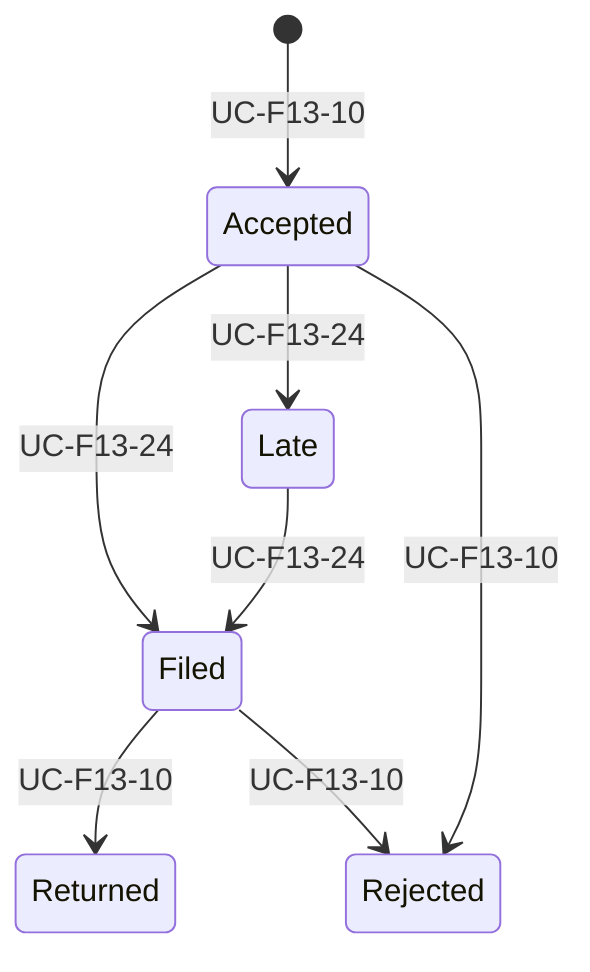

🏠 [Specs](../../../README.md) › 🧩 [Functional capabilities](../../README.md) › 💶 [F13 Payroll (plugin)](../README.md) ›
🗃️ [Data](README.md) › 🗃️ E-F13-09 Social declaration

# 🗃️ E-F13-09 Social declaration

**Status:** ✅ specified

## Purpose

A monthly or event declaration.

## Fields

| Name | Type | Required | Validation | Default | Example | Personal data | Custom fields |
|---|---|---|---|---|---|---|---|
| period, kind, due | records | yes | BR-F13-09 | - | Nov, monthly, 15 Dec | no | no |
| state, returns | state, list | yes | - | draft | accepted | no | no |

## Relations

As its use cases.

## Lifecycle

## Indexes and search

By number, date, partner.

## Retention

Kept for the period of its kind of record in the country pack (D293), or else its kind's default in the
[retention schedule](../../../05-non-functional/data-retention.md).

## Audit

Every change.

## Import and export

CSV, FEC where relevant.

## Used by

- [UC-F13-10](../use-cases/03-declarations-and-payments/uc-f13-10-file-the-monthly-social-declaration-and-handle-returns.md)
- [UC-F13-24 Pay intermittent performers](../use-cases/07-schemes-and-special-contracts/uc-f13-24-pay-intermittent-performers.md)

## Open questions

None.

---

⬅️ [E-F13-08 Pay transfer](e-f13-08-pay-transfer.md) · ⬆️ [Up](README.md) ·
➡️ [E-F13-10 Correction](e-f13-10-correction.md)
