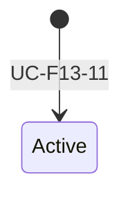

🏠 [Specs](../../../README.md) › 🧩 [Functional capabilities](../../README.md) › 💶 [F13 Payroll (plugin)](../README.md) ›
🗃️ [Data](README.md) › 🗃️ E-F13-10 Correction

# 🗃️ E-F13-10 Correction

**Status:** ✅ specified

## Purpose

A correction of a past period.

## Fields

| Name | Type | Required | Validation | Default | Example | Personal data | Custom fields |
|---|---|---|---|---|---|---|---|
| employee, period, item, difference | records | yes | BR-F13-02 | - | S. B., Mar, bonus, +120 | yes | no |

## Relations

As its use cases.

## Lifecycle

## Indexes and search

By number, date, partner.

## Retention

Kept for the period of its kind of record in the country pack (D293), or else its kind's default in the
[retention schedule](../../../05-non-functional/data-retention.md).

## Audit

Every change.

## Import and export

CSV, FEC where relevant.

## Used by

- [UC-F13-11](../use-cases/03-declarations-and-payments/uc-f13-11-correct-a-past-month.md)

## Open questions

None.

---

⬅️ [E-F13-09 Social declaration](e-f13-09-social-declaration.md) · ⬆️ [Up](README.md) ·
➡️ [E-F13-11 Contribution payment](e-f13-11-contribution-payment.md)
