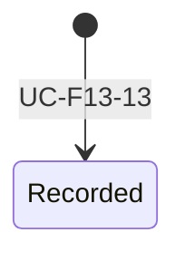

🏠 [Specs](../../../README.md) › 🧩 [Functional capabilities](../../README.md) › 💶 [F13 Payroll (plugin)](../README.md) ›
🗃️ [Data](README.md) › 🗃️ E-F13-12 Payroll entry

# 🗃️ E-F13-12 Payroll entry

**Status:** ✅ specified

## Purpose

An accounting entry of payroll.

## Fields

| Name | Type | Required | Validation | Default | Example | Personal data | Custom fields |
|---|---|---|---|---|---|---|---|
| run, account, amount | records | yes | - | - | Nov, 641, 182 000 | no | no |

## Relations

As its use cases.

## Lifecycle

## Indexes and search

By number, date, partner.

## Retention

As an accounting record:
[CR-FR-002 Accounting records kept 10 years](../../../10-country-packs/france/accounting/cr-fr-002-accounting-records-kept-ten-years.md).

## Audit

Every change.

## Import and export

CSV, FEC where relevant.

## Used by

- [UC-F13-13](../use-cases/03-declarations-and-payments/uc-f13-13-post-payroll-entries-to-accounting.md)
- [UC-F13-28 Compute profit-sharing and employee savings](../use-cases/08-deductions-savings-and-leave-pay/uc-f13-28-compute-profit-sharing-and-employee-savings.md)

## Open questions

None.

---

⬅️ [E-F13-11 Contribution payment](e-f13-11-contribution-payment.md) · ⬆️ [Up](README.md) ·
➡️ [E-F13-13 Sick leave](e-f13-13-sick-leave.md)
