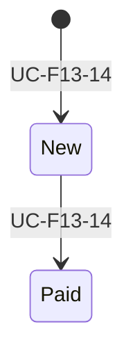

🏠 [Specs](../../../README.md) › 🧩 [Functional capabilities](../../README.md) › 💶 [F13 Payroll (plugin)](../README.md) ›
🗃️ [Data](README.md) › 🗃️ E-F13-13 Sick leave

# 🗃️ E-F13-13 Sick leave

**Status:** ✅ specified

## Purpose

An absence with allowances.

## Fields

| Name | Type | Required | Validation | Default | Example | Personal data | Custom fields |
|---|---|---|---|---|---|---|---|
| employee, from, to | records | yes | - | - | S. B., 3 Nov, 7 Nov | yes | no |
| allowances, top-up | amounts | no | - | - | 210, 140 | no | no |

## Relations

As its use cases.

## Lifecycle

## Indexes and search

By number, date, partner.

## Retention

Kept for the period of its kind of record in the country pack (D293), or else its kind's default in the
[retention schedule](../../../05-non-functional/data-retention.md).

## Audit

Every change.

## Import and export

CSV, FEC where relevant.

## Used by

- [UC-F13-14](../use-cases/04-events/uc-f13-14-handle-sick-leave-and-daily-allowances.md)

## Open questions

None.

---

⬅️ [E-F13-12 Payroll entry](e-f13-12-payroll-entry.md) · ⬆️ [Up](README.md) ·
➡️ [E-F13-14 End-of-contract file](e-f13-14-end-of-contract-file.md)
