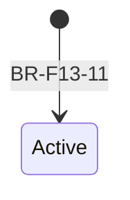

🏠 [Specs](../../../README.md) › 🧩 [Functional capabilities](../../README.md) › 💶 [F13 Payroll (plugin)](../README.md) ›
🗃️ [Data](README.md) › 🗃️ E-F13-14 End-of-contract file

# 🗃️ E-F13-14 End-of-contract file

**Status:** ✅ specified

## Purpose

Final pay and documents.

## Fields

| Name | Type | Required | Validation | Default | Example | Personal data | Custom fields |
|---|---|---|---|---|---|---|---|
| employee, last day | records | yes | BR-F13-11 | - | P. G., 30 Nov | yes | no |
| documents | list | yes | - | - | certificate, unemployment, receipt | no | no |

## Relations

As its use cases.

## Lifecycle

## Indexes and search

By number, date, partner.

## Retention

Kept for the period of its kind of record in the country pack (D293), or else its kind's default in the
[retention schedule](../../../05-non-functional/data-retention.md).

## Audit

Every change.

## Import and export

CSV, FEC where relevant.

## Used by

- [UC-F13-15](../use-cases/04-events/uc-f13-15-end-a-contract.md)

## Open questions

None.

---

⬅️ [E-F13-13 Sick leave](e-f13-13-sick-leave.md) · ⬆️ [Up](README.md) ·
➡️ [E-F13-15 Yearly payroll report](e-f13-15-yearly-payroll-report.md)
