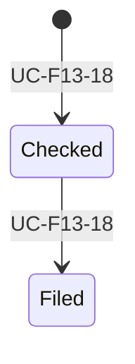

🏠 [Specs](../../../README.md) › 🧩 [Functional capabilities](../../README.md) › 💶 [F13 Payroll (plugin)](../README.md) ›
🗃️ [Data](README.md) › 🗃️ E-F13-15 Yearly payroll report

# 🗃️ E-F13-15 Yearly payroll report

**Status:** ✅ specified

## Purpose

A yearly payroll report.

## Fields

| Name | Type | Required | Validation | Default | Example | Personal data | Custom fields |
|---|---|---|---|---|---|---|---|
| year, kind | records | yes | - | - | 2026, equal-pay index | no | no |

## Relations

As its use cases.

## Lifecycle

## Indexes and search

By number, date, partner.

## Retention

Kept for the period of its kind of record in the country pack (D293), or else its kind's default in the
[retention schedule](../../../05-non-functional/data-retention.md).

## Audit

Every change.

## Import and export

CSV, FEC where relevant.

## Used by

- [UC-F13-18](../use-cases/05-reports-and-rules/uc-f13-18-report-yearly.md)

## Open questions

None.

---

⬅️ [E-F13-14 End-of-contract file](e-f13-14-end-of-contract-file.md) · ⬆️ [Up](README.md) ·
➡️ [E-F13-16 Rate set](e-f13-16-rate-set.md)
