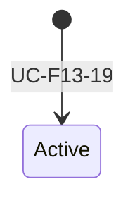

🏠 [Specs](../../../README.md) › 🧩 [Functional capabilities](../../README.md) › 💶 [F13 Payroll (plugin)](../README.md) ›
🗃️ [Data](README.md) › 🗃️ E-F13-16 Rate set

# 🗃️ E-F13-16 Rate set

**Status:** ✅ specified

## Purpose

Rates and ceilings for a period.

## Fields

| Name | Type | Required | Validation | Default | Example | Personal data | Custom fields |
|---|---|---|---|---|---|---|---|
| country pack, from | records | yes | BR-F13-01 | - | France, 2027-01-01 | no | no |

## Relations

As its use cases.

## Lifecycle

## Indexes and search

By number, date, partner.

## Retention

Kept for the period of its kind of record in the country pack (D293), or else its kind's default in the
[retention schedule](../../../05-non-functional/data-retention.md).

## Audit

Every change.

## Import and export

CSV, FEC where relevant.

## Used by

- [UC-F13-19](../use-cases/05-reports-and-rules/uc-f13-19-update-rates-and-rules-from-the-country-pack.md)

## Open questions

None.

---

⬅️ [E-F13-15 Yearly payroll report](e-f13-15-yearly-payroll-report.md) · ⬆️ [Up](README.md) ·
➡️ [E-F13-17 Scheme membership](e-f13-17-scheme-membership.md)
