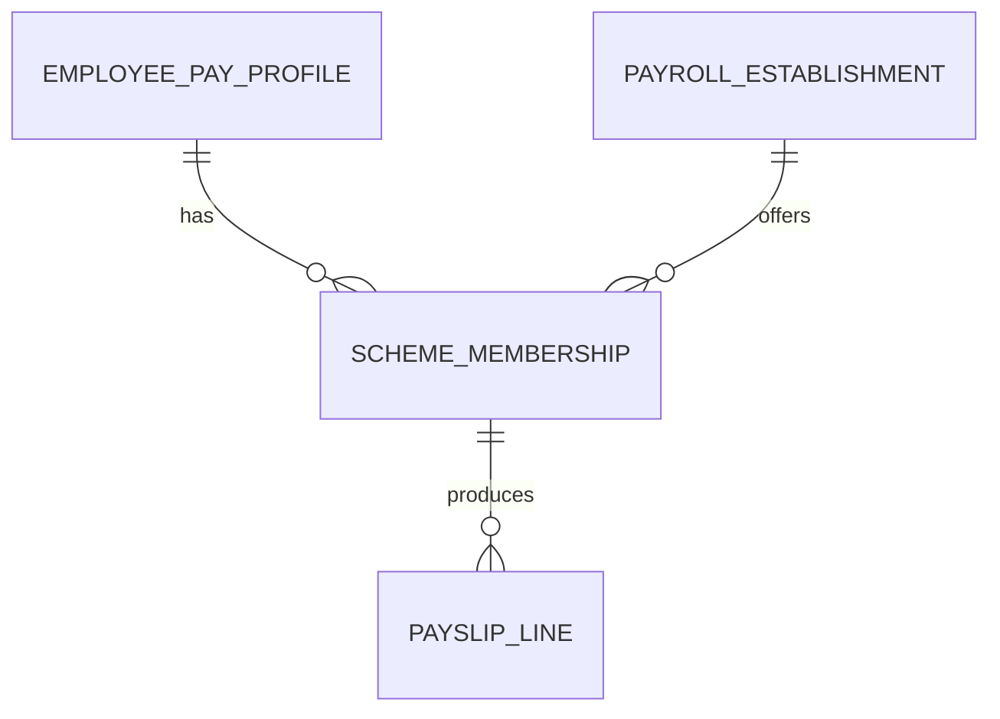
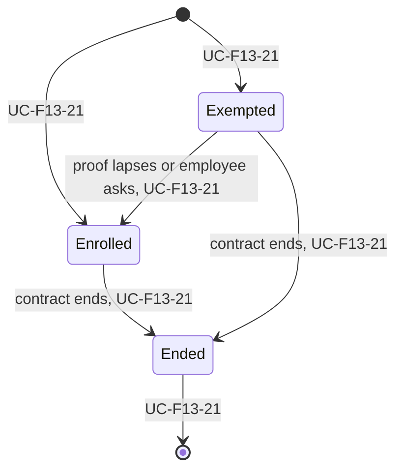

🏠 [Specs](../../../README.md) › 🧩 [Functional capabilities](../../README.md) › 💶 [F13 Payroll (plugin)](../README.md) ›
🗃️ [Data](README.md) › 🗃️ E-F13-17 Scheme membership

# 🗃️ E-F13-17 Scheme membership

**Status:** 🔄 waiting for the owner

## Purpose

An employee's membership of a health or provident scheme, or the exemption from it, with its proof and dates.

## Fields

| Name | Type | Required | Validation | Default | Example | Personal data | Custom fields |
|---|---|---|---|---|---|---|---|
| employee | link | yes | an employee with a pay profile | - | Sophie Bernard | yes | no |
| scheme | link | yes | a scheme of the establishment | - | Health scheme, insurer Mutuelle A | no | no |
| kind | choice | yes | health, provident | - | health | no | no |
| status | choice | yes | enrolled, exempted, ended | enrolled | exempted | no | no |
| exemption reason | choice | if exempted | the country pack's list | - | covered by a spouse's scheme | yes | no |
| proof | file | if exempted | PDF or image, 10 MB at most (Proposed) | - | attestation.pdf | yes | no |
| from, to | dates | from yes | to after from | contract start | 2026-03-01 | no | no |
| employee share, employer share | amounts | yes | sum is the scheme's price | from the scheme | 24.00, 36.00 EUR | no | no |

## Relations

## Lifecycle

## Indexes and search

By employee, scheme, status; unique on employee, scheme and start date; filter "exemption proof lapsing".

## Retention

As payroll records: CR-FR-047 HR records retention; the proof is kept as long as the exemption plus the same period.

## Audit

Every creation and change, with who, when, the old and the new value.

## Import and export

CSV export of memberships per insurer; import of an insurer's member list (CSV).

## Used by

- [UC-F13-21 Enrol employees in health and provident schemes](../use-cases/07-schemes-and-special-contracts/uc-f13-21-enrol-employees-in-health-and-provident-schemes.md)

## Open questions

None.

---

⬅️ [E-F13-16 Rate set](e-f13-16-rate-set.md) · ⬆️ [Up](README.md) ·
➡️ [E-F13-18 Special pay regime](e-f13-18-special-pay-regime.md)
