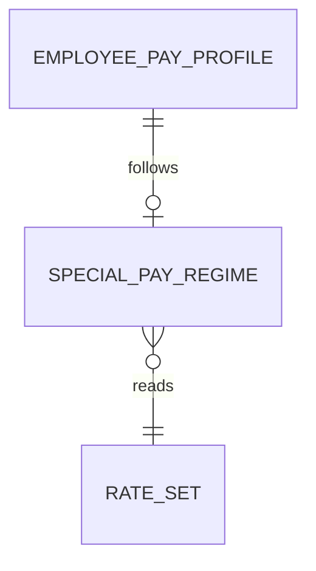
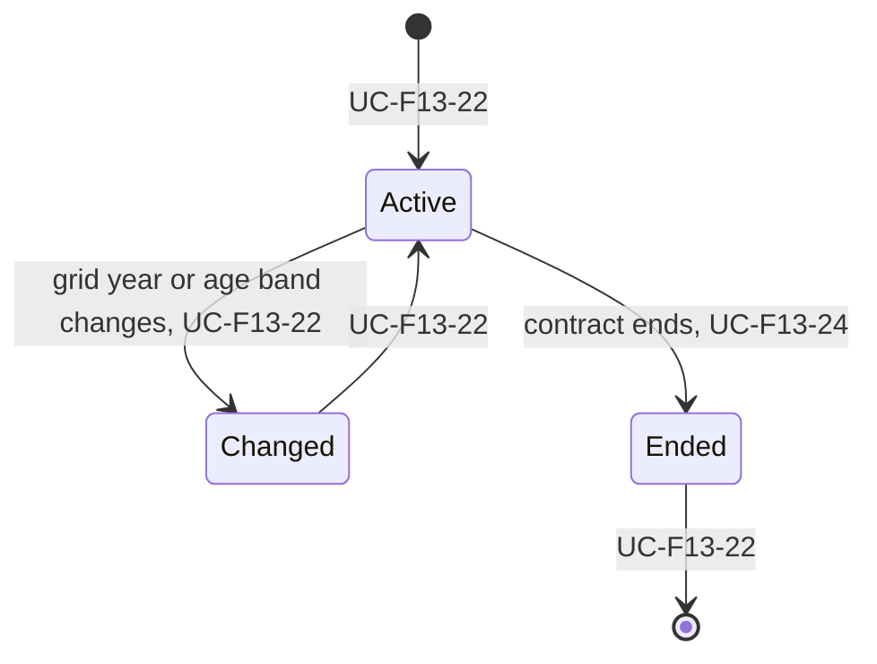

🏠 [Specs](../../../README.md) › 🧩 [Functional capabilities](../../README.md) › 💶 [F13 Payroll (plugin)](../README.md) ›
🗃️ [Data](README.md) › 🗃️ E-F13-18 Special pay regime

# 🗃️ E-F13-18 Special pay regime

**Status:** ✅ specified

## Purpose

The pay regime of an employee whose contract follows its own rules: apprentice, intern, company officer, intermittent
performer or farm worker under the MSA.

## Fields

| Name | Type | Required | Validation | Default | Example | Personal data | Custom fields |
|---|---|---|---|---|---|---|---|
| employee | link | yes | an employee with a pay profile | - | Lucas Martin | yes | no |
| regime | choice | yes | apprentice, intern, officer, performer, farm worker | - | apprentice | no | no |
| grid position | text | for apprentices | age band and contract year | - | 18 to 20, year 2 | no | no |
| collector | choice | yes | from the regime | from the regime | MSA | no | no |
| training body | text | for apprentices and interns | name and SIRET | - | CFA du Bâtiment | no | no |
| from, to | dates | yes | inside the contract | contract dates | 2026-09-01 to 2028-08-31 | no | no |

## Relations

## Lifecycle

## Indexes and search

By regime and employee; filter by collector.

## Retention

As the pay profile: CR-FR-047 HR records retention.

## Audit

Every creation and change, with who, when, the old and the new value.

## Import and export

CSV and JSON export through the API (T5); no bulk import.

## Used by

- [UC-F13-22 Pay an apprentice or an intern](../use-cases/07-schemes-and-special-contracts/uc-f13-22-pay-an-apprentice-or-an-intern.md)
- [UC-F13-23 Pay a company officer](../use-cases/07-schemes-and-special-contracts/uc-f13-23-pay-a-company-officer.md)
- [UC-F13-24 Pay intermittent performers](../use-cases/07-schemes-and-special-contracts/uc-f13-24-pay-intermittent-performers.md)
- [UC-F13-25 Pay farm workers under the MSA](../use-cases/07-schemes-and-special-contracts/uc-f13-25-pay-farm-workers-under-the-msa.md)

## Open questions

None.

---

⬅️ [E-F13-17 Scheme membership](e-f13-17-scheme-membership.md) · ⬆️ [Up](README.md) ·
➡️ [E-F13-19 Garnishment](e-f13-19-garnishment.md)
