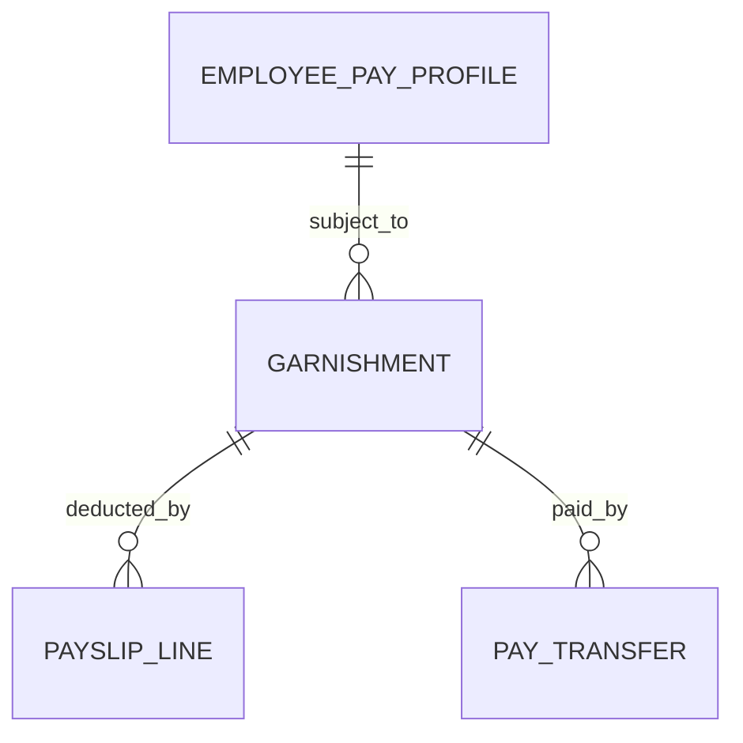
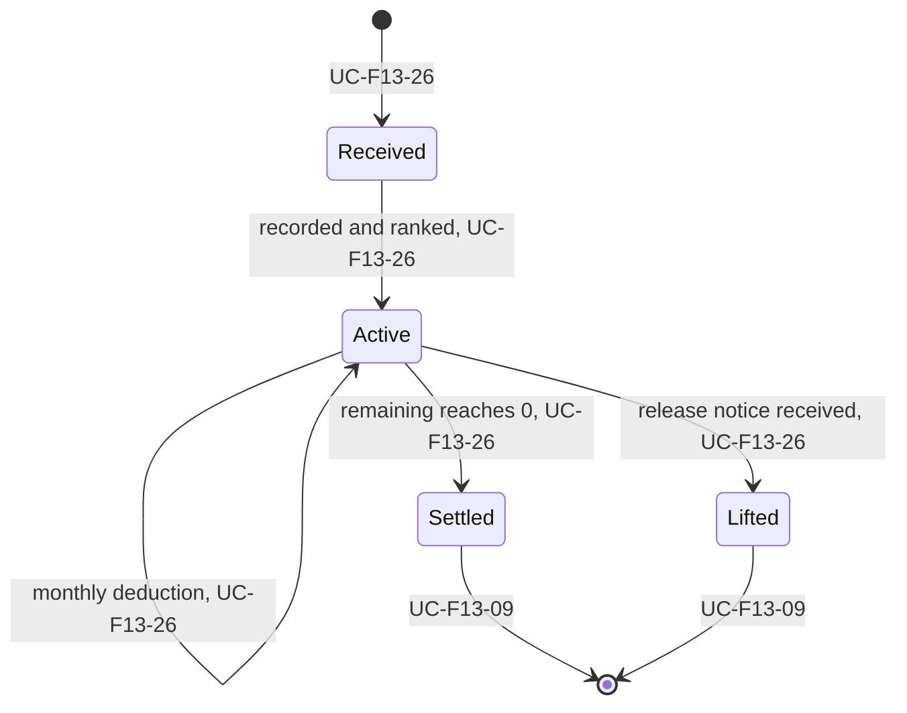

🏠 [Specs](../../../README.md) › 🧩 [Functional capabilities](../../README.md) › 💶 [F13 Payroll (plugin)](../README.md) ›
🗃️ [Data](README.md) › 🗃️ E-F13-19 Garnishment

# 🗃️ E-F13-19 Garnishment

**Status:** ✅ specified

## Purpose

An order to deduct part of an employee's pay for a creditor, a court or the tax office, with its ranking and what
remains due.

## Fields

| Name | Type | Required | Validation | Default | Example | Personal data | Custom fields |
|---|---|---|---|---|---|---|---|
| employee | link | yes | an employee with a pay profile | - | Karim Haddad | yes | no |
| creditor | text | yes | name and IBAN | - | Trésor public | yes | no |
| kind | choice | yes | court order, maintenance order, tax notice | - | tax notice | no | no |
| amount due | amount | yes | above 0 | - | 1 840.00 EUR | yes | no |
| reference, received | text, date | yes | - | - | ATD 2026-118, 2026-03-04 | no | no |
| priority | number | yes | from the kind | from the kind | 2 | no | no |
| remaining | amount | yes | computed | amount due | 1 412.36 EUR | yes | no |

## Relations

## Lifecycle

## Indexes and search

By employee, creditor and reference; filter active orders.

## Retention

As payroll records: CR-FR-047 HR records retention.

## Audit

Every creation and change, with who, when, the old and the new value.

## Import and export

The notice is attached as a file; no bulk import.

## Used by

- [UC-F13-26 Apply a wage garnishment](../use-cases/08-deductions-savings-and-leave-pay/uc-f13-26-apply-a-wage-garnishment.md)
- [UC-F13-09 Pay employees by SEPA transfer](../use-cases/03-declarations-and-payments/uc-f13-09-pay-employees-by-sepa-transfer.md)

## Open questions

None.

---

⬅️ [E-F13-18 Special pay regime](e-f13-18-special-pay-regime.md) · ⬆️ [Up](README.md) ·
➡️ [E-F13-20 Pay advance](e-f13-20-pay-advance.md)
