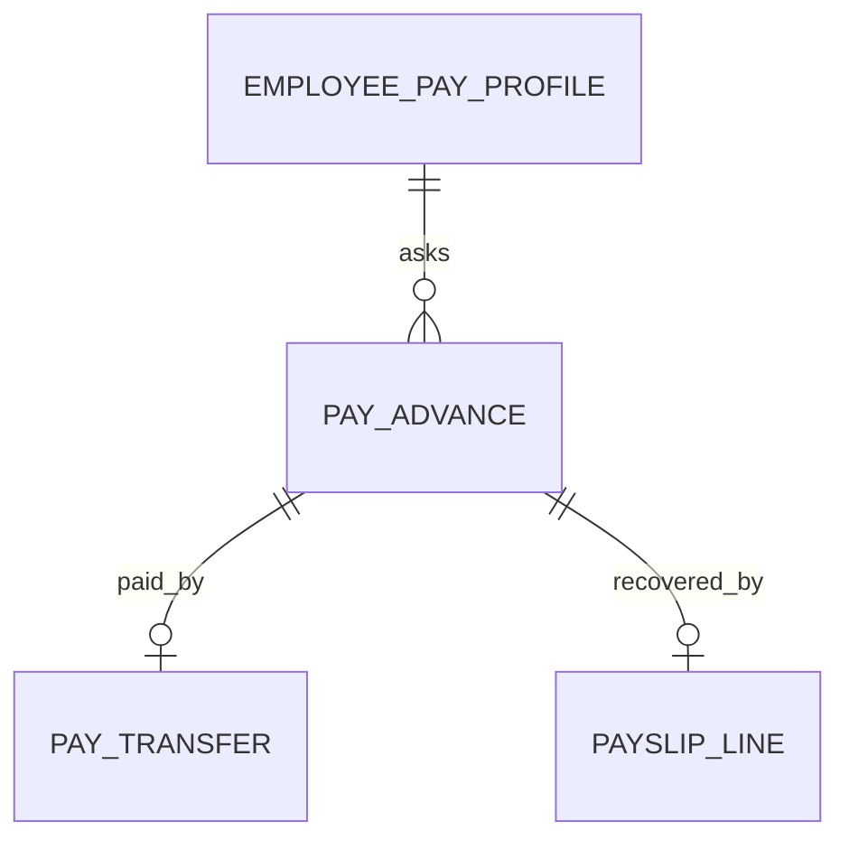
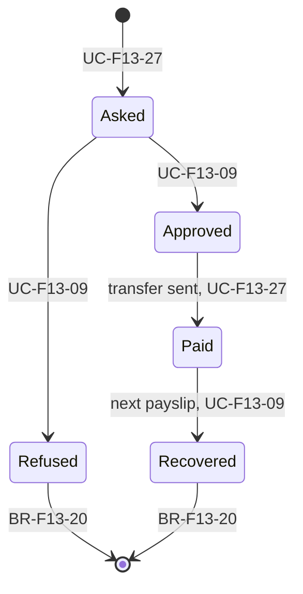

🏠 [Specs](../../../README.md) › 🧩 [Functional capabilities](../../README.md) › 💶 [F13 Payroll (plugin)](../README.md) ›
🗃️ [Data](README.md) › 🗃️ E-F13-20 Pay advance

# 🗃️ E-F13-20 Pay advance

**Status:** ✅ specified

## Purpose

Money paid to an employee before the pay date out of the pay already earned, recovered on the next payslip.

## Fields

| Name | Type | Required | Validation | Default | Example | Personal data | Custom fields |
|---|---|---|---|---|---|---|---|
| employee | link | yes | an employee with a pay profile | - | Sophie Bernard | yes | no |
| amount | amount | yes | at most the net earned so far (BR-F13-20) | - | 300.00 EUR | yes | no |
| asked, paid | dates | yes | paid after approved | - | 2026-03-15, 2026-03-16 | no | no |
| status | choice | yes | asked, approved, refused, paid, recovered | asked | recovered | no | no |
| recovered on | link | when recovered | a payslip | - | payslip March 2026 | no | no |

## Relations

## Lifecycle

## Indexes and search

By employee, status and month.

## Retention

As payroll records: CR-FR-047 HR records retention.

## Audit

Every creation and change, with who, when, the old and the new value.

## Import and export

CSV and JSON export through the API (T5); no bulk import.

## Used by

- [UC-F13-27 Grant a pay advance](../use-cases/08-deductions-savings-and-leave-pay/uc-f13-27-grant-a-pay-advance.md)
- [UC-F13-09 Pay employees by SEPA transfer](../use-cases/03-declarations-and-payments/uc-f13-09-pay-employees-by-sepa-transfer.md)

## Open questions

None.

---

⬅️ [E-F13-19 Garnishment](e-f13-19-garnishment.md) · ⬆️ [Up](README.md) ·
➡️ [E-F13-21 Profit-sharing year](e-f13-21-profit-sharing-year.md)
